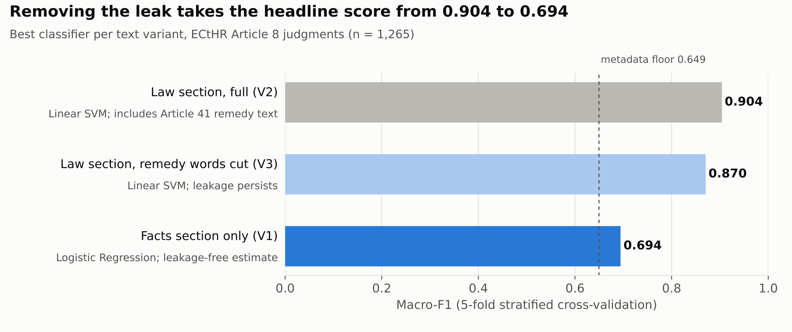
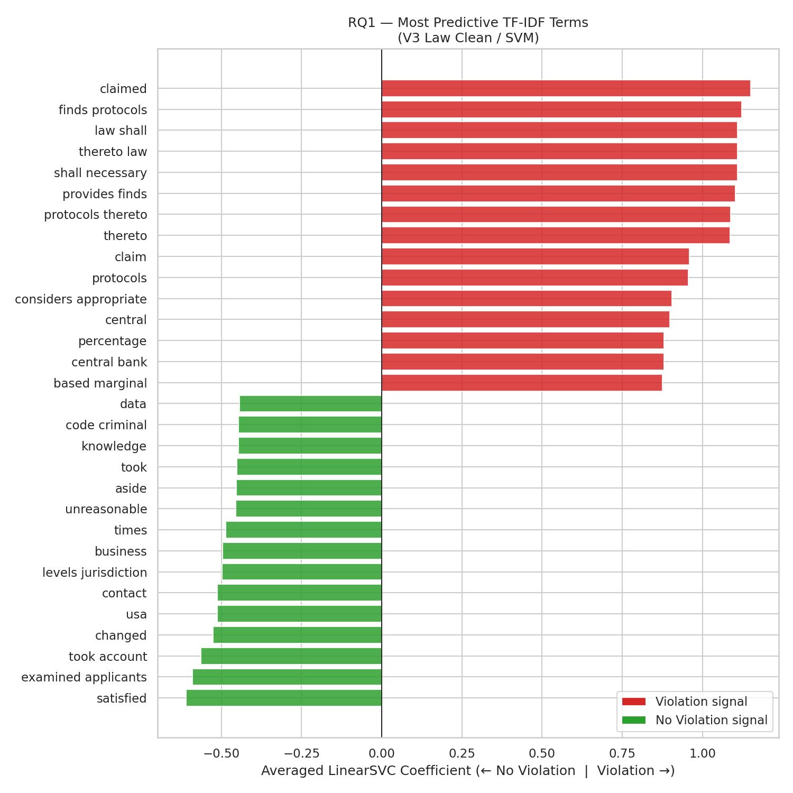
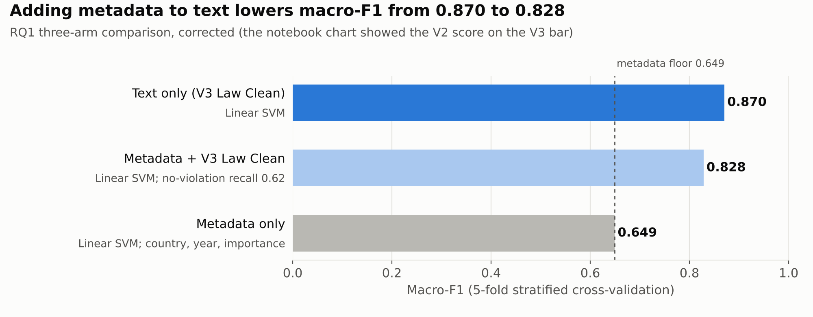

# Evaluating the model
{: .no_toc }

The best model scored a macro-F1 of 0.904. The project's most useful result was showing why that number couldn't be taken at face value, and what the honest number is.
{: .fs-5 .fw-300 }

  
On this page

  {: .text-delta }
- TOC
{:toc}

---

## The short version

| | |
|:--|:--|
| **The default reading** | A 0.904 macro-F1 on ECtHR judgments is a strong result: outcomes look highly predictable from text |
| **What we found instead** | The score was partly **data leakage**. The Law section contains Article 41 "just satisfaction" text, which only appears when a violation is found |
| **The honest estimate** | **0.694**, from the Facts section, which contains no remedy language |
| **Other problems the checks exposed** | A **country bias** that hurts minority-class recall, and a model that **doesn't transfer** across regions |
| **What it means** | A high score isn't the same as a model that has learned the law. What can be built isn't always what should be built |

## 1. Data leakage: finding where the score came from

**Check.** We ran the same models on three versions of the text, turning the leakage question into a controlled experiment: the full Law section (V2), the Law section with remedy vocabulary removed (V3), and the Facts section only (V1).

**What it showed.**
- Cutting remedy words only took the score from 0.904 to 0.870. The model found **secondary leakage terms** such as *claimed*, *finds protocols*, *thereto law* and *central bank*, which still sit in the remedy paragraphs.
- **Leakage is structural, not lexical.** A stop-word list can't remove it. The fix is to cut whole just-satisfaction paragraphs before building features.
- The Facts section (0.694) is the honest figure. It sits just below Chalkidis et al.'s (2019) bag-of-words SVM benchmark of 0.718.

**How it was spotted.** By reading the model's top-weighted features rather than trusting the score. Remedy and damages terms dominated the violation side.

## 2. Bias: what the model leans on

**Country, not law.** The metadata-only model (respondent state, year, importance) reached 0.649, well above chance, mostly because Russia accounts for 27% of the modelling set and loses about 94% of its cases.

**Adding metadata made the text model worse.** Combined with the cleaned Law text, the score dropped from 0.870 to 0.828. The country prior overrode the text signal: no-violation recall fell from 0.74 to 0.62 while violation recall rose to 0.97.

**Regional transfer fails in one direction.** A model trained on Eastern cases and tested on Western ones (zero country overlap) reached 0.774, against 0.855 the other way. It misclassified 32% of genuine Western no-violation cases as violations: it had learned to expect state fault.

{: .note }
Why macro-F1 and not accuracy: 78% of cases are violations, so a model that always predicts "violation" scores about 78% accuracy. Macro-F1 averages the two classes, so failing on the minority class shows up in the score.

## 3. Error analysis: reading the mistakes

Scores say *how often* a model is wrong. The team also looked at *which* cases it got wrong and why.

**Per-class recall.** The Facts-section SVM finds only **35%** of no-violation cases; it labels the other 65% as violations. Every text variant shows the same asymmetry: the model is much better at recognising a state losing than a state winning.

**Misclassified cases, East → West.** The Eastern-trained model produced 46 false positives and 17 false negatives on the Western test set. A sample of 15 of each was reviewed with an LLM (Gemini 2.5 Flash Lite), prompted as an Article 8 analyst and constrained to a fixed JSON schema. The patterns it reported:

| Error type | Cases | Pattern |
|:--|--:|:--|
| False positive (predicted violation, actually none) | 46 | Surveillance and data-collection cases (*Breyer*, *Uzun*) where the Court balanced the interference against security aims and found it justified. Procedural vocabulary (exhaustion of remedies, admissibility) read as a sign of state fault |
| False negative (missed a real violation) | 17 | Family-life cases (deportation, adoption, child welfare) where the violation is found through a detailed proportionality test, not an explicit description of state overreach |

{: .caution }
The LLM review is treated as a set of **hypotheses, not findings**. A language model can project legal reasoning onto what are really statistical errors or vocabulary gaps. The patterns above are consistent with the regional feature weights and with the RQ4 semantic-drift analysis, which is why they are reported, but they have not been verified case by case.

**Close reading of landmark cases.** Some errors can't be fixed by more of the same features:
- *Schalk and Kopf v. Austria* (2010) uses the same vocabulary as violation judgments (family life, private life, margin of appreciation) and finds **no violation**.
- *Breyer v. Germany* (2020) finds no violation after a detailed proportionality review. A bag-of-words model sees the safeguard vocabulary, not whether the safeguards were **sufficient**.

This is the **no-violation paradox**: restraint and protection use the same words, and the outcome depends on how they are arranged.

## 4. Evaluation practices used

- [x] Chose **macro-F1** because of the 78/22 class imbalance
- [x] Built **controlled variants** (V1 / V2 / V3) to isolate the leakage
- [x] **Inspected feature weights** instead of trusting the score
- [x] Tested **out-of-distribution transfer** with zero country overlap between train and test, plus a held-out boundary state (Turkey)
- [x] Reported **per-class recall** and confusion matrices, not only the average
- [x] **Reviewed misclassified cases** and close-read landmark judgments
- [x] Labelled the LLM-assisted analysis as **unverified**
- [x] Used **interpretable linear models** so every result could be explained

## 5. If this were a product

{: .note }
This section is a reflection written after the coursework. It applies the evaluation results to the question a product team would ask: should we ship this?

**Who might use an Article 8 outcome predictor, and for what decision?**

| User | Decision it would inform |
|:--|:--|
| Applicants' lawyers and NGOs | Whether a case is worth taking to Strasbourg |
| A court registry | Which applications to prioritise |
| Researchers and policymakers | Where violations are systemic and need structural reform |

**What would go wrong with this model as it stands.**
- **False hope for applicants.** With no-violation recall of 0.35, the Facts-section model tells two in three applicants who will lose that they are likely to win. That misdirects time, money and expectations.
- **Unequal treatment by country.** Any model that uses respondent state would rate cases by where they come from, not by their merits.
- **Silent failure in new settings.** The model's accuracy drops when the docket shifts, as the East → West test showed, and nothing in the output warns the user.
- **No reasons a person can challenge.** Under Article 8 itself, automated decisions that affect people must be foreseeable and open to challenge. A score with no explanation fails that test.

**What would need to be true before shipping.**
1. Remedy paragraphs removed before any feature extraction, and the score re-measured.
2. Separate performance reported for each region and for the minority class, with a minimum bar for each.
3. Respondent state excluded from the inputs.
4. Output shown as a set of reasons and comparable past cases, not a single probability.
5. A human reviewer in every decision that affects an applicant.

**Recommendation.** Don't ship it as an outcome predictor. The strongest use of this work is as a **research and monitoring tool**: the topic map and regional drift analysis show where Article 8 case law is settled, contested or systemic, which is useful to researchers and to those supervising how judgments are carried out.
