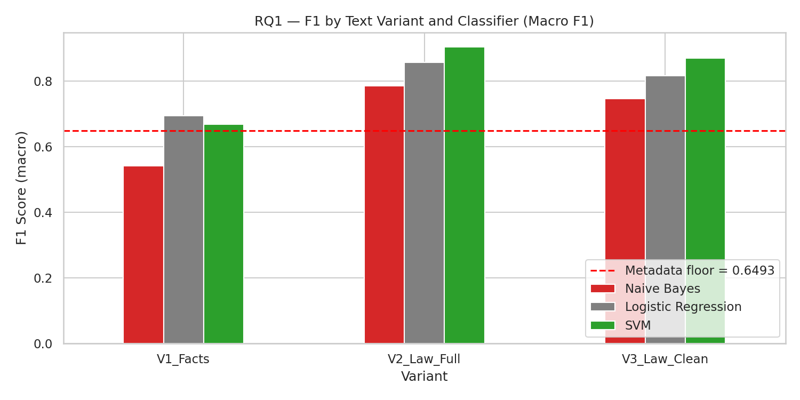
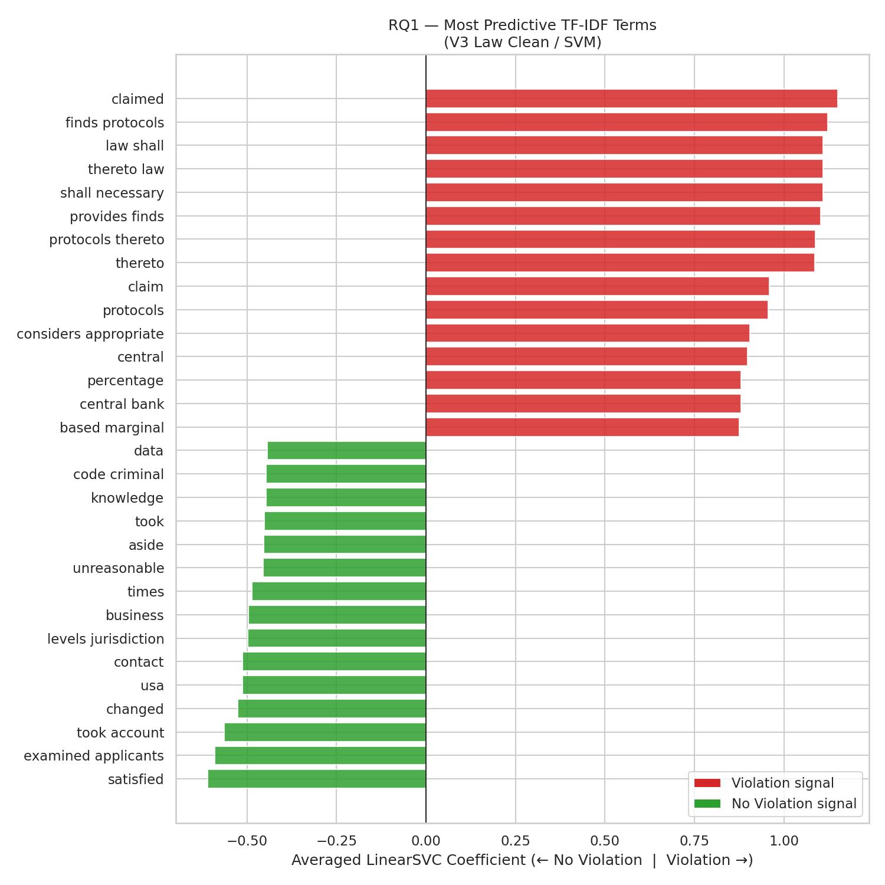
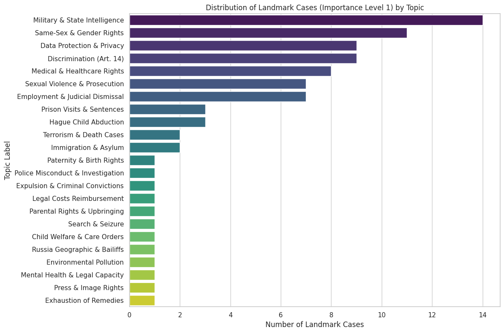
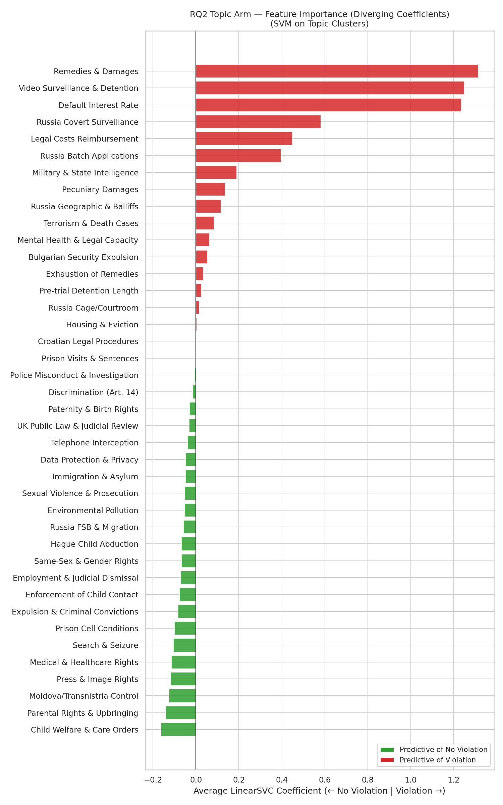
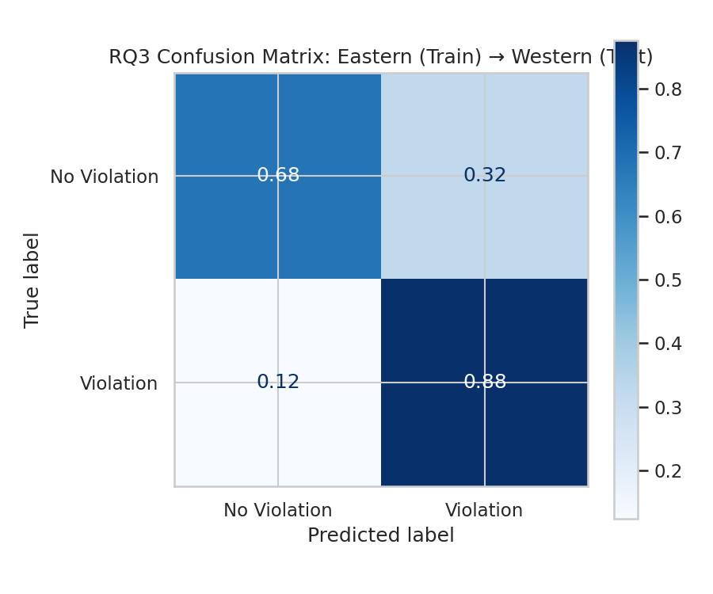
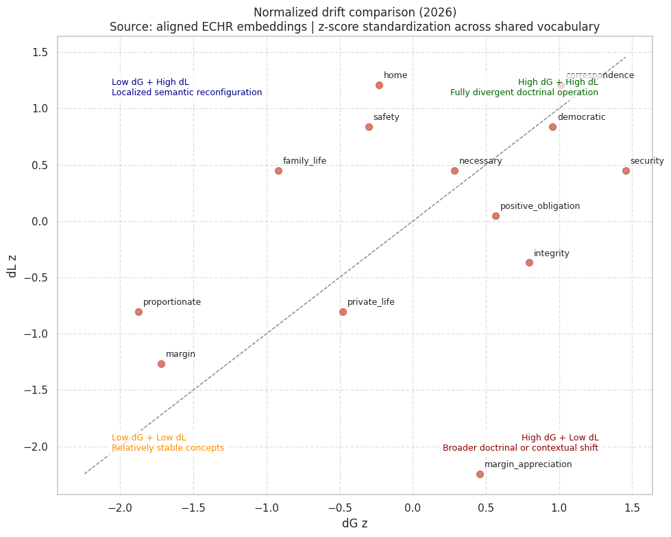
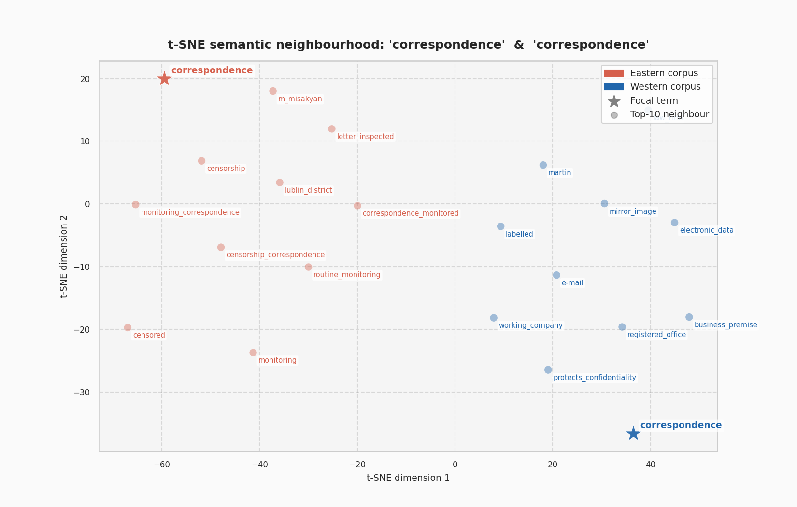

# Findings
{: .no_toc }

Four research questions, each built on the last. For how the models were stress-tested (leakage, bias, error analysis), see [Evaluating the model](evaluation.md). Scores are macro-F1 under 5-fold stratified cross-validation unless stated. Every number and figure here comes from the [full analysis notebook](web/final/LL5532X_Pt_5_Final_Project_Notebook_Group_1_v4.md).
{: .fs-5 .fw-300 }

  
On this page

  {: .text-delta }
- TOC
{:toc}

---

## RQ1: Does text beat metadata?

**Question.** Does the text of a judgment predict an Article 8 violation better than structured metadata (respondent state, year, importance level)? And which part of the judgment, the Facts or the Law, carries the stronger signal?

**Design.** A three-arm experiment: **metadata only**, **text only** and **metadata + text**. The text arm has three variants, which turn the leakage question into a controlled test:

| Variant | Text used | Purpose |
|:--|:--|:--|
| **V1 Facts** | Facts section only | No remedy language: an honest lower bound |
| **V2 Law Full** | Full Law section | Includes the Court's reasoning *and* Article 41 just-satisfaction text |
| **V3 Law Clean** | Law section with remedy vocabulary removed | Tests whether cleaning the vocabulary removes the leakage |

### Results

| Arm | Best classifier | Macro-F1 |
|:--|:--|--:|
| Metadata only | Linear SVM | 0.649 |
| V1 Facts | Logistic Regression | 0.694 |
| V2 Law Full | Linear SVM | **0.904** |
| V3 Law Clean | Linear SVM | 0.870 |
| Metadata + V3 Law Clean | Linear SVM | 0.828 |

### What it means

- **Text beats metadata**, on every variant. The substance of a judgment carries signal that structural attributes cannot replicate.
- **The Law section leaks the outcome.** Article 41 just-satisfaction language (damages, costs, default interest) appears only when a violation is found. Three rounds of stop-word cleaning still left the V3 model at 0.870, because it found secondary leakage terms such as *claimed*, *finds protocols* and *thereto law*. **Leakage is structural, not lexical**: the fix is to remove whole remedy paragraphs before feature extraction.
- **Adding metadata made things worse.** The respondent-country prior overrode the text model's no-violation signal: no-violation recall fell to 0.62 while violation recall rose to 0.97. Metadata is not useless (0.649 is above chance), but on an imbalanced docket it amplifies the imbalance.
- **Compared with the literature.** Aletras et al. (2016) found the Law section the *weakest* predictor for Article 8; they removed operative provisions first. Our reversal is consistent with remedy leakage. Our Facts-only score (0.694) sits just below Chalkidis et al.'s (2019) BOW-SVM benchmark of 0.718 macro-F1.

{: .key }
The Facts section (0.694) is the more legally honest estimate of how predictable Article 8 outcomes are. The 0.904 Law-section score mostly reflects how ECtHR judgments are structured.

---

## RQ2: What themes drive outcomes?

**Question.** What are the dominant themes in Article 8 case law from 2010 to 2023, and can topic weights act as predictive features?

**Design.** Non-negative matrix factorisation (NMF) on TF-IDF features. The coherence curve peaked at k = 7, but seven topics merged legally distinct areas such as surveillance and deportation, so the team chose **k = 40** on purpose, trading coherence for legal granularity. The 40 topic weights were then fed to Logistic Regression, Linear SVM and Naive Bayes.

### Results

| Classifier on 40 topic weights | Macro-F1 |
|:--|--:|
| Logistic Regression | **0.857** |
| Linear SVM | 0.855 |
| Naive Bayes | 0.743 |

Naive Bayes was kept as a diagnostic: topic weights are correlated, which breaks its independence assumption.

The 40 themes fall into four broad areas:

- **Procedural and remedial**: legal costs, pecuniary damages, default interest
- **State security and surveillance**: military intelligence, covert surveillance, batch deportation
- **Family and personal life**: child welfare and care orders, parental rights, expulsion of settled migrants
- **Emerging rights**: same-sex and gender recognition, data protection and retention, mental health and legal capacity

### What it means

Topics separate into three kinds:

1. **Artefacts.** The four Article 41 remedy clusters and the Russia-specific clusters record 100% violation. They predict well for the wrong reasons, and they carry the largest SVM coefficients (around 1.35).
2. **Settled law.** Clusters such as telephone interception (0.94 violation) line up with established surveillance case law.
3. **Genuinely contested.** Same-sex and gender recognition, child welfare, and search and seizure sit close to 50/50, reflecting live doctrinal disagreement inside the Court and across member states.

Close reading of three landmark cases shows where topic features stop working:

- *El-Masri v. the former Yugoslav Republic of Macedonia* (2012): the intelligence cluster correctly signals a clear violation.
- *Schalk and Kopf v. Austria* (2010): no violation, yet the judgment uses the same vocabulary of family life, private life and margin of appreciation as violation judgments.
- *Breyer v. Germany* (2020): no violation after a detailed proportionality review. A topic model sees the *presence* of safeguard vocabulary, not whether the safeguard was legally *sufficient*.

---

## RQ3: Do patterns transfer across regions?

**Question.** Does a model trained on one regional bloc of the docket generalise to the other? Is the RQ1 signal legally universal or geographically contingent?

**Design.** The docket was split into Eastern and Western blocs using an external country list, with zero country overlap between train and test. TF-IDF + Linear SVM was trained on one bloc and tested on the other, in both directions. Turkey was held out as a *boundary state*. Misclassifications were reviewed with an LLM-assisted error analysis, and topic-based SVMs (NMF, k = 20) were fitted per region.

### Results

| Direction | Linear SVM macro-F1 | Naive Bayes macro-F1 |
|:--|--:|--:|
| Train West → test East | **0.855** | 0.772 |
| Train East → test West | 0.774 | 0.424 |

| | Correct no-violation | Correct violation |
|:--|--:|--:|
| West → East | 75% | 96% |
| East → West | **68%** | 88% |

### What it means

- **The failure is directional.** The Eastern-trained model misclassifies 32% of genuine Western no-violation cases as violations. It is predisposed to find state fault.
- **Two causes.** First, both models lean on Article 41 boilerplate (*claimed*, *finds protocols*, *awards*). Second, the Eastern corpus is dominated by Russian cases with near-universal violation, so the Eastern model learns country-specific facts instead of transferable doctrine.
- **The no-violation vocabularies differ.** The Eastern model's no-violation signal is procedural delay and specific scenarios (*length proceedings*, *medical malpractice*, *education*). The Western model's is substantive balancing (*contact rights*, *divorce*, *appeal*).
- **Turkey confirms it.** Turkey's case text is closer to the East (cosine similarity 0.822 vs 0.785), yet the Western model does better on Turkish cases (macro-F1 0.45 vs 0.31). The gap is a reasoning problem, not a vocabulary one.

---

## RQ4: Do the same words mean the same thing?

**Question.** Why does the Eastern model fail on Western cases? Do core Article 8 terms carry different meanings in the two regional corpora?

**Design.** Two separate Word2Vec models, one per region, trained on the lemmatised Law sections (123,151 Eastern and 46,094 Western sentences), with bigrams such as `margin_appreciation` and `private_life` joined into single tokens. For 13 focal doctrinal terms the team measured:

- **dG, global drift**: how far a term moves between the aligned embedding spaces
- **dL, local drift**: how much its 25 nearest neighbours change (following Hamilton et al., 2016)

### Results

**High drift: *home* and *correspondence*.** Their nearest neighbours barely overlap between the regions:

| Term | Eastern neighbours | Western neighbours |
|:--|:--|:--|
| *correspondence* | censorship, monitoring correspondence, censored, routine monitoring | protects confidentiality, business premises, electronic data, e-mail, law firm |
| *home* | policeman entered, obligation to vacate, dormitory building | demolition, eviction, dwelling |

In the East, *correspondence* is about the state reading and censoring letters. In the West, it is about confidentiality of business and electronic communications.

**Low drift: *proportionate* and *margin*.** These words are stable. Both models agree on what they mean in isolation.

### What it means

- **High drift explains the false positives.** When the Eastern model meets *home* or *correspondence* in Western judgments it applies the wrong interpretive frame, which produces the RQ3 errors.
- **Low drift hides a second failure.** *Proportionate* means the same in both regions, but the Eastern model, overfitted to Russia's near-universal violation rate, never learned the elaborate proportionality balancing that Western judgments perform with it. The word is shared; the legal work it does is not.
- **Moderate-drift terms compound both problems**, adding partial misalignment that is harder to detect.

{: .key }
A portable Article 8 classifier would need a geographically balanced corpus, free of Article 41 leakage, rich enough in Western proportionality reasoning to learn what shared concepts *do* in a judgment. That corpus does not exist, because the docket itself is not balanced.

---

## Implications

**Legal.** Article 8 outcomes are, to a meaningful degree, linguistically predictable, which fits the rule-of-law principle that like cases are decided alike. But the leakage-free Facts score (0.694) is the honest figure, and tools that report Law-section scores overstate how mechanical Convention outcomes are.

**Policy.** Country-specific clusters suggest some violations are systemic. The NMF topic map could help target structural reform and the Committee of Ministers' supervision of execution, rather than treating each judgment in isolation.

**Ethical.** A deployed model would mislead applicants: the Facts-section SVM has a no-violation recall of only 0.35, so it tells two in three applicants who will lose that they are likely to win. A country feature risks entrenching inequality in access to Convention protection. And a prediction tool used in legal practice would itself have to meet the Article 8 standard of being "in accordance with the law": accessible, foreseeable, explainable and open to challenge.

## Limitations

1. **Article 41 leakage** affects RQ1–RQ3. Remedy paragraphs need to be removed before feature extraction.
2. **Geographic imbalance.** Russian cases dominate the Eastern corpus.
3. **Fixed topic count.** NMF was held at k = 20 for the regional models, which merges distinct concepts.
4. **Static representations.** TF-IDF, NMF and Word2Vec cannot read sentence-level context, such as *how* the Court applies the margin of appreciation.
5. **LLM-assisted error analysis** (Gemini 2.5 Flash Lite) in RQ3 may project legal reasoning onto what are statistical errors, so its output is treated as unverified.

## Future work

- Paragraph-level removal of just-satisfaction text, the highest-priority fix
- Extend to Articles 3, 5 and 6 to see whether leakage and geographic concentration are general ECtHR problems
- Contextual legal language models (e.g. Legal-BERT) to capture arrangement, not just presence, of words
- A pre-/post-2015 split to test whether semantic drift over time degrades performance
- Model the parties' submissions, not only the Court's judgment, to match the practitioner's prediction problem
