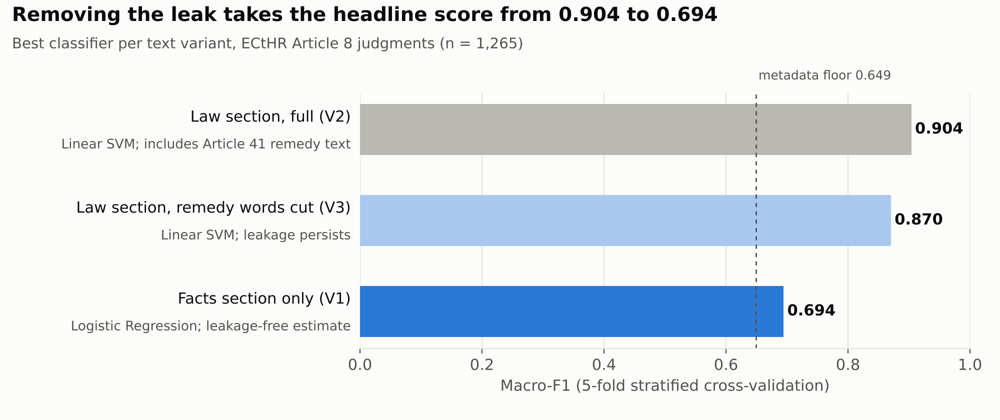

# Beyond Accuracy
{: .fs-9 }

**Predicting Privacy:** an NLP study of 1,265 European Court of Human Rights judgments under Article 8, and what a 0.904 model score was really measuring.
{: .fs-6 .fw-300 }

Jan – Apr 2026 · 4-person team · LL5532X, National University of Singapore
{: .text-grey-dk-000 }

[See how the model was evaluated](evaluation.md){: .btn .btn-primary .fs-5 .mb-4 .mb-md-0 .mr-2 }
[Read the findings](findings.md){: .btn .fs-5 .mb-4 .mb-md-0 .mr-2 }
[View on GitHub](https://github.com/RiniPi/LL5532X){: .btn .fs-5 .mb-4 .mb-md-0 }

---

## The story in four lines

| | |
|:--|:--|
| **The result** | A Linear SVM predicted Article 8 outcomes from judgment text with a macro-F1 of **0.904** |
| **The default reading** | Court outcomes are highly predictable from text |
| **What we found** | The Law section contains Article 41 "just satisfaction" text, which only appears after a violation. Part of the score was **data leakage**. On the Facts section alone, the honest score is **0.694** |
| **Why it matters** | A high score isn't the same as a model that has learned the law. What can be built isn't always what should be built |

## Skills demonstrated

| Area | What the project shows |
|:--|:--|
| **Model evaluation** | Macro-F1 under class imbalance, controlled text variants, per-class recall, out-of-distribution testing across regions |
| **Data leakage detection** | Traced the 0.904 score to remedy language, then showed that removing keywords wasn't enough |
| **Error analysis** | Reviewed misclassified cases and close-read landmark judgments to find what the model can't see |
| **Bias and fairness** | Showed the metadata model learns *which country* was sued, and that adding it hurts minority-class recall |
| **Responsible AI** | Set out what a legal-AI product would need before it could be used on real applicants |
| **NLP** | TF-IDF classifiers, NMF topic modelling, Word2Vec semantic drift, t-SNE, concordance analysis |
| **Research design** | Four research questions, each built on the one before; interpretable models chosen over black boxes |

## Four research questions

| | Question | Method | Short answer |
|:--|:--|:--|:--|
| **[RQ1](findings.md#rq1-does-text-beat-metadata)** | Does judgment text beat structured metadata, and which section carries the signal? | TF-IDF; SVM, Logistic Regression, Naive Bayes; three-arm design | **Yes**, but the metadata model learns *country*, not law, and the Law section leaks the outcome |
| **[RQ2](findings.md#rq2-what-themes-drive-outcomes)** | What themes run through Article 8 case law, and do they predict outcomes? | NMF topic modelling (k = 40) | Some themes are **artefacts** (remedies, Russia), some are settled law, and some are **genuinely contested** (close to 50/50) |
| **[RQ3](findings.md#rq3-do-patterns-transfer-across-regions)** | Does a model trained on one region generalise to the other? | Train East → test West, and the reverse | **Only one way.** West → East 0.855, East → West 0.774 |
| **[RQ4](findings.md#rq4-do-the-same-words-mean-the-same-thing)** | Do core legal terms mean the same thing in both regions? | Word2Vec semantic drift, t-SNE, concordances | **Same words, different work.** *Home* and *correspondence* sit in different neighbourhoods East and West |

## At a glance

| | |
|:--|:--|
| **Corpus** | 1,265 ECtHR judgments involving Article 8 (privacy, family life, home and correspondence), 2010–2023, from [HUDOC](https://hudoc.echr.coe.int/) |
| **Outcomes** | 982 violation (78%) · 283 no violation (22%) |
| **Largest respondent** | Russia: 342 cases (27%), about 94% violation |
| **Metric** | Macro-F1, 5-fold stratified cross-validation. A model that always says "violation" already scores about 78% accuracy |
| **Honest score** | **0.694** on the Facts section. The 0.904 Law-section score is partly leakage |

## Three takeaways

1. **The no-violation paradox.** Rights protection and judicial restraint use the same words. *Schalk and Kopf v. Austria* discusses "family life", "proportionality" and "discrimination" and still finds no violation. Bag-of-words models can't see the difference, because the outcome depends on how the words are *arranged*, not on whether they appear.
2. **A model learns its docket, not the law.** Trained on Eastern cases, it learns physical state coercion; trained on Western cases, it learns proportionality balancing. Neither is a universal Article 8.
3. **"Neutral" legal AI isn't on offer.** The docket itself is shaped by history and litigation patterns, so any legal AI built on it encodes that history.

## Explore the project

| Page | What you'll find |
|:--|:--|
| [Evaluating the model](evaluation.md) | Leakage, bias and error analysis, and what a responsible product would need |
| [Findings](findings.md) | Each research question with results, figures and interpretation |
| [Data & methods](methods.md) | Corpus, preprocessing, experimental design |
| [Research journey](research-journey.md) | How the questions changed from proposal to findings, and why |
| [Full analysis notebook](web/final/LL5532X_Pt_5_Final_Project_Notebook_Group_1_v4.md) | Every code output and figure |
| [PyCaret model comparison](web/pycaret_web_presentation_v1.md) | 14 classifiers benchmarked by interpretability |
| [Code & data](code-and-data.md) | Notebooks, datasets, models and how to run them |
| [References](references.md) | Papers and ECtHR cases cited |

## Team and roles

**LL5532X Group Project (Data Investigation), Group 1**

| Member | Role |
|:--|:--|
| **Rini Pinasthika** | Team lead: set the research questions and methods, built the pipeline; RQ4 semantic drift · [LinkedIn](https://www.linkedin.com/in/rini-pinasthika) |
| **Sophia Emily Lin** | RQ1: text vs metadata outcome prediction |
| **Nicha Nutchayangkul** | RQ2: topic modelling |
| **Amanda Lim Jin Mei** | RQ3: cross-regional generalisation |

The leakage finding, the error analysis and the conclusions were worked out together as a team.

{: .note }
This site presents coursework for LL5532X. All rights are reserved by the authors unless stated otherwise; please contact the group before reusing any material. Judgment texts are public documents of the European Court of Human Rights, published on HUDOC.
