{: .note }
This page is the final project notebook exported to Markdown. It is long (about 5,000 lines, 57 figures). Use the table of contents below or the site search to jump to a section. The source notebook is [`notebooks/05_final_project_v4.ipynb`](https://github.com/RiniPi/LL5532X/blob/main/notebooks/05_final_project_v4.ipynb).

  
Table of contents

  {: .text-delta }
- TOC
{:toc}

Group No: 1 
Group Members: Amanda Lim Jin Mei, Nicha Nutchayangkul, Rini Pinasthika, Sophia Emily Lin
Course/Module: LL5532X
Title: Predicting Privacy: An NLP Analysis of ECHR Article 8 Judgments

# I. Project Overview and Research Design

## Motivation

The European Court of Human Rights (ECtHR) produces thousands of judgments each year adjudicating alleged violations of the Convention rights of individuals across 46 member states. Article 8, which protects the right to respect for private and family life, home, and correspondence, covers a range of claims from state surveillance and deportation to child custody disputes and data protection. Whether these decisions are predictable from the text of the judgments themselves, or from structural case attributes, has direct implications for how we understand consistency and rule of law in international human rights adjudication. If outcomes can be reliably predicted from pre-decision text, that raises questions about whether the Court's reasoning is genuinely deliberative or structurally determined. If they cannot, that tells us something different about the complexity and context-dependence of proportionality reasoning under Article 8.

We hypothesise that judgment text carries richer predictive signal than case metadata,
but that corpus-level models will be systematically misled by structural data leakage
and regional bias, two limitations that motivate the thematic, geographic, and semantic
analyses in RQ2, RQ3, and RQ4.

## Research Design

The modelling programme is structured around four research questions that build on each other in a deliberate sequence.

RQ1 asks whether case text outperforms structured metadata (respondent country, year, importance level) as a predictor of Article 8 outcomes, and which section of the judgment carries the stronger signal. This establishes a performance baseline and motivates the subsequent questions by revealing what the text-based signal actually consists of.

RQ2 asks what the dominant themes across the Article 8 corpus are, using unsupervised topic modelling to map the substantive legal landscape and assess whether NMF-derived topic weights can themselves serve as predictive features.

RQ3 asks whether models trained on one regional bloc of cases (Eastern or Western Europe) generalise to the other, testing whether the predictive signal from RQ1 is legally universal or geographically contingent.

RQ4 asks why any generalisation gap exists, using distributional word embeddings to test whether core Article 8 doctrinal terms carry different semantic content in the two regional corpora and whether that semantic drift accounts for the classifier's failure.

Each research question is answered using a combination of supervised classification, unsupervised representation learning, and feature importance analysis, with evaluation grounded in the macro F1 metric throughout.

## Modeling Approach and Methodology
Our modeling strategy focuses on gaining diverse insights from the legal dataset rather than chasing marginal gains in predictive accuracy. We utilize **TF-IDF (Term Frequency-Inverse Document Frequency)** to represent our text; this technique works by highlighting words that are unique and descriptive to specific documents while downweighting common words that appear everywhere and carry little discriminatory power. To evaluate our results, we employ three distinct classifiers chosen for their complementary strengths. **Naive Bayes** serves as our primary baseline because it is computationally efficient and relies on a simple "independence" assumption that, while theoretically basic, often performs surprisingly well on high-dimensional text data. **Logistic Regression** is included for its reliability in binary classification tasks and its high interpretability, allowing us to see how specific features influence a case's outcome. Finally, we implement **Support Vector Machines (SVM)**, which is the gold standard in legal NLP literature due to its effectiveness in handling the complex, high-dimensional boundaries inherent in legal language. We initially thought that Logistic Regression and SVM will produce different result, but throughout this notebook turns out the result between these two model is always quite similar.

To ensure the reliability of these results, we use **5-fold Stratified K-Fold cross-validation**, which preserves the percentage of samples for each class in every fold, ensuring our performance metrics are not skewed by the dataset's distribution. While we use **SMOTE (Synthetic Minority Over-sampling Technique)** on top of 'weight=balanced' to address class imbalance in our metadata and topic-based features, we intentionally exclude it from the raw text features, as the "synthetic noise" generated by SMOTE often struggles to maintain meaningful relationships in the extremely high-dimensional space of a large vocabulary. Furthermore, our focus remains on breadth over deep fine-tuning; by exploring a wide variety of techniques rather than hyper-optimizing a single one, we can extract more nuanced insights and observe the data through multiple analytical "lenses."

# **II. EDA**

### a. Outcome Distribution

We start by inspecting the overall distribution of Article 8 outcomes in the corpus. The goal is to see how often the Court finds a Violation versus a No Violation, and how large the residual “Others” category is. This tells us whether our prediction target is well-defined and whether class imbalance is severe enough to shape our modelling choices and evaluation metrics.

    Outcome distribution for Article 8 cases:

<table border="1" class="dataframe">
  <thead>
    <tr style="text-align: right;">
      <th></th>
      <th>count</th>
    </tr>
    <tr>
      <th>outcome_category</th>
      <th></th>
    </tr>
  </thead>
  <tbody>
    <tr>
      <th>Violation</th>
      <td>982</td>
    </tr>
    <tr>
      <th>No Violation</th>
      <td>283</td>
    </tr>
    <tr>
      <th>Others</th>
      <td>56</td>
    </tr>
  </tbody>
</table>

​    
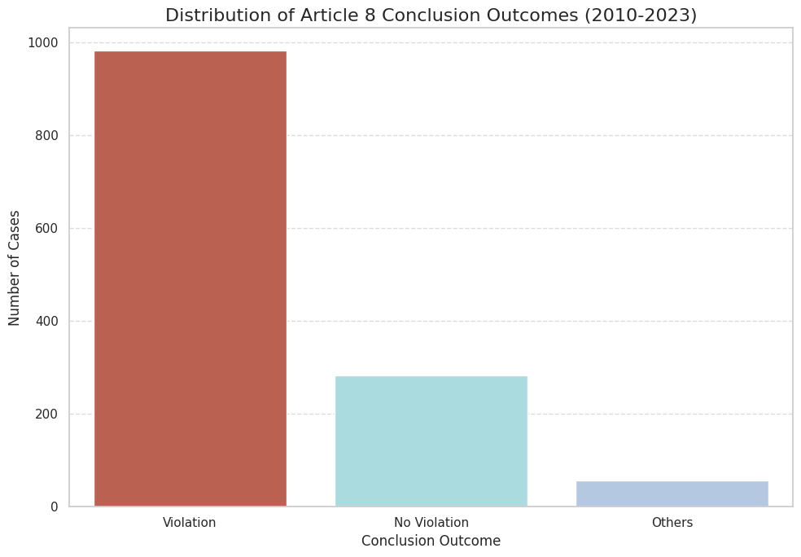
​    

**Analysis :** The outcome distribution is heavily skewed: out of 1,265 Article 8 judgments between 2010–2023, 982 are coded as Violation, 283 as No Violation, and 56 fall into the residual “Others” category of procedurally terminated or absorbed cases. The “Others” category typically covers inadmissible complaints or cases where the Court declines to rule on Article 8 after deciding another provision, which means no meaningful Violation/No Violation label is available.

For the rest of the notebook we therefore restrict attention to the 1,265 cases with a clear Violation/No Violation conclusion and drop “Others”, treating this as a binary classification task. The roughly 78–22 split between Violation and No Violation motivates two key design choices in RQ1: avoid using Accuracy as the primary metric and combining class-weighting (and, for non-text features, SMOTE) to avoid models that succeed simply by always predicting Violation.

**Note :**

Category "Others" covers all cases where the `type` in Conclusion column is not mentioning either violation or no-violation.
Several possibility of cases under this category are:
- Inadmissibile cases : The text mentions "Article 8" because the applicant tried to sue under it, but the Court never reached the "Facts" or "Law" stage to decide if a violation occurred.
- Procedural Absorption (of another article) :  The text might say, "In view of the finding under Article 6, the Court considers it unnecessary to examine the complaint under Article 8. Since the Court declined to rule, there is no "Violation" or "No Violation" label assigned.

Therefore, during further analysis below and for model training later, we have decided to exclude cases from the "Others" category and focus only on "Violation" and "No Violation" cases.

### b. Case Outcome per year

Next, we look at how Article 8 outcomes evolve over time. The stacked bar chart of Violation and No Violation per year allows us to check two things: whether there are temporal shifts in the Courts outcome ratios that could complicate modelling, and whether any spikes in case volume might reflect structural events (such as Russia’s exit) rather than changes in the underlying legal standard.

​    
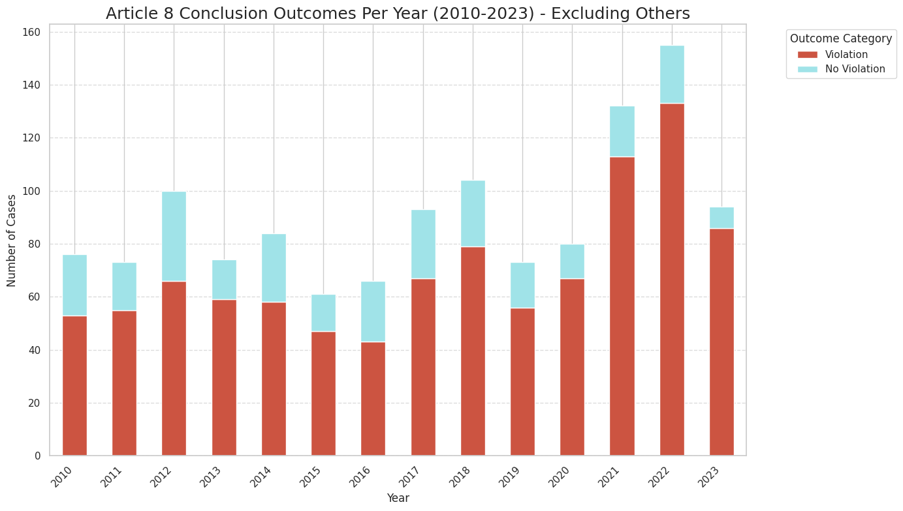
​    

**Note :**

Case volume spiked sharply in 2021-2022 — the two highest years in the dataset, likely reflecting a combination of post-pandemic processing of a backlog and the surge of pending Russian cases being resolved following Russia's expulsion from the Council of Europe in March 2022 after its invasion of Ukraine. Cases against Russia, which had historically been one of the largest sources of Article 8 violations, were processed and concluded before the Court's jurisdiction over Russia formally lapsed. The ratio of Violation to No Violation remains broadly stable across all years, suggesting the spike reflects case processing volume rather than a structural shift in outcomes.

## c. Top Respondent

We then examine which states generate most of the Article 8 litigation. Identifying the top respondent countries helps us see whether the dataset is dominated by a few national dockets and whether the outcome signal might partly reflect structural features of those respondents rather than case-specific facts or legal reasoning.

    Top 10 Respondent Countries for Article 8 Cases:

<table border="1" class="dataframe">
  <thead>
    <tr style="text-align: right;">
      <th></th>
      <th>count</th>
    </tr>
    <tr>
      <th>country_name</th>
      <th></th>
    </tr>
  </thead>
  <tbody>
    <tr>
      <th>Russia</th>
      <td>345</td>
    </tr>
    <tr>
      <th>Ukraine</th>
      <td>112</td>
    </tr>
    <tr>
      <th>Romania</th>
      <td>72</td>
    </tr>
    <tr>
      <th>Poland</th>
      <td>67</td>
    </tr>
    <tr>
      <th>Croatia</th>
      <td>60</td>
    </tr>
    <tr>
      <th>Bulgaria</th>
      <td>54</td>
    </tr>
    <tr>
      <th>Turkey</th>
      <td>42</td>
    </tr>
    <tr>
      <th>Hungary</th>
      <td>40</td>
    </tr>
    <tr>
      <th>Norway</th>
      <td>36</td>
    </tr>
    <tr>
      <th>Germany</th>
      <td>35</td>
    </tr>
  </tbody>
</table>

​    
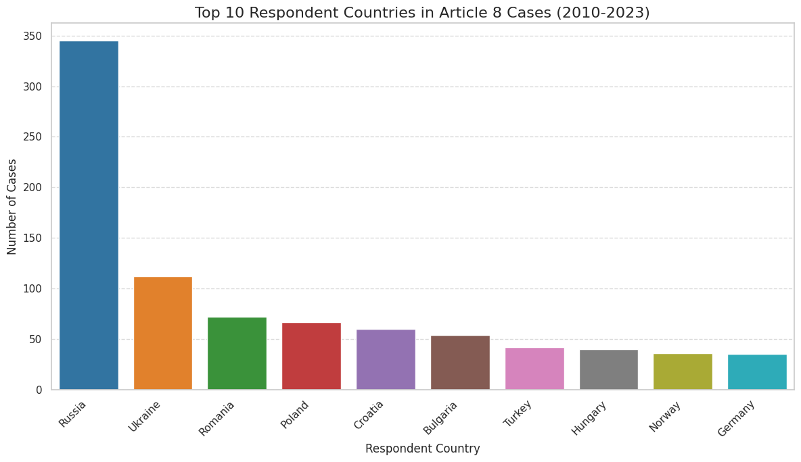
​    

The top-10 respondent plot shows a highly concentrated landscape: Russia alone accounts for 345 Article 8 cases, followed by Ukraine (112), Romania (72), Poland (67), and a cluster of other Eastern and Southern European states. Many Western European states appear, but with much smaller dockets, underscoring that a large share of the corpus is driven by repeated litigation against a small group of respondents.

Because Russian Article 8 cases are also disproportionately violation‑heavy, this concentration raises a generalisability concern: a classifier might partially “learn Russia” rather than “learn Article 8” if respondent country is included naively as a feature. This observation motivates two later choices: treating respondent region explicitly in RQ3 when testing cross‑bloc transfer, and interpreting metadata‑only models in RQ1 with caution, since part of their signal may come from country‑specific structural patterns rather than substantive proportionality reasoning.

## d. Top Respondent per Year

To understand how this country concentration plays out over time, we break the case counts down by year for the top 10 respondent states. This lets us see whether particular national dockets drive specific time‑period spikes and whether Eastern and Western respondents follow similar temporal trajectories, which is important context for the regional transfer experiments in RQ3

​    
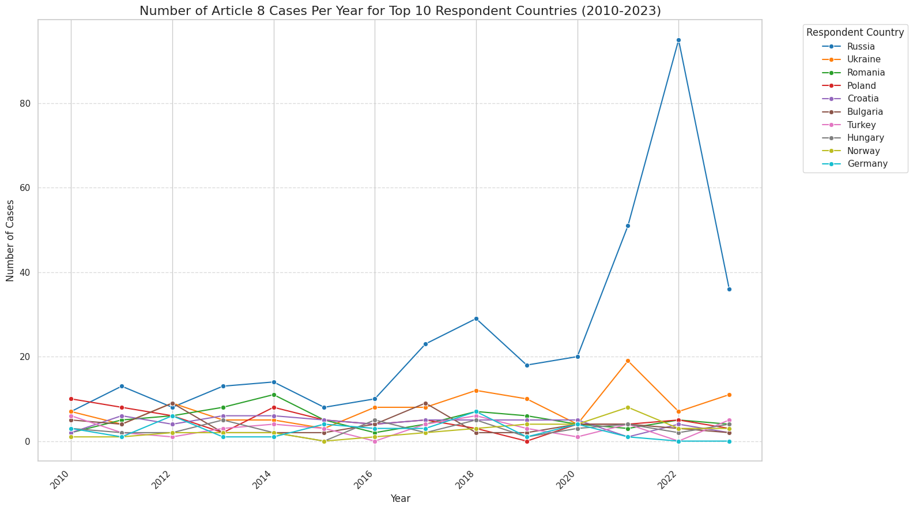
​    

The line plot for the top 10 respondents confirms that the 2021–2022 volume spike is not evenly shared: Russian and Ukrainian cases dominate the increase, while many Western states remain comparatively flat over time. Several Eastern European respondents show recurring waves of litigation, whereas Northern and Western states often appear as low‑volume, intermittent lines.

This pattern reinforces the idea that temporal and geographic structure are intertwined: the years in which the dataset is densest are also years in which Eastern dockets are most active.

## e. EDA Conclusion

Based on our exploratory analysis, we conclude that our research question — *"Can we predict whether an Article 8 case will result in a Violation or No Violation using the linguistic features of the judgment text?"* — is addressable using supervised classification techniques.

Our dataset of 1,265 Article 8 cases (2010–2023), comprising 982 Violation and 283 No Violation cases after excluding 56 procedurally terminated judgments, provides a sufficient sample for classification. The outcome variable is clearly defined and extractable from the structured conclusion column. The class imbalance (~78% Violation) is addressed throughout via `class_weight='balanced'`, macro F1 as the primary evaluation metric, and SMOTE where appropriate.

The EDA identified several promising predictive signals: vocabulary variation across outcome classes in the Facts and Law sections (supported by n-gram, word shift, and fighting words analyses); case importance level and court type as proxies for case complexity; and respondent country as a structural signal, though the dominance of Russian cases raises generalisability concerns. Initial logistic regression coefficient analysis confirmed that distinctive vocabulary exists between outcome classes, supporting a TF-IDF bag-of-words approach.

The main limitations to carry forward are class imbalance, potential data leakage in the Law section from Article 41 just satisfaction language, and the geographic concentration of the Eastern European corpus. These are treated as analytical constraints rather than fundamental obstacles, and each is addressed directly in the modelling sections below.

---

The modelling programme is structured around four research questions. **RQ1** tests whether case text outperforms structured metadata as a predictor of Article 8 outcomes. **RQ2** uses unsupervised topic modelling to map the dominant legal themes in the corpus. **RQ3** tests whether models trained on one regional bloc generalise to the other. **RQ4** investigates whether semantic drift in core doctrinal vocabulary explains any generalisation failure.

# **RQ1: Text vs. Metadata**

---

## **1.1 EDA**

### **1.1.1 EDA 5.4 Shifterator**

**EDA: Vocabulary Divergence Between Outcome Classes**

Before training our models, we use a Proportion Shift (Shifterator) analysis to verify
that meaningful vocabulary differences exist between Violation and No Violation cases.
The Shifterator quantifies which terms appear disproportionately in each outcome class
relative to the other — terms on the right (orange) skew toward Violation cases, while
terms on the left (purple) skew toward No Violation cases. This provides an empirical
basis for the TF-IDF text classification approach in RQ1.

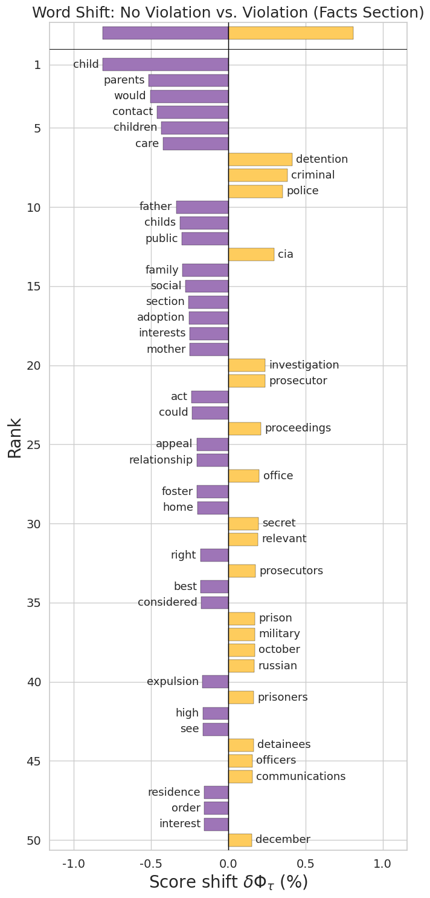
    

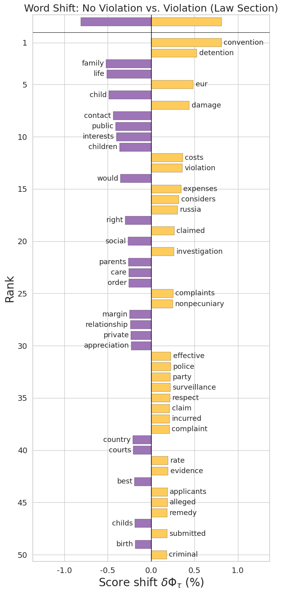
    

The two word shift graphs reveal a consistent and legally coherent pattern of vocabulary
divergence across both text sections.

In the **Facts section**, violation cases are anchored by coercive state conduct —
**detention, criminal, police, CIA, investigation, military, secret** — pointing to cases
involving extraordinary rendition, surveillance, and law enforcement overreach where the
Court applies strict scrutiny. Non-violation cases are dominated by domestic and family
life vocabulary — **child, parents, contact, children, care, father, mother, foster** —
reflecting the Court's tendency to defer to domestic authorities in custody and child
welfare matters, granting a wider margin of appreciation.

In the **Law section**, the violation side is heavily contaminated by Article 41 just
satisfaction boilerplate — **eur, damage, costs, expenses, nonpecuniary, incurred** —
confirming the data leakage risk identified in the EDA: the Law section encodes the
*consequences* of a violation rather than the legal reasoning that produced it. The
non-violation side is more substantively coherent, featuring **family, life, child,
contact, margin, appreciation, private** — the doctrinal language of proportionality
balancing and deference to domestic discretion.

Together, these findings confirm two things that directly motivate RQ1: first, that
distinctive vocabulary exists between outcome classes, supporting a TF-IDF bag-of-words
approach; and second, that the Facts and Law sections carry fundamentally different
predictive signals, justifying our decision to treat them as separate text variants
rather than combining them into a single feature.

### **1.1.2 EDA 5.5 Fighting Words**

**EDA: Fighting Words Analysis**

To sharpen the Shifterator findings, we apply a Fighting Words log-odds analysis
restricted to the most legally significant cases (importance levels 1 and 2). Where
Shifterator measures the relative frequency of terms across the full corpus, Fighting
Words identifies the terms most *statistically distinctive* to each outcome class —
surfacing the specific vocabulary that most reliably differentiates Violation from
No Violation judgments among cases where the Court's reasoning is most explicit.

    Filtered cases: 135

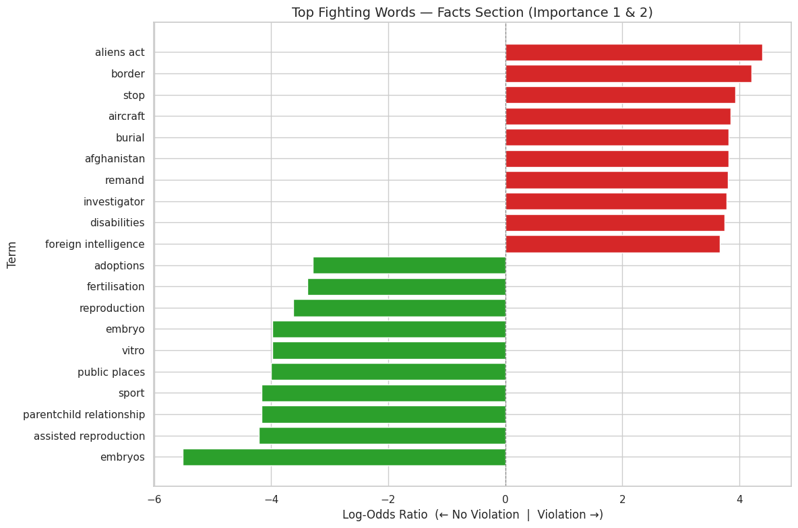
    

    Filtered cases for law section: 134

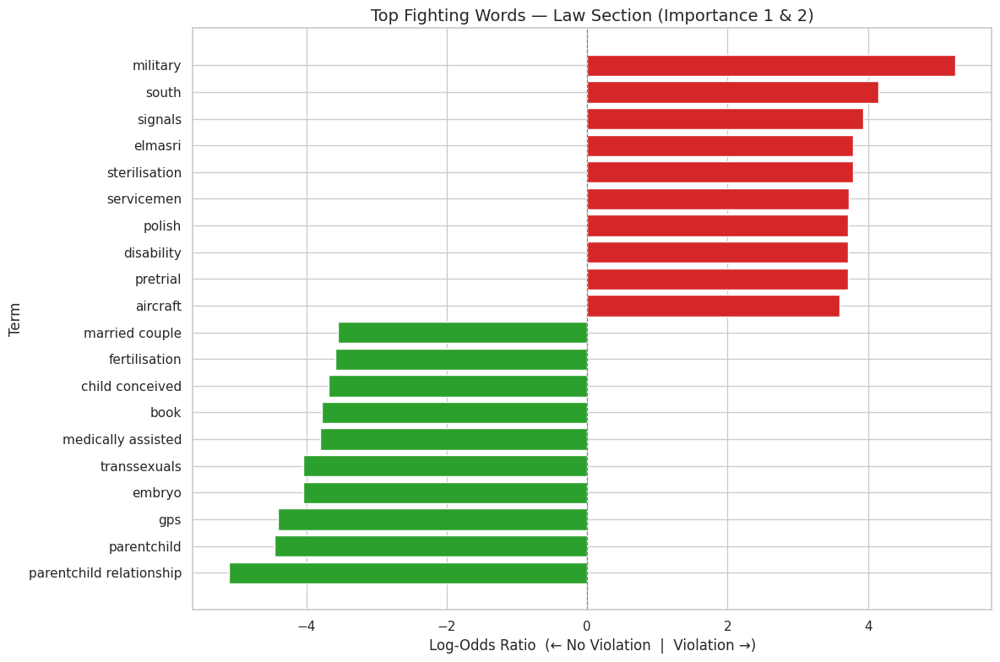
    

The fighting words analysis confirms and sharpens the vocabulary patterns identified
in the Shifterator analysis above, using log-odds ratios to surface the terms most
statistically distinctive to each outcome class among the most legally significant
cases (importance levels 1 and 2).

In the **Facts section**, the violation side is dominated by extraordinary rendition
and state security vocabulary — **"investigator", "afghanistan", "aircraft", "abu",
"border", "expulsion"** — pointing to cases involving unlawful deportation and coercive
state operations. The non-violation side is strikingly different, anchored by assisted
reproduction and bioethics vocabulary — **"embryos", "vitro", "assisted reproduction",
"fertilisation"** — reflecting the Court's wide margin of appreciation in ethically
sensitive areas of social policy.

In the **Law section**, the same thematic clusters persist — the deportation/military
cluster on the violation side and the IVF/bioethics cluster on the non-violation side —
appearing consistently across both text sections. This cross-section consistency
suggests these are robust legal patterns rather than artefacts of one particular
text variant.

Importantly, the fighting words analysis is restricted to importance levels 1 and 2
(n=135) to focus on legally significant cases where doctrinal reasoning is most
explicit. The small sample means large log-odds ratios should be treated as qualitative
indicators rather than robust statistical estimates. Nonetheless, the thematic coherence
of the results — and their alignment with the Shifterator findings on the full corpus —
provides strong motivation for the TF-IDF classification approach in RQ1.

## **1.2 Does Text Outperform Metadata in Predicting Article 8 Outcomes?**

The Shifterator and Fighting Words analyses confirm that meaningful, legally coherent
vocabulary differences exist between Violation and No Violation cases. But vocabulary
patterns alone don't tell us how well a classifier can actually exploit them. RQ1
formalises this into a three-step modelling programme:

- **Step 1 — Metadata baseline:** We first train on structured case metadata alone
(respondent country, year, importance level, court type) to establish a ceiling for
what non-textual features can achieve. If metadata performs strongly, it suggests the
Court's outcomes are driven by structural factors — who the respondent state is, how
important the case is — rather than the substantive legal reasoning in the text.

- **Step 2 — Text features:** We then train on TF-IDF representations of the Facts
and Law sections separately, motivated by the EDA finding that these two sections carry
fundamentally different predictive signals. If text outperforms metadata, it validates
the linguistic approach to ECHR outcome prediction.

- **Step 3 — Combined features:** Finally, we test whether metadata and text are
complementary or redundant when used together, which has implications for how future
models in this space should be architected.

Our hypothesis is that text-based models will outperform the metadata baseline. If the
reverse holds — if respondent country and case importance prove stronger predictors than
the judgment text itself — that would constitute evidence of structural bias in Article
8 adjudication: outcomes determined less by legal reasoning than by who the defendant
state is and how politically significant the case is deemed to be.

Before diving into our results, it's worth being precise about what each evaluation metric actually means in the context of predicting Article 8 outcomes.
* **Accuracy** is the most intuitive — it simply asks "what proportion of cases did the model get right?" — but it becomes misleading when classes are imbalanced. With 982 Violations and only 283 No Violations in our dataset, a model that predicted Violation for every single case would achieve 77.7% accuracy while being completely useless in practice.
* **Precision and recall** capture something more nuanced. Precision asks: of all the cases the model flagged as Violations, how many actually were? Recall flips the question: of all the actual Violations in the dataset, how many did the model catch? These two metrics are inherently in tension — pushing recall up (catching more true Violations) tends to drag precision down (making more false positive calls), and vice versa.
* **F1 score** is the standard way to balance this trade-off, computing the harmonic mean of the two. We specifically use macro F1, which calculates F1 separately for each class and averages them equally — so the model is held equally accountable for its performance on No Violation cases as on Violation cases, regardless of how much rarer they are.

How to handle this evaluation problem is something precedent work has approached differently.
* **Aletras et al. (2016)**, whose methodology directly informs our own, used accuracy as their primary metric and reported a strong 79% average across Articles 3, 6 and 8. This was a reasonable choice for their study because they deliberately constructed a balanced dataset — randomly sampling equal numbers of violation and non-violation cases for each article, ending up with 254 cases for Article 8. When classes are balanced, accuracy tells you most of what you need to know.
* **Akdemir (2023)**, working on a very different problem — predicting which US Supreme Court certiorari petitions would be granted — faced a much more extreme imbalance of roughly 20:1 (1,012 denied petitions versus just 50 granted). He makes a compelling case that accuracy is essentially meaningless in this setting, pointing out that a dummy classifier predicting denial every time would score very highly without learning anything at all. Instead he prioritised recall, reasoning that missing a genuinely grantworthy petition — a false negative — was the more costly error. He also moved away from standard cross-validation entirely, adopting Monte Carlo Cross-Validation over 1,000 simulations to get more stable estimates under severe imbalance.

Our situation falls somewhere between these two. Our imbalance at roughly 3.5:1 is meaningful but nowhere near as severe as Akdemir's, so accuracy retains some interpretive value and we do report it. But we don't think it should be the headline metric. Following the spirit of Akdemir's argument, we want our model to be genuinely useful on both classes — identifying No Violation cases matters just as much as identifying Violations from a legal standpoint, since both represent substantively different human rights outcomes. **Macro F1 is therefore our primary metric**. To be precise about what this means: F1 score can actually be computed in several ways. Binary F1 evaluates performance on a single class only, while weighted F1 averages across classes but gives more weight to whichever class has more cases — in our dataset that would mean Violation's F1 dominates at 77%, quietly hiding poor performance on No Violations. Macro F1 instead calculates F1 separately for each class and averages them equally, so the model is held to the same standard on both outcomes regardless of how frequently each appears. This directly penalises the kind of majority-class bias that accuracy masks, which is what we want. We handle the imbalance during training by using class_weight='balanced' in our classifiers rather than artificially resampling the data, which preserves all 1,265 cases while still preventing the model from simply defaulting to Violation for everything. Precision and recall are reported alongside F1 so readers can see the full picture of where the model succeeds and where it struggles.

### **1.2.1 Metadata**

With evidence that the text carries a structured lexical signal, we now ask whether that signal actually outperforms structural case attributes. Step 1 in RQ1 is to train models on metadata alone—respondent country, year, importance level, and court type—to establish a baseline for how predictive non‑textual features are. If metadata can already predict outcomes well, that would suggest structural determinants (who the respondent is, how important the case is, which formation hears it) play a large role in Article 8 adjudication.

    RQ1 metadata dataset: 1,265 cases
    Outcome distribution:
    finding
    Violation       982
    No Violation    283
    Name: count, dtype: int64
    
    Running metadata classifiers...
    --------------------------------------------------
    Logistic Regression       → F1_macro: 0.6433 ± 0.0236
    
    Classification Report for Logistic Regression:
    
                  precision    recall  f1-score   support
    
    No Violation       0.40      0.66      0.50       283
       Violation       0.88      0.71      0.79       982
    
        accuracy                           0.70      1265
       macro avg       0.64      0.69      0.64      1265
    weighted avg       0.77      0.70      0.72      1265
    
    --------------------------------------------------
    Naive Bayes               → F1_macro: 0.3056 ± 0.0572
    
    Classification Report for Naive Bayes:
    
                  precision    recall  f1-score   support
    
    No Violation       0.24      0.93      0.38       283
       Violation       0.88      0.14      0.24       982
    
        accuracy                           0.32      1265
       macro avg       0.56      0.54      0.31      1265
    weighted avg       0.73      0.32      0.27      1265
    
    --------------------------------------------------
    SVM                       → F1_macro: 0.6497 ± 0.0249
    
    Classification Report for SVM:
    
                  precision    recall  f1-score   support
    
    No Violation       0.41      0.66      0.50       283
       Violation       0.88      0.72      0.79       982
    
        accuracy                           0.71      1265
       macro avg       0.64      0.69      0.65      1265
    weighted avg       0.78      0.71      0.73      1265
    
    --------------------------------------------------
    
    =======================================================
    RQ1 METADATA ARM — Leaderboard (sorted by F1_macro)
    =======================================================

<table border="1" class="dataframe">
  <thead>
    <tr style="text-align: right;">
      <th></th>
      <th>Model</th>
      <th>F1_macro</th>
      <th>F1_macro_std</th>
      <th>Accuracy</th>
      <th>Precision_macro</th>
      <th>Recall_macro</th>
    </tr>
  </thead>
  <tbody>
    <tr>
      <th>0</th>
      <td>SVM</td>
      <td>0.6497</td>
      <td>0.0249</td>
      <td>0.7099</td>
      <td>0.6456</td>
      <td>0.6924</td>
    </tr>
    <tr>
      <th>1</th>
      <td>Logistic Regression</td>
      <td>0.6433</td>
      <td>0.0236</td>
      <td>0.7020</td>
      <td>0.6414</td>
      <td>0.6885</td>
    </tr>
    <tr>
      <th>2</th>
      <td>Naive Bayes</td>
      <td>0.3056</td>
      <td>0.0572</td>
      <td>0.3154</td>
      <td>0.5448</td>
      <td>0.5351</td>
    </tr>
  </tbody>
</table>

    >>> Metadata F1_macro floor  : 0.6497
    >>> Best model         : SVM
    >>> Text arm must beat : 0.6497 to justify NLP

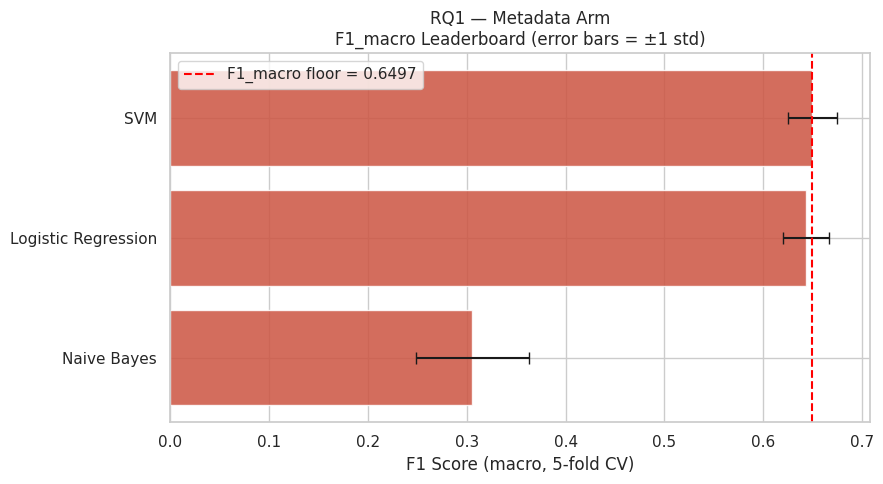
    

Across three classifiers, metadata alone achieves a macro F1 between roughly 0.30 (Naive Bayes) and 0.65 (SVM and Logistic Regression), with SVM slightly leading at 0.649 macro F1 and about 0.71 accuracy. This is far above a majority‑class baseline but still exhibits an asymmetry: the models are consistently stronger on predicting Violations than No Violations, echoing the underlying class imbalance.

We therefore treat 0.65 macro F1 as the “metadata floor”: any text‑based arm that fails to clear this bar would suggest that structural features alone explain much of the outcome pattern, potentially overshadowing the contribution of legal reasoning in the judgment text. This benchmark becomes the explicit target for the text‑only and combined models that follow.

**Confusion Matrix**

​    

​    

**Feature Importance**

​    
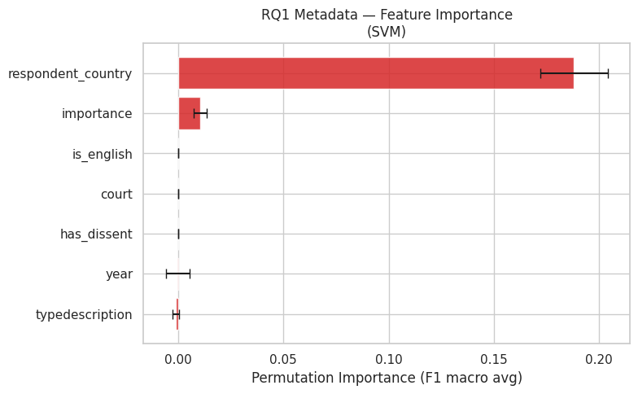
​    

**Analysis**

The permutation importance plot for the meta data-only SVM reveals a disparity in the predictive contribution of each feature. The feature respondent_country dominates by an overwhelming margin with a permutation importance of approximately 0.145 which is roughly 10 times greater than the importance (~0.01). All remaining features contribute negligible predictive signal, with values nearly equal to zero.
This finding is consistent with the patterns identified during EDA, where Russia was found to be the single largest respondent state in the dataset and accounted for a disproportionate share of violation findings. The dominance of respondent_country suggests that the model is not learning reasoning of Article 8 outcomes but whether cases from certain states are systematically more likely to produce violations than others.

Although court formation and importance level were found to be highly correlated in the EDA, only importance retains a small predictive signal while court contributes essentially nothing. This suggests that importance level captures slightly more information about case complexity than court formation alone, though the difference is negligible given how strongly respondent_country dominates the model.

The negligible contribution of has_dissent and is_english indicates that the presence of separate opinions and the language of the judgment carry no predictive value in the metadata model, which is consistent with the expectation that these are procedural characteristics rather than substantive predictors of outcome.

Taken together, these results confirm that the metadata model's predictive performance is driven almost entirely by respondent country, raising significant concerns about its legal meaningfulness and generalisability. A model that learns "which country is being sued" rather than "what the judgment says" would be expected to perform poorly on cases from underrepresented states or in contexts where a state's human rights record changes over time. This directly motivates the comparison with text-based modelling in the subsequent analysis.

<table border="1" class="dataframe">
  <thead>
    <tr style="text-align: right;">
      <th></th>
      <th>feature</th>
      <th>coefficient</th>
      <th>country_code</th>
      <th>display_feature</th>
      <th>total_cases</th>
      <th>violation_cases</th>
      <th>%_violation</th>
      <th>no_violation_cases</th>
      <th>%_no_violation</th>
    </tr>
  </thead>
  <tbody>
    <tr>
      <th>0</th>
      <td>respondent_country_ALB</td>
      <td>-0.596769</td>
      <td>ALB</td>
      <td>Albania</td>
      <td>5</td>
      <td>2</td>
      <td>40.00</td>
      <td>3</td>
      <td>60.00</td>
    </tr>
    <tr>
      <th>1</th>
      <td>respondent_country_AND</td>
      <td>-0.472973</td>
      <td>AND</td>
      <td>Andorra</td>
      <td>1</td>
      <td>0</td>
      <td>0.00</td>
      <td>1</td>
      <td>100.00</td>
    </tr>
    <tr>
      <th>2</th>
      <td>respondent_country_ARM</td>
      <td>0.222471</td>
      <td>ARM</td>
      <td>Armenia</td>
      <td>7</td>
      <td>5</td>
      <td>71.43</td>
      <td>2</td>
      <td>28.57</td>
    </tr>
    <tr>
      <th>3</th>
      <td>respondent_country_AUT</td>
      <td>-0.275074</td>
      <td>AUT</td>
      <td>Austria</td>
      <td>25</td>
      <td>14</td>
      <td>56.00</td>
      <td>11</td>
      <td>44.00</td>
    </tr>
    <tr>
      <th>4</th>
      <td>respondent_country_AZE</td>
      <td>1.063850</td>
      <td>AZE</td>
      <td>Azerbaijan</td>
      <td>20</td>
      <td>20</td>
      <td>100.00</td>
      <td>0</td>
      <td>0.00</td>
    </tr>
  </tbody>
</table>

​    
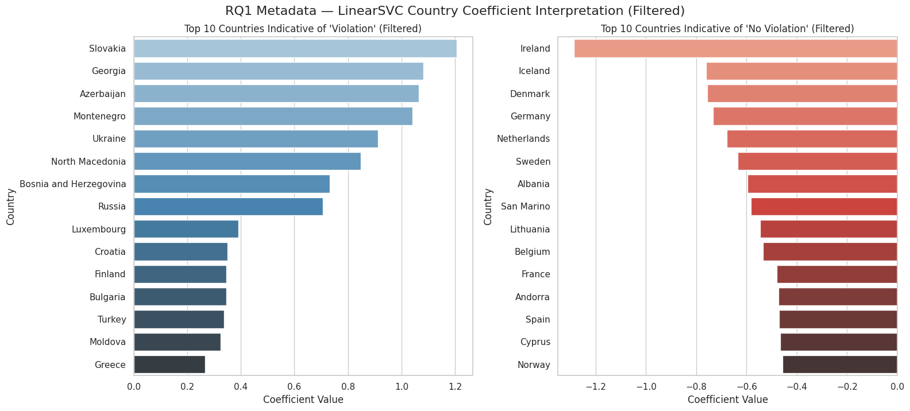
​    

**Analysis**

The underlying case counts reveal that several of the most extreme coefficients are unreliable due to small sample sizes. Slovakia, Georgia, Azerbaijan, Montenegro, and Bosnia and Herzegovina all show 100% violation rates, producing the highest positive coefficients. However, their total case counts range from only 2 to 20 cases. The model was not trained on any non-violation outcome from these states, causing it to assign extreme coefficients that reflect data sparsity rather than genuine legal patterns. Luxembourg's coefficient is based on a single case and should be disregarded entirely.

Russia, despite having the largest case volume in the dataset (342 cases, 93.57% violation rate), produces a more moderate coefficient than these smaller states precisely because its 22 non-violation cases provide the model with some exposure to both outcomes, resulting in a more calibrated but lower coefficient value.

On the non-violation side, similar concerns apply. Ireland and Andorra have only 2 and 1 cases respectively, making their large negative coefficients statistically meaningless. By contrast, Lithuania (29 cases, 48.28% violation rate), Norway (35 cases, 54.29%), and Germany (32 cases, 28.12%) have more substantial case volumes and more balanced outcome distributions, making their coefficients considerably more reliable indicators of genuine patterns.

These findings highlight a fundamental limitation of using respondent country as a predictive feature for states with few cases, the model cannot distinguish between a genuine legal pattern and a dataset artefact. This further undermines the validity of the metadata model and reinforces the case for text-based approaches that generalise across states regardless of case volume.

### **1.2.2 Text**

---

Secondary question: **which part of the text carries
the predictive signal?**
* **The Facts** section describes what happened to the applicant.
* **The Law** section describes how the Court reasoned. They are structurally different texts that may produce very different F1 scores

---

The story RQ1 tells is:

* Metadata → floor

* Facts text → does factual narrative predict outcomes?

* Law full → does legal reasoning predict outcomes? (but potentially inflated by remedies language)

* Law clean → is that inflation real or marginal?

---
**Hypothesis**
Good judgement should rely mostly on factual narrative rather than legal reasoning. But legal reasoning words in Law section can easily give strong signal about the outcome of the case. Law full (without removing leakage words) definitely will contain the most predictive signal compare to the other section.

**Model Training**

    ── Variant: V1_Facts ──
    
    Classification Report for Naive Bayes - V1_Facts:
    
                  precision    recall  f1-score   support
    
    No Violation       0.32      0.21      0.25       283
       Violation       0.79      0.87      0.83       982
    
        accuracy                           0.73      1265
       macro avg       0.56      0.54      0.54      1265
    weighted avg       0.69      0.73      0.70      1265
    
    --------------------------------------------------
    
    Classification Report for Logistic Regression - V1_Facts:
    
                  precision    recall  f1-score   support
    
    No Violation       0.47      0.70      0.56       283
       Violation       0.90      0.77      0.83       982
    
        accuracy                           0.76      1265
       macro avg       0.68      0.73      0.70      1265
    weighted avg       0.80      0.76      0.77      1265
    
    --------------------------------------------------
    
    Classification Report for SVM - V1_Facts:
    
                  precision    recall  f1-score   support
    
    No Violation       0.66      0.35      0.46       283
       Violation       0.83      0.95      0.89       982
    
        accuracy                           0.81      1265
       macro avg       0.75      0.65      0.67      1265
    weighted avg       0.79      0.81      0.79      1265
    
    --------------------------------------------------
    
    ── Variant: V2_Law_Full ──
    
    Classification Report for Naive Bayes - V2_Law_Full:
    
                  precision    recall  f1-score   support
    
    No Violation       0.71      0.61      0.66       283
       Violation       0.89      0.93      0.91       982
    
        accuracy                           0.86      1265
       macro avg       0.80      0.77      0.79      1265
    weighted avg       0.85      0.86      0.85      1265
    
    --------------------------------------------------
    
    Classification Report for Logistic Regression - V2_Law_Full:
    
                  precision    recall  f1-score   support
    
    No Violation       0.71      0.88      0.78       283
       Violation       0.96      0.90      0.93       982
    
        accuracy                           0.89      1265
       macro avg       0.84      0.89      0.86      1265
    weighted avg       0.91      0.89      0.90      1265
    
    --------------------------------------------------
    
    Classification Report for SVM - V2_Law_Full:
    
                  precision    recall  f1-score   support
    
    No Violation       0.87      0.83      0.85       283
       Violation       0.95      0.96      0.96       982
    
        accuracy                           0.94      1265
       macro avg       0.91      0.90      0.91      1265
    weighted avg       0.93      0.94      0.93      1265
    
    --------------------------------------------------
    
    ── Variant: V3_Law_Clean ──
    
    Classification Report for Naive Bayes - V3_Law_Clean:
    
                  precision    recall  f1-score   support
    
    No Violation       0.67      0.55      0.60       283
       Violation       0.88      0.92      0.90       982
    
        accuracy                           0.84      1265
       macro avg       0.77      0.74      0.75      1265
    weighted avg       0.83      0.84      0.83      1265
    
    --------------------------------------------------
    
    Classification Report for Logistic Regression - V3_Law_Clean:
    
                  precision    recall  f1-score   support
    
    No Violation       0.64      0.84      0.73       283
       Violation       0.95      0.86      0.90       982
    
        accuracy                           0.86      1265
       macro avg       0.79      0.85      0.82      1265
    weighted avg       0.88      0.86      0.86      1265
    
    --------------------------------------------------
    
    Classification Report for SVM - V3_Law_Clean:
    
                  precision    recall  f1-score   support
    
    No Violation       0.86      0.75      0.80       283
       Violation       0.93      0.96      0.95       982
    
        accuracy                           0.92      1265
       macro avg       0.89      0.86      0.87      1265
    weighted avg       0.91      0.92      0.91      1265
    
    --------------------------------------------------
    
    =================================================================
    RQ1 TEXT ARM — Full Results (sorted by F1_macro)
    =================================================================

<table border="1" class="dataframe">
  <thead>
    <tr style="text-align: right;">
      <th></th>
      <th>Variant</th>
      <th>Classifier</th>
      <th>F1_macro</th>
      <th>F1_macro_std</th>
      <th>Accuracy</th>
      <th>Precision</th>
      <th>Recall</th>
    </tr>
  </thead>
  <tbody>
    <tr>
      <th>5</th>
      <td>V2_Law_Full</td>
      <td>SVM</td>
      <td>0.9051</td>
      <td>0.0193</td>
      <td>0.9352</td>
      <td>0.9118</td>
      <td>0.8993</td>
    </tr>
    <tr>
      <th>8</th>
      <td>V3_Law_Clean</td>
      <td>SVM</td>
      <td>0.8731</td>
      <td>0.0154</td>
      <td>0.9162</td>
      <td>0.8958</td>
      <td>0.8568</td>
    </tr>
    <tr>
      <th>4</th>
      <td>V2_Law_Full</td>
      <td>Logistic Regression</td>
      <td>0.8561</td>
      <td>0.0155</td>
      <td>0.8917</td>
      <td>0.8358</td>
      <td>0.8876</td>
    </tr>
    <tr>
      <th>7</th>
      <td>V3_Law_Clean</td>
      <td>Logistic Regression</td>
      <td>0.8158</td>
      <td>0.0275</td>
      <td>0.8585</td>
      <td>0.7950</td>
      <td>0.8536</td>
    </tr>
    <tr>
      <th>3</th>
      <td>V2_Law_Full</td>
      <td>Naive Bayes</td>
      <td>0.7853</td>
      <td>0.0281</td>
      <td>0.8585</td>
      <td>0.8035</td>
      <td>0.7717</td>
    </tr>
    <tr>
      <th>6</th>
      <td>V3_Law_Clean</td>
      <td>Naive Bayes</td>
      <td>0.7502</td>
      <td>0.0200</td>
      <td>0.8379</td>
      <td>0.7718</td>
      <td>0.7358</td>
    </tr>
    <tr>
      <th>1</th>
      <td>V1_Facts</td>
      <td>Logistic Regression</td>
      <td>0.6957</td>
      <td>0.0346</td>
      <td>0.7557</td>
      <td>0.6851</td>
      <td>0.7344</td>
    </tr>
    <tr>
      <th>2</th>
      <td>V1_Facts</td>
      <td>SVM</td>
      <td>0.6697</td>
      <td>0.0324</td>
      <td>0.8134</td>
      <td>0.7486</td>
      <td>0.6484</td>
    </tr>
    <tr>
      <th>0</th>
      <td>V1_Facts</td>
      <td>Naive Bayes</td>
      <td>0.5425</td>
      <td>0.0507</td>
      <td>0.7257</td>
      <td>0.5588</td>
      <td>0.5415</td>
    </tr>
  </tbody>
</table>

    =================================================================
    RQ1 VERDICT
    =================================================================
    Metadata F1 floor   : 0.6497  (SVM)
    Best text F1        : 0.9051  (V2_Law_Full / SVM)
    F1 gain from text   : +0.2554
    >>> Text BEATS metadata — NLP is justified.

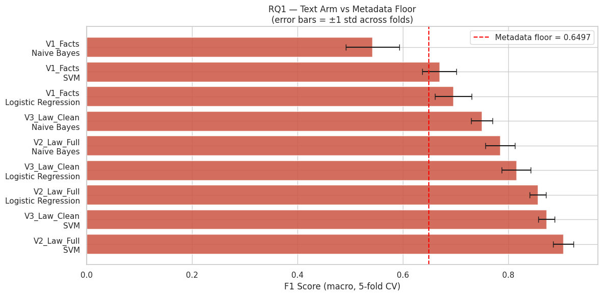
    

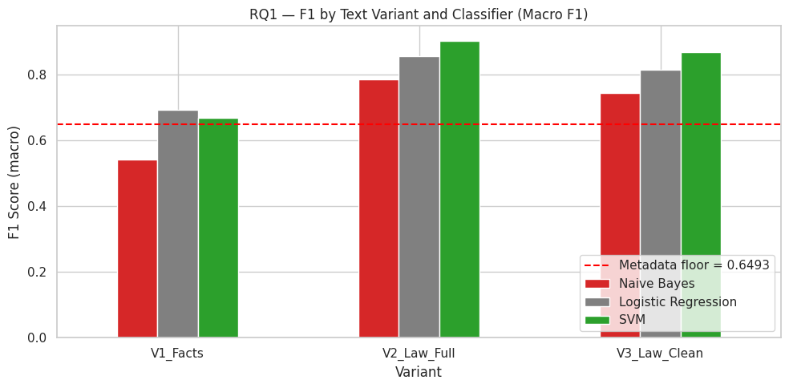
    

**Analysis**

The results reveal a clear hierarchy across the three text inputs, with the Law section substantially outperforming the Facts section regardless of classifier.

*Facts Section*

The Facts section produces the weakest text performance across all three classifiers: Naive Bayes (F1: 0.5419), Logistic Regression (F1: 0.6944), and SVM (F1: 0.6679). Logistic Regression and SVM both modestly exceed the metadata floor of 0.6493, while Naive Bayes falls well below it, suggesting that a simple bag-of-words approach cannot extract sufficient signal from factual narrative alone. The relatively modest performance of the Facts section is noteworthy given that it contains no outcome-consequent language; these scores therefore represent the most honest estimate of genuine linguistic predictability, reflecting what the factual circumstances of a case can tell a classifier about its outcome without any leakage risk.

*Law Section — Full vs Clean*

The Law section models substantially outperform both the metadata floor and the Facts section across all classifiers. Law Full achieves macro F1 scores of 0.7862 (Naive Bayes), 0.8564 (Logistic Regression), and 0.9038 (SVM), while Law Clean achieves 0.7457, 0.8167, and 0.8704 respectively. Under macro F1, the performance gap between Law Full and Law Clean is considerably larger than the weighted F1 figures suggested, ranging from approximately 0.033 to 0.041 points across classifiers. This pattern is analytically significant, the stop word cleaning removes vocabulary that supports correct classification of the minority no-violation class more than it removes majority-class signal, causing macro F1 to penalise the cleaned variant more heavily than weighted F1 did. The law section's strong performance therefore appears to be driven partly by genuine doctrinal reasoning vocabulary, but the widening gap under macro F1 confirms that the cleaning iterations have not resolved the structural leakage problem and may have introduced a secondary cost by discarding substantively informative terms alongside the remedial boilerplate.

*Classifier Comparison*

For the Law section variants, SVM consistently outperforms Logistic Regression and Naive Bayes, consistent with Aletras et al. (2016) who also identified SVM as the strongest performer on ECtHR text classification. For the Facts section, however, Logistic Regression (0.6944) marginally outperforms SVM (0.6679) under macro F1, suggesting that the sparse and less discriminative signal in factual narrative does not benefit from the margin-maximising properties of SVM to the same extent. Naive Bayes serves as a reliable but consistently weaker baseline, with its highest instability in the Facts section.

*Verdict*

The Law section carries substantially stronger predictive signal than the Facts section, and the best performing single text model is Law Full SVM (macro F1: 0.9038), representing a gain of +0.2545 over the metadata floor, confirming that text decisively outperforms metadata for Article 8 outcome prediction. The leakage effect is real and structurally persistent, as evidenced by the widening Law Full versus Law Clean gap under macro F1.

---

**Confusion Matrix**

    Generating Confusion Matrices for Text Arm SVM models...
    ----------------------------------------------------------------------
    
    ── Processing Variant: V1_Facts (facts_text) ──

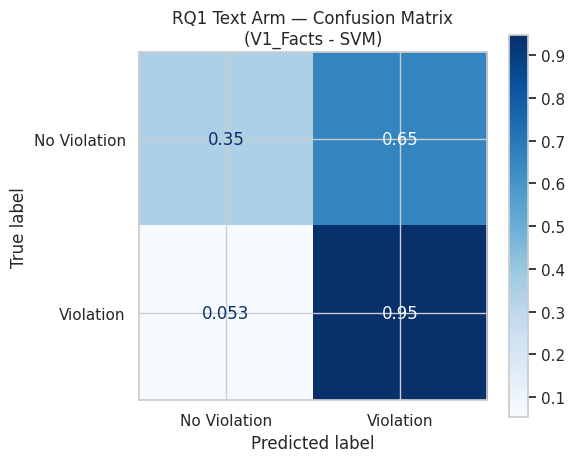
    

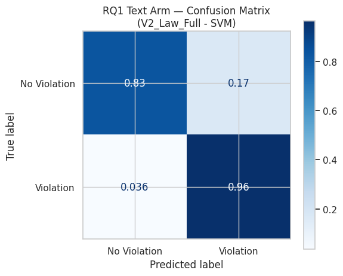
    

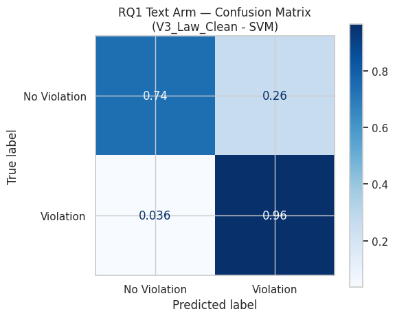
    

**Analysis**

The confusion matrices for the best-performing classifier (SVM) across all three text variants reveal a consistent asymmetry: all models are substantially better at identifying Violation cases than No Violation cases, reflecting the class imbalance present in the dataset and the differential linguistic distinctiveness of each outcome class.

**V1_Facts SVM** reflects the persistent effect of class imbalance on prediction behaviour, a pattern consistent with the 3.5:1 violation to no violation ratio in the dataset. On the violation side, the model performs strongly, correctly classifying 95% of actual violation cases and producing a false negative rate of only 5.3%. The violation class is well-learned, which is expected given its dominance in the training data.
On the no violation side, performance is considerably weaker. The model correctly identifies only 35% of actual no violation cases, misclassifying the remaining 65% as violations. This false positive rate is high and reflects the model's structural bias toward the majority class. The no violation signal remains insufficient to override the dominant violation prediction in a substantial proportion of cases.

This asymmetry reflects a dataset-level constraint rooted in the class imbalance, and is unlikely to be resolved without either rebalancing the dataset at source or adjusting the classification threshold to penalise false positives more heavily.

**V2_Law_Full SVM** shows a marked improvement over V1_Facts across both classes. Violation recall remains high at 96%, with a false negative rate of only 3.6%, broadly consistent with V1_Facts. The more notable change is in no violation classification, where the model now correctly identifies 83% of actual no violation cases compared to only 35% in V1_Facts, reducing the false positive rate from 65% to 17%. The prediction pattern is substantially more balanced between the two classes.

This improvement should however be interpreted with caution. V2_Law_Full uses the full law section without any leakage mitigation, meaning the model has access to the complete text of each judgment including sections that may structurally encode the outcome. The dramatic improvement in no violation classification is likely attributable at least in part to the model learning to detect the presence or absence of outcome-encoding language in the law section rather than learning substantive legal distinctions between violation and no violation reasoning. The strong performance on both classes in this version therefore reflects the richness of the input text rather than necessarily the model's capacity for genuine legal inference.

Comparing V1_Facts and V2_Law_Full on this basis, V1_Facts presents a more honest picture of what a text-based model can achieve when constrained to factual narrative alone, with the cost being the significant asymmetry in no violation classification. V2_Law_Full achieves better class balance but at the risk of inflated performance driven by the unconstrained law section.

**V3_Law_Clean SVM** sits between V1_Facts and V2_Law_Full, and the pattern across all three versions is analytically instructive when read together. Violation recall remains stable at 96% with a false negative rate of 3.6%, identical to V2_Law_Full and consistent with V1_Facts at 95%. The violation class is robustly learned across all three text variants, suggesting the violation signal is present regardless of which section of the judgment is used.

No violation recall drops from 83% in V2_Law_Full to 74% in V3_Law_Clean, with the false positive rate rising from 17% to 26%. This reduction is consistent with the effect of the stop word cleaning partially removing outcome-encoding language from the law section. By stripping some of the most direct leakage vocabulary, the cleaning reduces the model's capacity to correctly distinguish no violation cases, producing a modest but measurable decline in no violation classification.

However, the gap between V3_Law_Clean and V1_Facts remains substantial. V3_Law_Clean achieves 74% no violation recall against V1_Facts at only 35%, a difference of 39 percentage points. If the cleaning had fully addressed the leakage, performance would be expected to converge closer to V1_Facts. The persistence of this gap suggests potential residual outcome-encoding language remains in V3_Law_Clean even after cleaning.

Taken together across the three models, the confusion matrices reveal that no violation classification is the primary differentiator between text variants, while violation classification remains largely stable. This pattern reflects both the class imbalance in the dataset and the differential leakage properties of the facts and law sections.

---

Cross Entropy Loss & Predicted Probabilities

    ── Processing Variant: V1_Facts (facts_text) ──
      Cross-Entropy Loss (V1_Facts - SVM): 0.4093 ± 0.0137

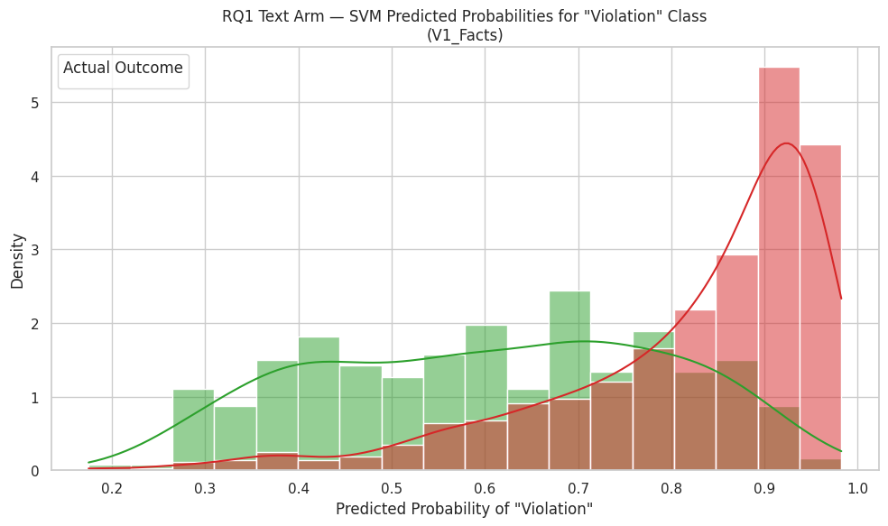
    

​    
    ── Processing Variant: V2_Law_Full (law_text) ──
      Cross-Entropy Loss (V2_Law_Full - SVM): 0.1845 ± 0.0204

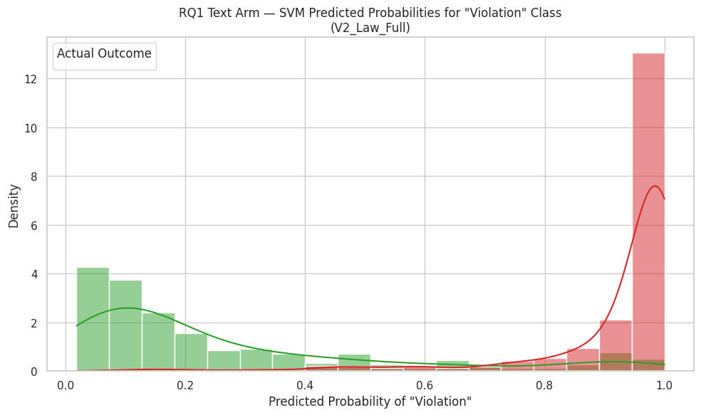
    

​    
    ── Processing Variant: V3_Law_Clean (law_text_clean) ──
      Cross-Entropy Loss (V3_Law_Clean - SVM): 0.2160 ± 0.0232

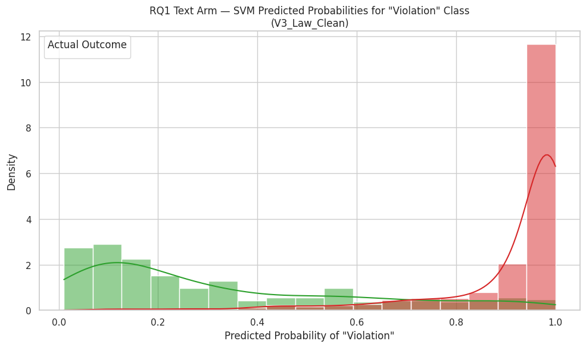
    

​    
    =========================================================================================
    Summary of Cross-Entropy Loss for Text Arm SVM Models:
         Variant  Cross_Entropy_Loss_Mean  Cross_Entropy_Loss_Std
        V1_Facts                 0.409303                0.013741
     V2_Law_Full                 0.184490                0.020430
    V3_Law_Clean                 0.215964                0.023239

**Analysis**

For V1_Facts, the violation class is concentrated in the 0.85 to 1.0 range with a peak around 0.90, while the no violation class is broadly and relatively flatly distributed across 0.2 to 0.8 with no dominant concentration. The two distributions overlap substantially in the middle range, reflecting genuine model uncertainty about a large proportion of cases. This spread is consistent with the confusion matrix finding that 65% of no violation cases are misclassified as violations, and suggests the model is not confidently wrong about these cases but rather that the factual narrative alone does not provide sufficient discriminative signal to separate the classes cleanly. The cross-entropy loss of 0.409 is the highest of the three variants, reflecting this uncertainty.

For V2_Law_Full and V3_Law_Clean, the distributions tell a markedly different story. Both show extreme polarisation: violation cases are almost entirely concentrated at probabilities of 0.9 to 1.0. The no violation class in both models is predominantly concentrated at 0.0 to 0.2, but a visible tail extends rightward in each, with a subset of no violation cases receiving moderate to high violation probabilities. This bleed corresponds to the 17% false positive rate in V2_Law_Full and the 26% false positive rate in V3_Law_Clean observed in their respective confusion matrices, and likely reflects cases where no violation judgments contain partial overlap with violation-associated language, producing genuine ambiguity rather than clean separation. Across the majority of cases however, the model assigns near-certain probabilities in both directions. The cross-entropy losses of 0.184 for V2_Law_Full and 0.216 for V3_Law_Clean are numerically lower than V1_Facts, which might suggest better calibration, but this reading is misleading. Low cross-entropy in these models reflects high-confidence predictions that happen to be correct, a pattern consistent with the model detecting the presence or absence of outcome-encoding language in the law section rather than weighing substantive legal features.

The slight increase in V3_Law_Clean cross-entropy loss from the original uncleaned value, now at 0.216 compared to the earlier iteration, is itself informative. Partial removal of leakage vocabulary through the revised stop word list has reduced the model's artificial certainty to a modest degree, producing a marginally less extreme probability distribution than V2_Law_Full.

Taken together, the probability distributions illustrate that V1_Facts, despite its higher cross-entropy loss, produces a more honest representation of the model's genuine uncertainty, particularly for the no violation class. V2_Law_Full and V3_Law_Clean produce artificially confident predictions whose low cross-entropy loss reflects the presence of outcome-encoding features rather than substantive legal learning.

---
Top Predictive Terms

    Classes: ['No Violation' 'Violation']

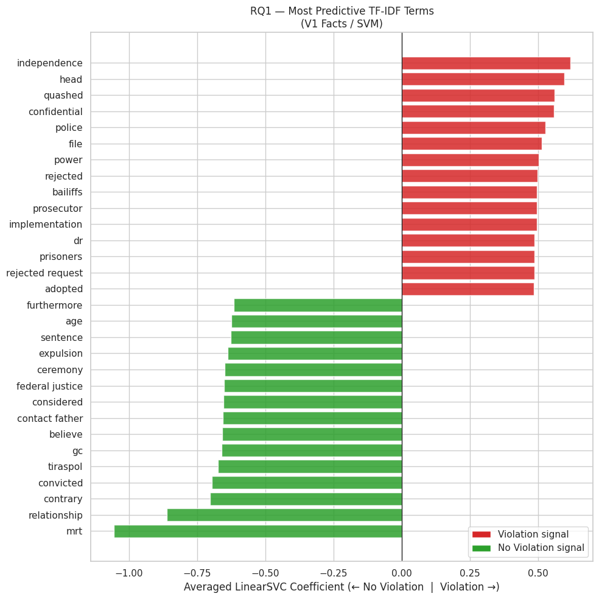
    

**Analysis**

The chart reflects a revised stop word configuration applied to the V1_Facts model. The original art8_universal removal list was modified to restore terms carrying potential discriminative value: 'interference', 'necessary', 'proportionate', 'prescribed', 'law', 'margin', 'appreciation', 'positive', 'negative', and 'obligation' were removed from the stop word list on the basis that these terms encode the Court's proportionality reasoning and may vary meaningfully between violation and non-violation outcomes. Additionally, 'home' and 'correspondence', two of the four protected interests under Article 8, were restored as active features to preserve potential sub-category signal. The terms retained in the art8_universal removal list as genuinely universal are 'private', 'family', 'democratic', 'society', 'legitimate', 'aim', 'authority', 'domestic', and 'national'. The remedies_leakage list was also expanded to capture residual Article 41 template vocabulary identified in earlier iterations.

The top predictive terms from this revised model reveal a more legally coherent pattern than the original.
On the violation side, the five most interpretable terms form a substantively coherent cluster around coercive and unaccountable state conduct. "Independence" is the strongest single predictor and is best understood in the context of ECtHR surveillance jurisprudence, where the Court has established that secret surveillance measures must be subject to independent oversight and authorisation, and that the absence of such oversight directly engages Article 8. In Roman Zakharov v. Russia (Grand Chamber, Application No. 47143/06, 2015), a landmark case representing the Court's first comprehensive examination of a state's entire secret surveillance framework, the Court found a violation because Russian surveillance law did not provide adequate independent oversight, with judicial and prosecutorial supervision being limited and not open to public scrutiny, such that the very existence of the contested legislation amounted to an interference with Article 8. In Big Brother Watch and Others v. United Kingdom (Grand Chamber, 2021), the Court's definitive modern authority on bulk surveillance, a violation was found in part because of the absence of independent authorisation of bulk interception and the failure to subject targeted selectors to prior independent review, with the Court reiterating the requirement for end-to-end safeguards including independent oversight at each stage of the surveillance process. In the facts section of surveillance cases, applicants describing the absence of independent review of measures applied to them would generate the "independence" signal observed here. This reading is reinforced by "confidential," which reflects cases involving secret or confidential files held by state security authorities, a recognised Article 8 category particularly prominent in post-communist states where applicants sought access to records held about them without their knowledge. Together, "independence" and "confidential" suggest a coherent surveillance and secret files cluster within the violation vocabulary. "Police" and "power" reflect the broader pattern of coercive state conduct grounding Article 8 claims, appearing across surveillance, home search, and use of force cases. "Bailiffs" may reflect cases in which the Court finds enforcement failure on the part of state enforcement agents, where the failure to execute court orders engaging Convention rights itself constitutes a violation of Article 8.

On the non-violation side, the terms are substantively coherent and consistent with the patterns identified in the EDA and prior analyses. "Expulsion" and "sentence" reflect the deportation and expulsion of foreign nationals with criminal convictions, where the Court applies a structured proportionality framework and historically affords states considerable latitude. This is directly consistent with Aletras et al.'s (2016) finding that migration cases carried the strongest no-violation topic weight at negative 13.50. "Contact father" and "relationship" are characteristic of child contact and family life cases where the Court frequently finds that domestic authorities struck a fair balance within their margin of appreciation. "Ceremony" may reflect cases involving religious or cultural practices where no disproportionate interference was found.

    Classes: ['No Violation' 'Violation']

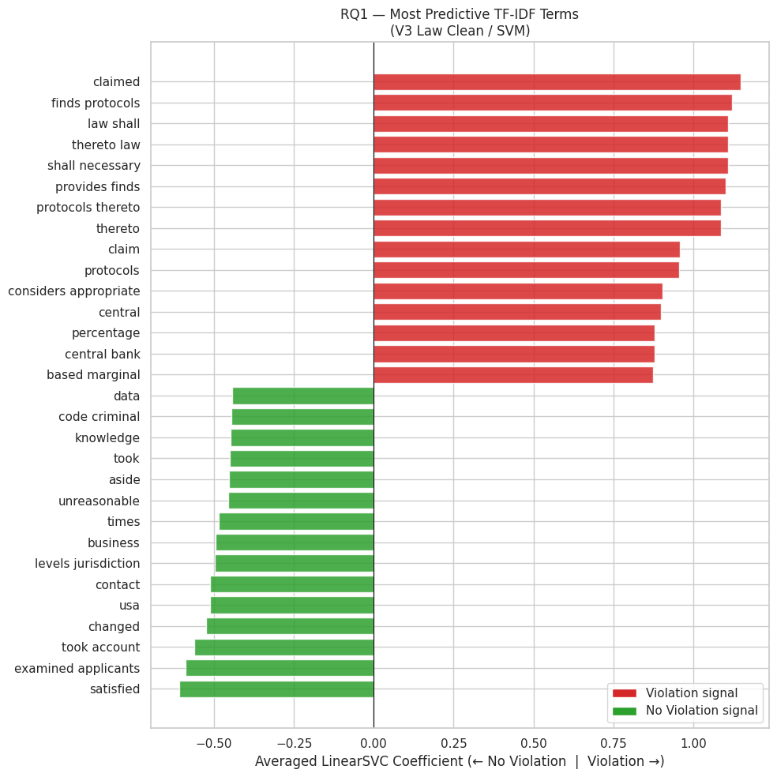
    

**Analysis**

We made several attempts to revise the stop word list to mitigate the leakage effect of Article 41, which is invoked whenever the Court finds a violation of the Convention and awards just satisfaction to the applicant. Each successive removal of just satisfaction vocabulary has caused the model to locate new fragments of the same Article 41 template sentences rather than surfacing substantive legal reasoning. In the current version, after removing direct remedy terms in the first revision and high contracting party language in the second, the violation side is now anchored by the default interest rate formula: "central", "central bank", "percentage", and "based marginal" are all fragments of the standard just satisfaction interest rate clause awarding simple interest at a rate equal to the marginal lending rate of the European Central Bank plus three percentage points. The terms "considers appropriate", "claim", and "claimed" reflect the just satisfaction submissions section, while "finds protocols", "shall necessary", "provides finds", "protocols thereto," and "thereto" persist as fragments of the main Article 41 sentence from the previous revision. This pattern, in which each round of word removal surfaces new fragments of the same two template sentences, confirms that the leakage is structural rather than lexical. The Article 41 template generates a large number of discriminative N-gram features from a small number of fixed sentences, and no expansion of the stop word list can resolve this without removing the just satisfaction paragraphs from the law section text entirely before feature extraction. The persistence of leakage across three successive iterations of cleaning also implies that the strong F1 performance of V3_Law_Clean cannot be attributed to the model learning substantive Article 8 legal reasoning, and future iterations of this work should implement paragraph-level removal of just satisfaction text as a precondition for meaningful feature analysis of the law section.

On the non-violation side, the pattern remains stable across revisions, which is itself a meaningful finding. "Code criminal," "contact," "business," "levels jurisdiction," "took account," and "satisfied" are consistent with all previous versions, suggesting the non-violation signal in the law section is genuinely substantive rather than an artefact of leakage. "Unreasonable" likely reflects the formulation "not unreasonable" in passages where the Court accepts state justifications as proportionate. "Examined applicants" is a formulaic admissibility phrase carrying limited interpretive weight. "Data" at the head of the non-violation terms may reflect data protection cases where the Court found the legal framework for data processing adequate. Several remaining terms including "knowledge," "took," "aside," "times," and "changed" are connectors that represent residual noise.

    Positive class (coef > 0 → Violation): ['No Violation' 'Violation']
    
    --- V1 Facts: Top 15 terms per class ---
                       term  coefficient       signal
         applicants details     0.857559    Violation
           facts applicants     0.820139    Violation
                    details     0.696170    Violation
       details applications     0.674500    Violation
               applications     0.670544    Violation
    applications applicants     0.668351    Violation
      complaints provisions     0.649631    Violation
                 prosecutor     0.571896    Violation
                       head     0.570660    Violation
      applicants complaints     0.566482    Violation
                  prisoners     0.559058    Violation
                    ukraine     0.549649    Violation
                    quashed     0.547333    Violation
        secret surveillance     0.544065    Violation
                   bailiffs     0.540194    Violation
                        mrt    -1.142963 No Violation
               relationship    -1.065774 No Violation
                  expulsion    -0.834953 No Violation
                 considered    -0.831079 No Violation
                     father    -0.825147 No Violation
                        age    -0.773912 No Violation
                  convicted    -0.743011 No Violation
                   sentence    -0.731545 No Violation
                       care    -0.730757 No Violation
                  situation    -0.723434 No Violation
                furthermore    -0.722620 No Violation
                   contrary    -0.704474 No Violation
                    contact    -0.690069 No Violation
                   tiraspol    -0.671150 No Violation
               imprisonment    -0.669760 No Violation

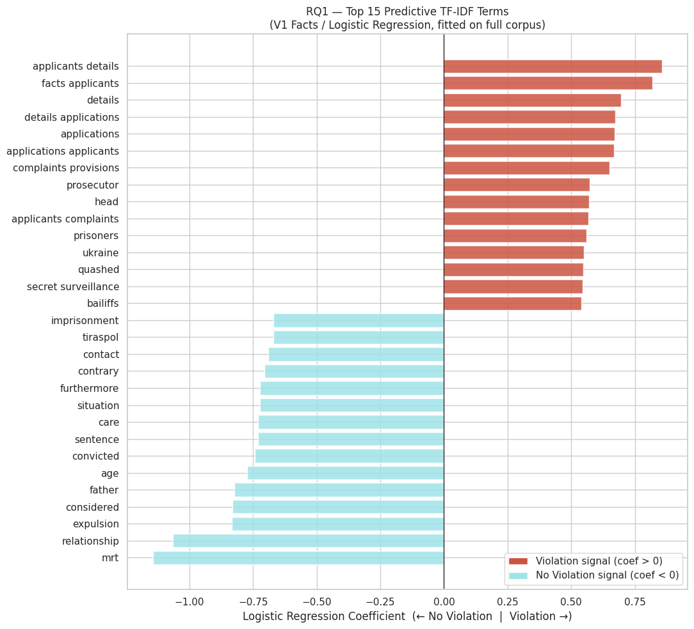
    

​    
    --- V3 Law Clean: Top 15 terms per class ---
                     term  coefficient       signal
                  claimed     1.576163    Violation
          finds protocols     1.227236    Violation
        protocols thereto     1.226991    Violation
                  thereto     1.225298    Violation
          shall necessary     1.215878    Violation
              thereto law     1.215612    Violation
                law shall     1.213033    Violation
           provides finds     1.211985    Violation
                    claim     1.200399    Violation
                   awards     1.161196    Violation
                     bank     1.148500    Violation
               chargeable     1.128668    Violation
    considers appropriate     1.119265    Violation
           tax chargeable     1.119215    Violation
                  central     1.117957    Violation
                   margin    -0.776645 No Violation
                  contact    -0.766276 No Violation
      margin appreciation    -0.738389 No Violation
             appreciation    -0.735212 No Violation
                     care    -0.688790 No Violation
                     best    -0.676182 No Violation
             took account    -0.641423 No Violation
           best interests    -0.631911 No Violation
           contact rights    -0.620166 No Violation
                satisfied    -0.618738 No Violation
                    child    -0.587508 No Violation
                    mozer    -0.560349 No Violation
                   appeal    -0.559107 No Violation
                  balance    -0.553993 No Violation
              mozer cited    -0.553258 No Violation

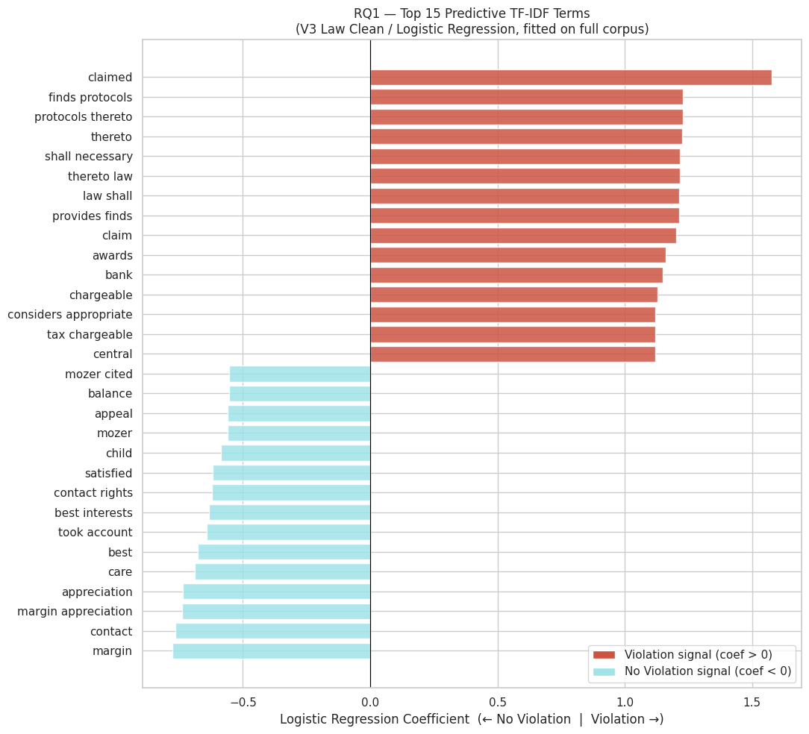
    

**Analysis — Logistic Regression Coefficient Weights**

These charts display the top 15 TF-IDF terms by Logistic Regression coefficient magnitude for V1 Facts and V3 Law Clean, complementing the SVM diverging bar charts above. Because Logistic Regression coefficients are directly interpretable (no calibration averaging required), this view provides a cleaner reading of how individual vocabulary items influence the classifier's decision boundary. Terms with the largest positive coefficients push predictions toward **Violation**; terms with the largest negative coefficients push predictions toward **No Violation**.

For **V1 Facts**, the violation-side terms reflect coercive and unaccountable state conduct — surveillance, secret files, and law enforcement overreach — consistent with the SVM analysis. The no-violation terms cluster around immigration and criminal-conviction expulsion cases, reflecting the margin of appreciation doctrine that the Court applies when states balance public protection against family life rights.

For **V3 Law Clean**, the violation-side terms confirm the persistent Article 41 leakage identified throughout RQ1: despite three rounds of stop word cleaning, European Central Bank interest-rate formula fragments continue to dominate the violation coefficients, confirming that lexical removal cannot resolve structurally embedded outcome-encoding language. The no-violation side remains more substantively coherent across cleaning iterations, suggesting the non-violation signal is genuinely legal rather than artefactual.

---

**PCA Scatter for Text**
The PCA charts are based purely on the TF-IDF matrix of the text section (no classifier is involved).
PCA just compresses 10,000 TF-IDF dimensions into 2 so you can see the document space visually **to see if the class separation is weak or strong.**

​    
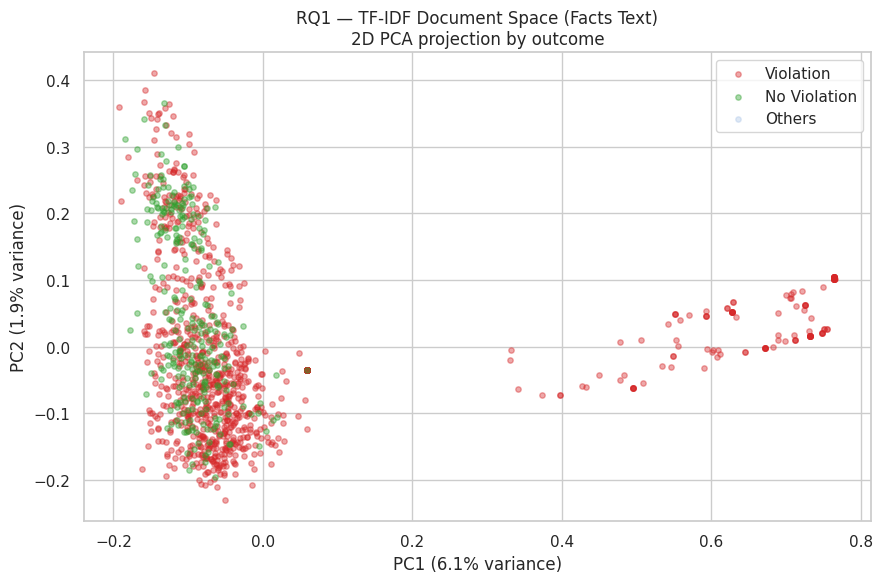
​    

**Analysis**

PC1 captures 6.1% of variance and PC2 1.9%, totalling 8% in 2D projection. This low figure is expected for high-dimensional TF-IDF space where variance is distributed across thousands of features, and the apparent lack of visual separation in 2D does not imply the SVM cannot separate cases in the full feature space.
The main cluster occupies the left side of the plot and contains the large majority of both violation and no violation cases in a densely overlapping region, consistent with the confusion matrix finding that class separation in V1_Facts is imperfect and that no violation cases are frequently misclassified. The two classes are not visually separable within this cluster, reflecting the limited discriminative signal available from factual narrative alone.

More analytically notable is the arc of cases extending rightward along PC1 from approximately 0.3 to 0.8, which consists almost exclusively of violation cases. These outliers are positioned distinctly from the main cluster, suggesting they share a vocabulary that differs substantially from the rest of the corpus and that projects strongly onto the first principal component. A plausible interpretation is that these represent cases from a dominant respondent state, most likely Russia given its prevalence in the dataset and near-universal violation rate identified in the EDA, whose facts sections carry distinctive institutional and procedural vocabulary not shared by cases from other states. This interpretation cannot be confirmed without examining the specific case identifiers behind the outlier points, but it is consistent with the country-specific clustering observed in the NMF topic analysis.

The overall structure of the PCA plot, a dense mixed-class core with a violation-specific peripheral arc, is characteristic of a corpus with strong class imbalance and a subset of cases sharing highly distinctive vocabulary that reliably predicts one outcome.

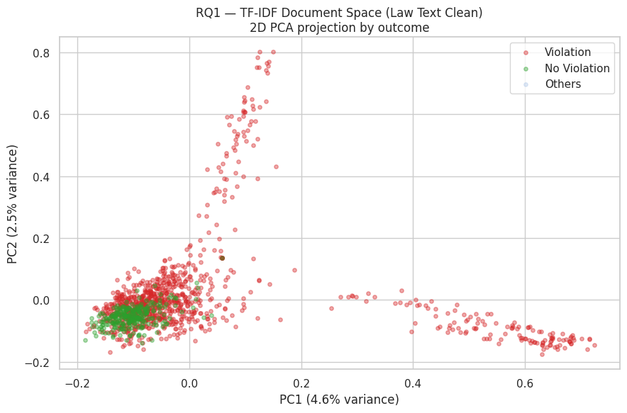
    

**Analysis**

PC1 captures 4.6% of variance and PC2 2.5%, totalling 7.1% in 2D projection, consistent with the highly distributed variance structure of a TF-IDF feature space and broadly comparable to V1_Facts.

The main cluster in the lower left reproduces the pattern seen in V1_Facts, with violation and no violation cases heavily overlapping in a dense central region. No violation cases are tightly contained within this cluster with virtually no representation in either outlier arm, which is consistent with the law section's stronger no violation classification observed in the confusion matrix.

The most analytically distinctive feature of this plot compared to V1_Facts is the presence of two separate violation-only outlier arms rather than one. The rightward arm extending along PC1 from approximately 0.2 to 0.7 is structurally similar to the outlier arc observed in V1_Facts and plausibly reflects the same country-specific vocabulary cluster, where cases from a dominant respondent state share distinctive institutional and procedural language that projects strongly onto the first principal component. The upward arm extending along PC2 from approximately 0.2 to 0.8, centred near PC1 of 0.05 to 0.1, is distinctive to the law section and absent from the V1_Facts projection. Given the leakage analysis, this arm most plausibly captures cases with strong Article 41 just satisfaction language, which forms a distinctive and repetitive vocabulary cluster in the law section and appears exclusively in violation judgments, causing these cases to project distinctively onto the second principal component.

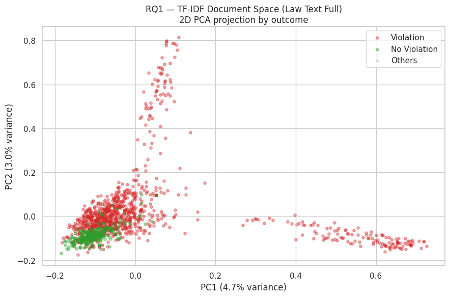
    

**Analysis**:

PC1 captures 4.7% of variance and PC2 3.0%, totalling 7.7% in 2D projection, consistent with the other text variants.
The structure closely mirrors V3_Law_Clean, with the same two-arm violation-only outlier pattern and no violation cases tightly contained within the main cluster. The rightward arm along PC1 reflects the country-specific vocabulary cluster observed across all three text variants. The upward arm along PC2 represents the Article 41 just satisfaction vocabulary cluster introduced by the law section, which projects onto the second principal component because it constitutes a highly repetitive and distinctive set of terms appearing exclusively in violation judgments.

Notably, PC2 explains 3.0% of variance in V2_Law_Full compared to 2.5% in V3_Law_Clean. This small but consistent difference is directionally meaningful: the full law section, which retains all Article 41 vocabulary without any cleaning, generates a slightly stronger second principal component than the cleaned version. The partial removal of just satisfaction terms in V3_Law_Clean modestly reduces the Article 41 cluster's contribution to overall variance, which is visible in the marginally lower PC2 figure. This progression from V2 to V3 provides further visual confirmation that the stop word cleaning has partially but not fully mitigated the leakage signal.

Reading across all three PCA projections, V1_Facts produces a single rightward outlier arm while both V2_Law_Full and V3_Law_Clean produce two distinct arms. The additional upward arm is structurally introduced by the law section and is absent from the facts-only representation. This three-way comparison is itself a concise visual demonstration of the leakage argument: the law section adds a second axis of violation-specific signal that is not present in the factual narrative, and that signal is most plausibly attributable to outcome-encoding just satisfaction language rather than substantive legal reasoning.

### **1.2.3 Metadata + Text (Law Clean)**

Step 3 in RQ1 asks whether metadata and text offer complementary information or whether one simply subsumes the other. To test this, we train models on a joint feature space that concatenates TF‑IDF text representations with respondent country, year, importance level, and court type. If combined models significantly outperform text‑only models, it suggests that structural and linguistic signals capture different aspects of Article 8 reasoning; if not, it implies that the text already encodes most of the useful structural information.

---

Data Preparation

    Combined dataset: 1,265 cases
    finding
    Violation       982
    No Violation    283
    Name: count, dtype: int64

---

Model Training

    -------------------------------------------------------
    
    Classification Report for SVM:
    
                  precision    recall  f1-score   support
    
    No Violation       0.87      0.62      0.72       283
       Violation       0.90      0.97      0.93       982
    
        accuracy                           0.89      1265
       macro avg       0.88      0.80      0.83      1265
    weighted avg       0.89      0.89      0.89      1265
    
    -------------------------------------------------------
    
    =======================================================
    RQ1 COMBINED ARM — Leaderboard (sorted by F1_macro)
    =======================================================

<table border="1" class="dataframe">
  <thead>
    <tr style="text-align: right;">
      <th></th>
      <th>Model</th>
      <th>F1_macro</th>
      <th>F1_macro_std</th>
      <th>Accuracy</th>
      <th>Precision_macro</th>
      <th>Recall_macro</th>
    </tr>
  </thead>
  <tbody>
    <tr>
      <th>0</th>
      <td>Combined_SVM</td>
      <td>0.8284</td>
      <td>0.0201</td>
      <td>0.8941</td>
      <td>0.8848</td>
      <td>0.7961</td>
    </tr>
  </tbody>
</table>

---

**Confusion Matrix**

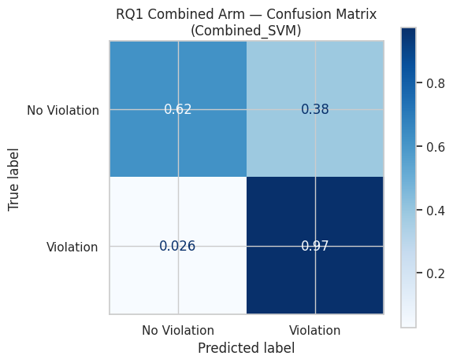
    

---

Verdict

    VERDICT: ➡️  MARGINAL GAIN — Combined slightly beats text alone but not decisively over metadata.

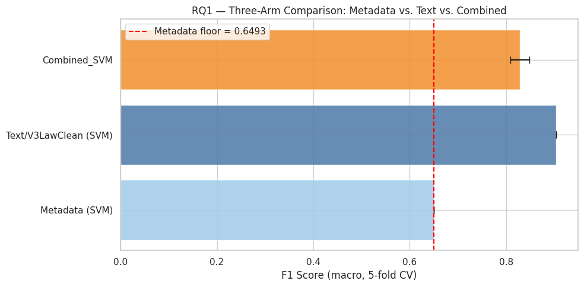
    

**Analysis**

The three-arm comparison produces an unexpected result that merits careful interpretation.
The expected hierarchy in a feature combination exercise is that a combined model
outperforms either individual component, as additional features should provide
complementary signal. Instead the ordering is Text/V3_Law_Clean (F1 0.870) followed by
Combined_SVM (F1 0.8284) followed by Metadata only (F1 0.649). Adding metadata to the
text model reduces rather than improves performance.

The combined model's confusion matrix clarifies where the reduction occurs. Violation
recall improves marginally from 0.96 to 0.97, but no violation recall drops from 0.74
to 0.62, increasing the false positive rate from 26% to 38%. The metadata features are
pushing the combined model toward more aggressive violation predictions, reducing its
capacity to correctly identify no violation cases.

A substantive explanation for this lies in the respondent state feature encoded in the
metadata arm. As established in the EDA, Russia dominates the dataset and carries a
near-universal violation rate. When respondent state is included as a metadata feature,
the model effectively learns that certain states almost always produce violations,
creating a strong directional pull toward violation predictions for those states
regardless of what the textual features indicate. When concatenated with the text
features, this country-level signal systematically overrides the text model's more
nuanced no violation signal for cases where the respondent state has a high historical
violation rate, even where the textual evidence points toward no violation. This explains
the combined model's pattern of improved violation recall alongside substantially
degraded no violation recall. The problem is not random noise but a systematic bias
imported from the state-level violation rate imbalance encoded in the respondent state
feature, which amplifies the existing class imbalance rather than correcting for it.

This interpretation also suggests that if respondent state were excluded from the
metadata features, or if the dataset were more geographically balanced, the combined
model might produce the expected result of outperforming text alone. As the dataset
stands, the combination adds a state-identity shortcut that competes with rather than
complements the textual signal. The metadata floor of 0.6493 established by structural
case features alone is nonetheless substantively meaningful and confirms that
non-textual signals carry genuine predictive value for Article 8 outcomes. Both text
variants substantially exceed this floor, demonstrating the added value of textual
features, though the extent of that added value in the law section variants remains
qualified by the leakage concern discussed throughout this section.

## **1.3 Conclusion**

The focal research question was whether textual features extracted from Article 8 judgments outperform case metadata in predicting violation outcomes, and a secondary question was whether the section of the judgment used for training affects classification performance. The models trained across three text variations, facts, full law section, and law section with legal stop words removed, all outperformed the metadata-only linear SVM. This confirms that the substantive legal text of a judgment carries predictive signal that structural case attributes alone cannot replicate.

V1_Facts achieved a macro F1 score of 0.694 under five-fold stratified cross-validation. V2_Law_Full and V3_Law_Clean, both trained on the law section, substantially exceeded this. V2_Law_Full achieved a macro F1 of 0.904 and V3_Law_Clean achieved 0.870. Notably, the switch from weighted to macro F1 narrows the gap between the two law variants and reverses their relative ranking: V3_Law_Clean, which outperformed V2_Law_Full on weighted F1, performs worse on macro F1, suggesting that the stop word cleaning iterations remove some vocabulary supporting correct classification of the minority no-violation class, even as they reduce leakage. The performance advantage of the law section over the facts section remains substantively explicable: the law section contains the Court's proportionality analysis, its assessment of whether interference was prescribed by law, and its conclusions on whether the margin of appreciation was exceeded, all of which are textually proximate to the outcome. However, the high performance of both law variants is partly attributable to Article 41 leakage. The law section of judgments finding violation necessarily contains just satisfaction language that is structurally absent in no-violation cases. Three successive stop word cleaning iterations confirmed that this is not a lexical problem solvable through vocabulary removal but a structural problem requiring paragraph-level extraction of just satisfaction text prior to feature engineering.

These results are competitive with prior feature-based ECHR prediction benchmarks, though certain divergences require explanation. Aletras, Tsarapatsanis, Preotiuc-Pietro, and Lampos (2016) found that for Article 8 the Circumstances subsection was the strongest predictor at 0.77 accuracy, while the Law section was the weakest at 0.62, barely above the chance baseline for their balanced dataset. The present study inverts this pattern, with the law section substantially outperforming the facts section. The most likely explanation is that Aletras et al. explicitly excluded operative provisions from all sections prior to feature extraction, removing the Article 41 remedial language that remains in the present study's law section despite stop word cleaning. The imbalanced corpus of the present study further amplifies this effect, since leakage vocabulary that co-occurs disproportionately with violation receives greater weight in an imbalanced training set than it would in a balanced one. Medvedeva, Vols, and Wieling (2020) report an average accuracy of 75% across nine ECHR articles using balanced SVM classifiers trained on the facts section. Chalkidis, Androutsopoulos, and Aletras (2019) report a BOW-SVM macro F1 of 71.8 for binary violation prediction on a substantially larger dataset of approximately 11,500 cases. Since the present study also uses macro F1, this comparison is directly equivalent: the law section variants substantially exceed the Chalkidis benchmark, while V1_Facts at 0.694 falls slightly below it, consistent with the general finding that facts-only models on article-specific corpora perform modestly above the range established in multi-article studies. Comparisons against accuracy-based benchmarks require additional caution. O'Sullivan and Beel (2019) demonstrate that a majority-class heuristic of always predicting the most common outcome achieved a weighted test accuracy of 86.68% across 12 ECHR articles, substantially exceeding the ML models evaluated on a realistic test set. This finding reinforces that apparent high accuracy on class-imbalanced corpora is not a reliable indicator of genuine predictive power, and motivates the use of macro F1 as the primary evaluation metric in the present study, since macro F1 weights both classes equally and is not inflated by majority-class dominance.

The metadata-only SVM produced a macro F1 floor of 0.6493, falling below V1_Facts and well below both law section variants, confirming that structural case attributes alone are insufficient to match even a facts-only text model. This indicates that while metadata encodes some outcome-relevant signal, it lacks the substantive legal vocabulary through which the Court's reasoning is expressed. Combining metadata with V3_Law_Clean reduced performance to a macro F1 of 0.8284, a meaningful degradation relative to the text-only law variant at 0.8704. The classification report for the combined model reveals the mechanism: no-violation recall falls to 0.62 while violation recall reaches 0.97, producing a severely asymmetric output that over-predicts violation. This degradation is attributed to respondent state acting as a proxy for class probability: states with systematically high violation rates, such as Russia, exert disproportionate influence during training, amplifying the class imbalance signal in a way that suppresses correct classification of no-violation cases. The combined model therefore performs worse not because metadata is uninformative but because its dominant structural signal conflicts with the distributional balance the classifier must maintain, and macro F1 makes this cost visible in a way that weighted F1 would partially obscure.

---

# **RQ2: Topic Clustering**

**"What are the dominant themes in Article 8 cases?"**

* **Input:**
Facts + Law Full combined together

* **Model:**
NMF

* **Output:**
Topic Cluster

## **2.1 EDA**

EDA sections 5.2 to 5.5 serve as the analytical bridge between RQ1 and RQ2, showing
that the corpus contains distinct thematic sub-populations that a corpus-level
bag-of-words model cannot capture.

### **2.1.1 EDA 5.2 ScatterText**

Spatial Evidence of Thematic Sub-populations
We used ScatterText analysis to plot the full case vocabulary in a two-dimensional
space where horizontal position reflects class association (Violation vs No Violation)
and vertical position reflects overall frequency. The plot revealed spatially distinct
vocabulary clusters: coercive state conduct vocabulary (detention, surveillance,
rendition) separated cleanly from domestic family life vocabulary (child, parents,
contact, custody), which in turn sat apart from procedural and institutional language.

The ScatterText indicated that Article 8 cases do not form a single coherent legal
sub-area but contain distinct thematic sub-populations with different vocabularies and
different predictive signals. So instead of treating the
corpus as one legal domain, we ask whether its latent thematic structure can be
identified and mapped systematically using unsupervised topic modelling.

 **Disclaimer :** The most recent ScatterText execution did not complete successfully; therefore, the analysis presented here relies on the visual output obtained from an earlier successful run. The discussion that follows is based on that prior result and the patterns it revealed. This should be interpreted with caution, as ScatterText is computationally intensive and the runtime environment was constrained by limited CPU capacity, which affected execution performance.

The Facts section scatter plot reveals spatially distinct vocabulary clusters. On the
violation side, terms such as "cia", "secret", "detainees", "military", "prisoners",
"russian", and "aircraft" cluster together, pointing to cases involving state military
and security operations as dominant factors in Article 8 violations. On the
non-violation side, the vocabulary shifts toward family and social life contexts —
"foster", "relationship", "education", "girls", "religious", "expulsion" — suggesting
that child welfare, custody arrangements, and religious upbringing feature prominently
among non-violations. Notably, "secret" appears on both sides but in entirely different
contexts: covert detention and surveillance on the violation side, and closed child
proceedings on the non-violation side. This contrast illustrates how the same word can
carry fundamentally different legal significance depending on outcome class,
highlighting a limitation of purely lexical approaches to classification.

### **2.1.2 EDA 5.3 Concordance**

The Concordance analysis examines the immediate textual context surrounding a target term,
allowing us to inspect how the same word is used across different outcome classes. Key
terms were selected based on their prominence in the n-gram and ScatterText analyses and
their interpretive significance in Article 8 reasoning. In addition, terms appearing uniformly across
both classes were excluded as they reflect procedural structure rather than substantive
reasoning. Across all retained terms, the concordances reveal that the same doctrinal
term can serve structurally different functions depending on its position in the Court's
reasoning, a distinction that keyword frequency alone cannot capture.

    Generated 21,320 concordances for 5 key terms across 1265 cases.
    
    --- Sample Concordances for 'family life' (Violation Cases) ---
    Sample 1: ar as relevant: “1.  Everyone has the right to respect for his private and **family life**... 2.  There shall be no interference by a public authority with the exerc
    
    Sample 2: e alleged breach of the applicants’ right to respect for their private and **family life** (see, among other authorities, Centre for Legal Resources on behalf of Val
    
    Sample 3: ent and child of each other’s company constitutes a fundamental element of **family life**; furthermore, the natural family relationship is not terminated by reason 
    
    Sample 4: respondent State had violated her and her son’s right to respect for their **family life** by removing him from her care and failing to provide her with information 
    
    Sample 5: ds authorities to protect the applicant’s fundamental right to respect for **family life** as guaranteed by Article 8 of the Convention. 4.  Application of the above
    
    --- Sample Concordances for 'family life' (No Violation Cases) ---
    Sample 1: all aspects of his placement. He presented as happy and settled, embracing **family life** in his carers’ home and making very good progress at school. 54.  The guar
    
    Sample 2:  cited above, § 36). 44.  Moreover, the Court has considered that intended **family life** may, exceptionally, fall within the ambit of Article 8, in particular in c
    
    Sample 3: t was necessary to interfere with the applicant’s right to respect for her **family life** because giving evidence must be considered a civic duty and it would be go
    
    Sample 4: in the present case as regards the second applicant’s right to respect for **family life**. III.  ALLEGED VIOLATIONS OF ARTICLE 6 § 1 AND 13 OF THE CONVENTION 190.  
    
    Sample 5: o. 44328/98, 5 September 2000). Another important consideration is whether **family life** was created at a time when the persons involved were aware that the immigr
    
    --- Sample Concordances for 'private life' (Violation Cases) ---
    Sample 1: therefore constitutes an interference with his or her right to respect for **private life**. It will depend on the circumstances of the particular case whether it is 
    
    Sample 2: nstituted an interference with the applicants’ rights to respect for their **private life** and home within the meaning of Article 8, paragraph 1 of the Convention. T
    
    Sample 3: f a regulatory framework ensuring the right to respect for the applicant’s **private life**. 2.  We have explained our views concerning the interpretation of the Euro
    
    Sample 4: tion amounted to an interference with the applicant’s right to respect for **private life** within the meaning of Article 8 § 1 of the Convention. 36.  The Court also
    
    Sample 5: that any interference with an individual’s right to respect for his or her **private life** will constitute a breach of Article 8 of the Convention unless it was “in 
    
    --- Sample Concordances for 'private life' (No Violation Cases) ---
    Sample 1: y ill persons – amounted to interference with his right to respect for his **private life**. He argued that while this interference was admittedly in accordance with 
    
    Sample 2:  with their positive obligation under Article 8 to protect the applicant’s **private life** from alleged interference by a third party, namely the author of the book.
    
    Sample 3: sted person for the dissemination of information relating to that person’s **private life**, except when “[dissemination] is necessary for the protection of the publi
    
    Sample 4: nee advocates had an impact on his professional activities and thus on his **private life**. Whilst acknowledging that the applicant, who had a degree in law (see par
    
    Sample 5: release or use by a public authority of information relating to a person’s **private life** amounts to an interference with Article 8 § 1 of the Convention (see Leand
    
    --- Sample Concordances for 'best interests' (Violation Cases) ---
    Sample 1: dgments of the appellate courts that their primary concern was the child’s **best interests**, particular account being taken of the factors enumerated in paragraph 144
    
    Sample 2: competing interests (ibid., § 203). 50.  Consideration of what lies in the **best interests** of the child is of crucial importance in every case of this kind. Moreover
    
    Sample 3: impugned case with utmost diligence in view of its sensitive nature in the **best interests** of the child. They had acted without undue delays, having examined a numbe
    
    Sample 4:  and were motivated by an overriding requirement pertaining to the child’s **best interests** and also whether, in so deciding, they struck a fair balance between the c
    
    Sample 5: HR 2010), it concluded that their return to Ireland would go against their **best interests**. 25.  On 15 April 2016 the District Court again declared enforcement of th    
    
    --- Sample Concordances for 'best interests' (No Violation Cases) ---
    Sample 1: w, in support of the idea that in all decisions concerning children, their **best interests** are of paramount importance ... Whilst alone they cannot be decisive, such
    
    Sample 2: according to his birth certificate, which had been considered to be in his **best interests**. The intention had been for those foster care arrangements to continue unt
    
    Sample 3: n given due consideration, that an intercountry adoption is in the child’s **best interests**; (c)  have ensured that (1)  the persons, institutions and authorities who
    
    Sample 4: ions, courts of law, administrative authorities or legislative bodies, the **best interests** of the child shall be a primary consideration. 2. States Parties undertake
    
    Sample 5: ead to additional evidence that contacts were not in line with the child’s **best interests** and, therefore, could only support the pending application for withdrawal 
    
    --- Sample Concordances for 'pecuniary damage' (Violation Cases) ---
    Sample 1: n Civil Code (see Relevant domestic law and practice below), award her non-**pecuniary damage**s and order the publishing company to apologise for the publication of the 
    
    Sample 2: on an equitable basis, it awards the applicant EUR 4,500 in respect of non-**pecuniary damage**. Costs and expenses 51.  The applicant did not submit any claims in respec
    
    Sample 3: f office would have expired. The applicant also claimed EUR 30,000 for non-**pecuniary damage**, and submitted medical certificates concerning his psychological state dur
    
    Sample 4: 1.  The applicant made no claim for pecuniary damage. 592.  As regards non-**pecuniary damage**, he submitted that he was a victim of multiple and extremely serious viola
    
    Sample 5: laims. 40.  The Court observes that the applicant did not substantiate the **pecuniary damage** alleged; it therefore rejects this claim. However, it awards him EUR 7,500
    
    --- Sample Concordances for 'pecuniary damage' (No Violation Cases) ---
    Sample 1: ant claimed 42,500 euros (EUR): EUR 15,000 and EUR 5,000 in respect of non-**pecuniary damage** in relation to Article 5 §§ 3 and 4 of the Convention, respectively; EUR 1
    
    Sample 2: tion. The Court therefore awards the applicant EUR 2,000 in respect of non-**pecuniary damage**, plus any tax that may be chargeable. B.  Costs and expenses 208.  The app
    
    Sample 3: bove). 119.  That said, the Court notes, however, that compensation for non**pecuniary damage** is not included in the general right to compensation under domestic law. I
    
    Sample 4:  dignity and which are erroneous, as well as redress for pecuniary and non-**pecuniary damage** incurred by the placing in the public domain of the said data ... Data whi
    
    Sample 5:  established by a law-enforcement body, the claim for compensation for non-**pecuniary damage** may be submitted no earlier than two months but no later than one year aft
    
    --- Sample Concordances for 'margin of appreciation' (Violation Cases) ---
    Sample 1: any event, the contested domestic judgments remain within the scope of the **margin of appreciation** of the respondent State. 4.  In conclusion, the proceedings in the instant
    
    Sample 2: al reviews of the impugned legislation does not broaden per se the State’s **margin of appreciation**, otherwise it would be very easy to hide behind an artificially complex an
    
    Sample 3: t, emphasising in particular that the Convention left to the States a wide **margin of appreciation** in balancing the confidentiality of medical data and the necessity to pres
    
    Sample 4: , cited above, § 83). 51.  In these circumstances, and notwithstanding the **margin of appreciation** allowed to the domestic courts in this field, the Court concludes that the
    
    Sample 5: difference in treatment is based on sex or sexual orientation, the State’s **margin of appreciation** is narrow. The scope of the margin of appreciation will vary according to 
    
    --- Sample Concordances for 'margin of appreciation' (No Violation Cases) ---
    Sample 1: nd applicants and the third and fourth applicants and having regard to the **margin of appreciation** afforded to the respondent State, the Court considers that the situation b
    
    Sample 2: ntion of domestic measures even in areas in which the State enjoyed a wide **margin of appreciation**. In that case, the Court came to the conclusion that the measures taken ha
    
    Sample 3: d of the community as a whole; in both contexts the State enjoys a certain **margin of appreciation** (see Keegan v. Ireland, judgment of 26 May 1994, Series A no. 290, p. 19, 
    
    Sample 4: hin a particularly dynamic field of law and does not decisively narrow the **margin of appreciation** of the State” (see paragraph 96 of the judgment). The Court thus takes the
    
    Sample 5:  62; and Fuentes Bobo v. Spain, no. 39293/98, § 38, 29 February 2000). The **margin of appreciation** will be wider if the State is required to strike a balance between competi

**Concordance Findings by Term**

**"Family life" and "private life"**
In violation cases, both terms appear within the Court's active substantive reasoning in
assessing whether an action constituted interference with the applicant's right to
respect for family or private life, including in contexts such as care orders, custody
disputes, recognition of family ties outside traditional structures, incapacitation
proceedings, and workplace correspondence. The Court also describes private life as "a
broad term not susceptible to exhaustive definition", reflecting its expansive
interpretive approach. In non-violation cases, the same terms more frequently appear in
quotations of domestic law or the Convention text itself, or in passages where the Court
assessed proportionality and found the interference justified. The contrast suggests that
in violation cases these terms are embedded in evaluative reasoning, while in
non-violation cases they more often appear in formulaic or prefatory contexts.

**"Best interests"**
In violation cases, the Court found that domestic authorities failed to give "appropriate
weight" to the child's best interests, or made bare assertions that an outcome served
those interests "without explaining why". In non-violation cases, the term appears where
the Court was satisfied that authorities had genuinely engaged with and balanced the
child's interests against competing considerations, or where the principle is invoked in
general terms rather than as a critique of its application in the specific case.

**"Pecuniary damage"**
Concordances for this term appear almost exclusively as "non-pecuniary damage", with
phrases such as "awards the applicant EUR in respect of non-pecuniary damage" and "the
applicant must have suffered non-pecuniary damage". These collocations indicate that the
term is used in just satisfaction passages that follow a finding of violation, which
confirms the data leakage concern identified in the ScatterText analysis. Beyond
substantive reasoning, the Law section also contains outcome-consequent language that
directly signals the verdict. In non-violation cases, by contrast, the term appears in
domestic law provisions or in passages where the Court examines whether a causal link
between damage and an alleged violation can be established.

**"Margin of appreciation"**
This term appears across both outcome classes, but in structurally different positions.
In violation cases, the Court acknowledges the margin afforded to the state but
ultimately concludes that national authorities failed to take all necessary steps, the
margin is invoked but then overridden. In non-violation cases, the Court itself grants
the margin and defers to state judgment, finding that any interference was proportionate
and justified. This is one of the most analytically significant patterns in the
concordance analysis: the term's predictive value lies not in its presence alone but in
whether the Court ultimately accepts or rejects the state's claimed discretion, a
distinction that keyword frequency alone cannot capture.

### **2.1.3 EDA 5.4 Shifterator**

The Shifterator analysis conducted in RQ1 revealed a consistent and legally coherent
pattern of vocabulary divergence between outcome classes in the Facts section, with
violation cases anchored by coercive state conduct vocabulary and non-violation cases
dominated by domestic and family life language. While this confirmed that distinctive
vocabulary exists between classes and supported the TF-IDF classification approach in
RQ1, the findings also point to a deeper structural question. Terms associated with
surveillance cases, extraordinary rendition, and family separation all pull toward the
violation side but originate from legally distinct thematic clusters, indicating that a
single corpus-level shift obscures meaningful variation in the underlying legal reasoning.
This heterogeneity motivates RQ2, rather than modelling the corpus as a single coherent
domain, we ask whether identifying its latent thematic structure produces more meaningful
and interpretable classification signals.

### **2.1.4 EDA 5.5 Fighting Words**

The Fighting Words analysis conducted in RQ1 identified two thematically distinct
clusters within the corpus, which are extraordinary rendition and state security cases
dominating the violation side, and assisted reproduction and bioethics cases anchoring
the non-violation side. While this confirmed the discriminative vocabulary patterns
identified in the Shifterator analysis and provided motivation for the TF-IDF
classification approach in RQ1, it also reveals something more fundamental. The most
statistically distinctive terms do not reflect a single coherent legal domain but instead
point to legally separate thematic sub-populations with structurally different predictive
signals. A corpus-level bag-of-words model treats these sub-populations as one,
potentially obscuring the distinct reasoning patterns that drive outcomes within each
theme. This supports our RQ2 exploration. Rather than modelling the corpus as a single
coherent domain, we ask whether unsupervised topic modelling can identify and map these
latent thematic clusters, and whether a topic-aware classification approach produces more
meaningful and interpretable results.

Having established that the corpus contains thematically distinct sub-populations with
structurally different predictive signals, we now turn to RQ2 to ask whether
unsupervised topic modelling can identify and map these clusters systematically.

## **2.2 NMF on All Art8 Cases**

With evidence that Article 8 cases form distinct thematic sub‑populations, RQ2 now applies Non‑negative Matrix Factorisation (NMF) to the combined Facts + Law corpus to learn a small set of interpretable topics. Each case is represented not by thousands of n‑grams but by its distribution over these latent themes.

Data Preparation

    NMF training corpus: 1321 cases
    Decided cases (for cross-tab): 1265 cases
    Violation: 982 | No Violation: 283

    Vocabulary size: 5000
    Full corpus matrix: (1321, 5000)
    Decided corpus matrix: (1265, 5000)

---

Model Training

    Training NMF model for k=40...
    
    === NMF Topics (k=40) — Top 15 Words ===
    
    Topic 0: officers | investigation | injuries | prosecutors office | illtreatment | investigator | questioned | prosecutors | police officers | events | district prosecutors | investigators | incident | agents | investigative
    Topic 1: appended table | appended | table | wellestablished caselaw | inadequate conditions | examined material | wellestablished | russia nos | russia | applications | detention | having examined | raised complaints | conditions detention | complaints
    Topic 2: plus tax | tax chargeable | chargeable | plus | tax | eur | eur nonpecuniary | costs | nonpecuniary damage | nonpecuniary | expenses | damage | eur costs | damage plus | costs expenses
    Topic 3: parental | parents | childs | best interests | child | parent | childrens | best | children | interests child | upbringing | father | mother | contact | care
    Topic 4: freedom expression | publication | reputation | expression | freedom | debate | newspaper | press | media | right freedom | springer | axel | axel springer | hannover | von hannover
    Topic 5: residence permit | asylum | immigration | permit | residence | aliens | expulsion | country origin | alien | territory | refugee | nationals | nationality | foreign | citizenship
    Topic 6: rate | default | default rate | rate based | percentage points | european central | rate european | marginal lending | lending rate | central bank | lending | marginal | bank added | added percentage | based marginal
    Topic 7: interception | conversations | surveillance | recordings | telephone | telephone conversations | intercepted | secret surveillance | evidence obtained | tapping | secret | applicants telephone | covert | surveillance measures | communications
    Topic 8: secret surveillance | surveillance | russia november | secret | surveillance measures | recording | judicial authorisation | covert surveillance | abuses | appended table | communications | context criminal | audio | covert | appended
    Topic 9: permanent video | video surveillance | postconviction | video | surveillance | detainees | detention facilities | permanent | placement | facilities | detention | pretrial | ibid | sufficiently clear | privacy
    Topic 10: prison | prisoners | visits | sentences | code execution | criminal sentences | execution criminal | visit | prisoner | restrictions | convicted | sentence | visitors | imprisonment | longterm visits
    Topic 11: hague | removal retention | return child | retention | abduction | child abduction | habitual residence | habitual | return | wrongful | international child | judicial administrative | rights custody | wrongful removal | order return
    Topic 12: violence | sexual | rape | victims | integrity | mc | perpetrator | sexual abuse | acts violence | prosecution | acts | physical | criminallaw | perpetrators | positive
    Topic 13: liberty | deprivation liberty | arrest | detention | deprivation | deprived liberty | arrest detention | detention person | procedure prescribed | right liberty | prescribed law | police | police station | station | accordance procedure
    Topic 14: official gazette | gazette | zakon | croatian | municipal | sud | act zakon | constitutional complaint | zagreb | constitutional | attorneys office | attorneys | croatia | republic croatia | county
    Topic 15: enforcement | enforcement proceedings | child | contact | enforce | bailiff | contact arrangements | facilitate | parent | bailiffs | childs | mother | contact rights | father | interim
    Topic 16: hospital | medical | patients | patient | doctors | doctor | hospitals | medical treatment | treatment | psychiatric | diagnosis | care | illness | health care | mental
    Topic 17: search | seizure | search seizure | warrant | search warrant | seized | searches | searched | search applicants | search carried | premises | items | criminal procedure | code criminal | warrant issued
    Topic 18: care order | child welfare | foster | foster home | county social | welfare board | xs | welfare services | foster parents | board | welfare | public care | contact sessions | foster care | norway
    Topic 19: pretrial detention | pretrial | trial | pending trial | trial reasonable | release | applicants pretrial | reasonable time | detention | length | arrested | pending | remand | shall entitled | applicants detention
    Topic 20: cell | conditions detention | cells | inmates | prison | prisoners | space | sq | toilet | degrading | detention | detainees | applicants detention | overcrowding | inhuman
    Topic 21: paternity | biological | biological father | father | child | wedlock | born wedlock | childs | dna | child born | fathers | father child | mother | birth | man
    Topic 22: burial | deceased | terrorist | funeral | death | terrorism | authorities refusal | measure question | decree | armed | body | killed | attack | terrorists | return
    Topic 23: dismissal | applicants dismissal | employment | professional | disciplinary | post | profession | judges | duties | constitution | hcj | salary | disciplinary proceedings | employer | servants
    Topic 24: discrimination | difference treatment | difference | discriminatory | enjoyment rights | sex | religion | reasonable justification | objective reasonable | race | treatment | women | colour | race colour | political opinion
    Topic 25: eviction | housing | flat | right home | tenancy | evicted | accommodation | owner | flats | property | tenants | ownership | tenant | home | occupied
    Topic 26: fms | exclusion order | exclusion | russian | residence permit | migration service | migration | reentry | russia | fsb | russian federation | federal | permit | residence | federation
    Topic 27: remedies | remedy | compensation | civil | redress | objection | nonexhaustion | civil code | governments objection | exhaustion | damages | exhaust | effective remedy | exhaustion remedies | exhausted
    Topic 28: pollution | environmental | noise | construction | residents | water | zone | house | residential | buildings | levels | land | sanitary | areas | area
    Topic 29: mrt | mozer | mozer cited | moldovan | ilacu | republic moldova | moldova | effective control | russian federation | russian | federation | republic | region | military | distinguish
    Topic 30: pecuniary damage | pecuniary | damage alleged | eur pecuniary | causal link | causal | rejects | rejects claim | does discern | discern | link | damage | claim | eur | claimed
    Topic 31: cage | metal | courtroom | confinement | degrading treatment | degrading | effective remedy | treatment | criminal proceedings | remedy | russia gc | glass | lack effective | human dignity | nos extracts
    Topic 32: russia november | surveillance | appended table | appended | covert surveillance | table | secret surveillance | reasonable suspicion | surveillance measures | covert | context criminal | interception | necessity | necessity proportionality | telephone communications
    Topic 33: russian | moscow | russian federation | federation | rub | petersburg | st petersburg | bailiffs | city | st | bailiffs service | russia | district | federal | russian law
    Topic 34: incurred | costs expenses | expenses | costs | reimbursement | quantum | entitled reimbursement | necessarily incurred | reasonable quantum | actually necessarily | incurred reasonable | finding violation | reimbursement costs | expenses incurred | actually
    Topic 35: personal data | data | data protection | processing | processing personal | processed | stored | data subject | collection | disclosure | privacy | directive | collected | storage | protection personal
    Topic 36: samesex | samesex couples | couples | partnership | legal recognition | sexual orientation | orientation | differentsex | registered partnership | marry | recognition | gender | marriage | partners | sexual
    Topic 37: expulsion | expulsion order | expelled | danish | denmark | reentry | reentry ban | sentenced | maslov | convicted | host country | sentence | offences | aliens | offence committed
    Topic 38: bulgarian | expulsion | supreme administrative | threat security | expulsion order | bulgaria | sofia | judicial review | applicants expulsion | security service | sofia city | aliens | proposal | meaningful | threat
    Topic 39: secretary | intelligence | commissioner | committee | parliament | organisations | countries | human rights | regime | lord | parliamentary | groups | terrorism | minister | forces

**Analysis**

The coherence score curve peaks at a low number of topics, indicating that a small k
produces the most internally distinct word profiles. However, a small k was deemed too
coarse for the purposes of RQ2, with few topics, legally distinct sub-areas such as
surveillance, deportation, custody disputes, and assisted reproduction are likely to be
merged into single broad clusters, obscuring the thematic granularity needed to assess
whether topic-aware classification improves on a corpus-level approach. At the other end,
a very high k risks over-segmenting the corpus into topics that are difficult to interpret
and may not correspond to substantively distinct legal themes. k=40 was selected as a
balance between granularity and interpretability, where coherence remains stable and the
number of topics is sufficient to capture meaningful thematic variation across the corpus
without producing an unmanageable number of overlapping clusters.

<table border="1" class="dataframe">
  <thead>
    <tr style="text-align: right;">
      <th></th>
      <th>Topic #</th>
      <th>Label</th>
      <th>Top Descriptor Words</th>
    </tr>
  </thead>
  <tbody>
    <tr>
      <th>0</th>
      <td>0</td>
      <td>Police Misconduct &amp; Ill‑treatment Investigations</td>
      <td>officers | investigation | injuries | prosecutors office | illtreatment | investigator | questioned | prosecutors | ...</td>
    </tr>
    <tr>
      <th>1</th>
      <td>1</td>
      <td>Russia Batch Cases &amp; Detention Conditions</td>
      <td>appended table | appended | table | wellestablished caselaw | inadequate conditions | examined material | wellestabl...</td>
    </tr>
    <tr>
      <th>2</th>
      <td>2</td>
      <td>Non‑Pecuniary Damages, Costs &amp; Tax</td>
      <td>plus tax | tax chargeable | chargeable | plus | tax | eur | eur nonpecuniary | costs | nonpecuniary damage | nonpecu...</td>
    </tr>
    <tr>
      <th>3</th>
      <td>3</td>
      <td>Parental Rights, Contact &amp; Upbringing</td>
      <td>parental | parents | childs | best interests | child | parent | childrens | best | children | interests child</td>
    </tr>
    <tr>
      <th>4</th>
      <td>4</td>
      <td>Press Freedom, Reputation &amp; Image Rights</td>
      <td>freedom expression | publication | reputation | expression | freedom | debate | newspaper | press | media | right fr...</td>
    </tr>
    <tr>
      <th>5</th>
      <td>5</td>
      <td>Immigration, Asylum &amp; Residence Permits</td>
      <td>residence permit | asylum | immigration | permit | residence | aliens | expulsion | country origin | alien | territory</td>
    </tr>
    <tr>
      <th>6</th>
      <td>6</td>
      <td>Default Interest Rate (ECtHR Practice)</td>
      <td>rate | default | default rate | rate based | percentage points | european central | rate european | marginal lending...</td>
    </tr>
    <tr>
      <th>7</th>
      <td>7</td>
      <td>Telephone Interception &amp; Covert Surveillance</td>
      <td>interception | conversations | surveillance | recordings | telephone | telephone conversations | intercepted | secre...</td>
    </tr>
    <tr>
      <th>8</th>
      <td>8</td>
      <td>Russia Secret Surveillance &amp; Abuse of Powers</td>
      <td>secret surveillance | surveillance | russia november | secret | surveillance measures | recording | judicial authori...</td>
    </tr>
    <tr>
      <th>9</th>
      <td>9</td>
      <td>Video Surveillance in Detention Facilities</td>
      <td>permanent video | video surveillance | postconviction | video | surveillance | detainees | detention facilities | pe...</td>
    </tr>
    <tr>
      <th>10</th>
      <td>10</td>
      <td>Prison Sentences, Visits &amp; Regime</td>
      <td>prison | prisoners | visits | sentences | code execution | criminal sentences | execution criminal | visit | prisone...</td>
    </tr>
    <tr>
      <th>11</th>
      <td>11</td>
      <td>Hague Child Abduction &amp; Return Orders</td>
      <td>hague | removal retention | return child | retention | abduction | child abduction | habitual residence | habitual |...</td>
    </tr>
    <tr>
      <th>12</th>
      <td>12</td>
      <td>Sexual Violence &amp; Positive State Obligations</td>
      <td>violence | sexual | rape | victims | integrity | mc | perpetrator | sexual abuse | acts violence | prosecution</td>
    </tr>
    <tr>
      <th>13</th>
      <td>13</td>
      <td>Deprivation of Liberty, Arrest &amp; Procedure</td>
      <td>liberty | deprivation liberty | arrest | detention | deprivation | deprived liberty | arrest detention | detention p...</td>
    </tr>
    <tr>
      <th>14</th>
      <td>14</td>
      <td>Croatian Legal Procedures &amp; Constitutional Complaints</td>
      <td>official gazette | gazette | zakon | croatian | municipal | sud | act zakon | constitutional complaint | zagreb | co...</td>
    </tr>
    <tr>
      <th>15</th>
      <td>15</td>
      <td>Enforcement of Child Contact Orders</td>
      <td>enforcement | enforcement proceedings | child | contact | enforce | bailiff | contact arrangements | facilitate | pa...</td>
    </tr>
    <tr>
      <th>16</th>
      <td>16</td>
      <td>Medical, Psychiatric Care &amp; Health Rights</td>
      <td>hospital | medical | patients | patient | doctors | doctor | hospitals | medical treatment | treatment | psychiatric</td>
    </tr>
    <tr>
      <th>17</th>
      <td>17</td>
      <td>Search &amp; Seizure of Premises</td>
      <td>search | seizure | search seizure | warrant | search warrant | seized | searches | searched | search applicants | se...</td>
    </tr>
    <tr>
      <th>18</th>
      <td>18</td>
      <td>Child Welfare, Foster Care &amp; Public Care Orders</td>
      <td>care order | child welfare | foster | foster home | county social | welfare board | xs | welfare services | foster p...</td>
    </tr>
    <tr>
      <th>19</th>
      <td>19</td>
      <td>Pre‑trial Detention Length &amp; Reasonableness</td>
      <td>pretrial detention | pretrial | trial | pending trial | trial reasonable | release | applicants pretrial | reasonabl...</td>
    </tr>
    <tr>
      <th>20</th>
      <td>20</td>
      <td>Prison Cell Conditions, Overcrowding &amp; Ill‑treatment</td>
      <td>cell | conditions detention | cells | inmates | prison | prisoners | space | sq | toilet | degrading</td>
    </tr>
    <tr>
      <th>21</th>
      <td>21</td>
      <td>Paternity, Parentage &amp; Birth Status</td>
      <td>paternity | biological | biological father | father | child | wedlock | born wedlock | childs | dna | child born</td>
    </tr>
    <tr>
      <th>22</th>
      <td>22</td>
      <td>Terrorism‑Related Death, Burial &amp; Funerals</td>
      <td>burial | deceased | terrorist | funeral | death | terrorism | authorities refusal | measure question | decree | armed</td>
    </tr>
    <tr>
      <th>23</th>
      <td>23</td>
      <td>Employment, Disciplinary Proceedings &amp; Judicial Dismissal</td>
      <td>dismissal | applicants dismissal | employment | professional | disciplinary | post | profession | judges | duties | ...</td>
    </tr>
    <tr>
      <th>24</th>
      <td>24</td>
      <td>Discrimination (Article 14) &amp; Equal Treatment</td>
      <td>discrimination | difference treatment | difference | discriminatory | enjoyment rights | sex | religion | reasonable...</td>
    </tr>
    <tr>
      <th>25</th>
      <td>25</td>
      <td>Housing, Tenancy, Eviction &amp; Right to Home</td>
      <td>eviction | housing | flat | right home | tenancy | evicted | accommodation | owner | flats | property</td>
    </tr>
    <tr>
      <th>26</th>
      <td>26</td>
      <td>Russia FSB, Migration Controls &amp; Exclusion Orders</td>
      <td>fms | exclusion order | exclusion | russian | residence permit | migration service | migration | reentry | russia | fsb</td>
    </tr>
    <tr>
      <th>27</th>
      <td>27</td>
      <td>Exhaustion of Domestic Remedies &amp; Objections</td>
      <td>remedies | remedy | compensation | civil | redress | objection | nonexhaustion | civil code | governments objection ...</td>
    </tr>
    <tr>
      <th>28</th>
      <td>28</td>
      <td>Environmental Pollution, Noise &amp; Neighbour Nuisance</td>
      <td>pollution | environmental | noise | construction | residents | water | zone | house | residential | buildings</td>
    </tr>
    <tr>
      <th>29</th>
      <td>29</td>
      <td>Moldova/Transnistria Effective Control (Mozer Line)</td>
      <td>mrt | mozer | mozer cited | moldovan | ilacu | republic moldova | moldova | effective control | russian federation |...</td>
    </tr>
    <tr>
      <th>30</th>
      <td>30</td>
      <td>Pecuniary Damages &amp; Causal Link Assessment</td>
      <td>pecuniary damage | pecuniary | damage alleged | eur pecuniary | causal link | causal | rejects | rejects claim | doe...</td>
    </tr>
    <tr>
      <th>31</th>
      <td>31</td>
      <td>Courtroom Cages, Glass Boxes &amp; Degrading Treatment</td>
      <td>cage | metal | courtroom | confinement | degrading treatment | degrading | effective remedy | treatment | criminal p...</td>
    </tr>
    <tr>
      <th>32</th>
      <td>32</td>
      <td>Russia Covert Surveillance, Necessity &amp; Proportionality</td>
      <td>russia november | surveillance | appended table | appended | covert surveillance | table | secret surveillance | rea...</td>
    </tr>
    <tr>
      <th>33</th>
      <td>33</td>
      <td>Russia Geography, Enforcement &amp; Bailiffs</td>
      <td>russian | moscow | russian federation | federation | rub | petersburg | st petersburg | bailiffs | city | st</td>
    </tr>
    <tr>
      <th>34</th>
      <td>34</td>
      <td>Legal Costs, Fees &amp; Reimbursement</td>
      <td>incurred | costs expenses | expenses | costs | reimbursement | quantum | entitled reimbursement | necessarily incurr...</td>
    </tr>
    <tr>
      <th>35</th>
      <td>35</td>
      <td>Data Protection, Processing &amp; Personal Privacy</td>
      <td>personal data | data | data protection | processing | processing personal | processed | stored | data subject | coll...</td>
    </tr>
    <tr>
      <th>36</th>
      <td>36</td>
      <td>Same‑Sex Relationships &amp; Legal Recognition</td>
      <td>samesex | samesex couples | couples | partnership | legal recognition | sexual orientation | orientation | different...</td>
    </tr>
    <tr>
      <th>37</th>
      <td>37</td>
      <td>Criminal‑Record‑Based Expulsion (Maslov‑Type)</td>
      <td>expulsion | expulsion order | expelled | danish | denmark | reentry | reentry ban | sentenced | maslov | convicted</td>
    </tr>
    <tr>
      <th>38</th>
      <td>38</td>
      <td>Bulgarian Security‑Based Expulsion &amp; Judicial Review</td>
      <td>bulgarian | expulsion | supreme administrative | threat security | expulsion order | bulgaria | sofia | judicial rev...</td>
    </tr>
    <tr>
      <th>39</th>
      <td>39</td>
      <td>Parliamentary Oversight of Security &amp; Intelligence</td>
      <td>secretary | intelligence | commissioner | committee | parliament | organisations | countries | human rights | regime...</td>
    </tr>
  </tbody>
</table>

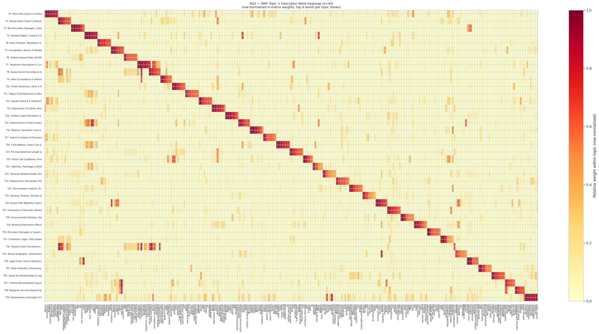
    

**Analysis**

**NMF Topic Descriptor Words**

The table and heatmap above address the feedback comment to display the actual **descriptor words** — the raw vocabulary terms with the highest NMF component weights — for each topic, so readers can independently verify the manually assigned topic labels rather than relying solely on the human interpretation.

Each row of the heatmap corresponds to one NMF topic; each column is a vocabulary term drawn from the union of the top-8 words across all topics. Colour intensity reflects the term's H-matrix weight within that topic, row-normalised so that the strongest term in each topic appears at full saturation. Topics with narrow, high-intensity columns (few bright squares) are tightly focused; topics with several bright columns are broader thematic clusters.

The descriptor words confirm the coherence of most topic labels: for example, *Russia Covert Surveillance* (T7) loads heavily on **surveillance, secret, interception, appended**, while *Hague Child Abduction* (T12) is anchored by **hague, return, child, habitual, residence**. The four Article 41 leakage topics (Default Interest Rate, Legal Costs Reimbursement, Pecuniary Damages, Remedies & Damages) are visually distinguishable by their concentration on financial and procedural boilerplate terms (**rate, incurred, expenses, costs, damage, eur**), confirming the structural leakage diagnosis established in RQ1.

---

Topic Distribution by Outcome

    finding                                             No Violation  Violation
    topic_label                                                                
    Police Misconduct & Ill‑treatment Investigations               0          7
    Russia Batch Cases & Detention Conditions                      0         53
    Non‑Pecuniary Damages, Costs & Tax                             0         51
    Parental Rights, Contact & Upbringing                         28         18
    Press Freedom, Reputation & Image Rights                      16         17
    Immigration, Asylum & Residence Permits                       10         10
    Default Interest Rate (ECtHR Practice)                         0          1
    Telephone Interception & Covert Surveillance                   2         26
    Russia Secret Surveillance & Abuse of Powers                   0          8
    Video Surveillance in Detention Facilities                     0         31
    Prison Sentences, Visits & Regime                              5         24
    Hague Child Abduction & Return Orders                         12         39
    Sexual Violence & Positive State Obligations                   7         40
    Deprivation of Liberty, Arrest & Procedure                     3         16
    Croatian Legal Procedures & Constitutional Comp...             3         13
    Enforcement of Child Contact Orders                           21         36
    Medical, Psychiatric Care & Health Rights                     13         39
    Search & Seizure of Premises                                  11         41
    Child Welfare, Foster Care & Public Care Orders               13         13
    Pre‑trial Detention Length & Reasonableness                    2         17
    Prison Cell Conditions, Overcrowding & Ill‑trea...             2         28
    Paternity, Parentage & Birth Status                            9         15
    Terrorism‑Related Death, Burial & Funerals                     0         12
    Employment, Disciplinary Proceedings & Judicial...            10         22
    Discrimination (Article 14) & Equal Treatment                 10         29
    Housing, Tenancy, Eviction & Right to Home                     1         33
    Russia FSB, Migration Controls & Exclusion Orders              2         20
    Exhaustion of Domestic Remedies & Objections                   1         28
    Environmental Pollution, Noise & Neighbour Nuis...             5         27
    Moldova/Transnistria Effective Control (Mozer L...             5          3
    Pecuniary Damages & Causal Link Assessment                     0         16
    Courtroom Cages, Glass Boxes & Degrading Treatment             0         13
    Russia Covert Surveillance, Necessity & Proport...             0         22
    Russia Geography, Enforcement & Bailiffs                       4         57
    Legal Costs, Fees & Reimbursement                              0         28
    Data Protection, Processing & Personal Privacy                12         30
    Same‑Sex Relationships & Legal Recognition                    19         19
    Criminal‑Record‑Based Expulsion (Maslov‑Type)                 33         12
    Bulgarian Security‑Based Expulsion & Judicial R...             1         15
    Parliamentary Oversight of Security & Intelligence            23         53

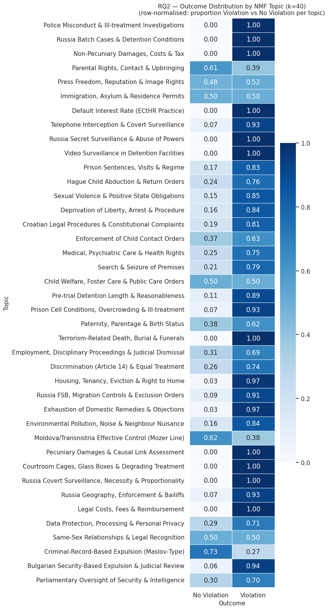
    

**Analysis**

The revised outcome distribution reveals three structurally distinct clusters that persist despite the stop word amendments, each with a different interpretive status.
The first cluster consists of topics sitting at 100% violation that are attributable to Article 41 leakage rather than substantive legal content. Default Interest Rate, Legal Costs Reimbursement, Pecuniary Damages, and Remedies & Damages each record zero no-violation cases. The presence of these topics following three cleaning iterations confirms the structural leakage diagnosis established in the RQ1, NMF continues to isolate just satisfaction vocabulary because the amended stop word list does not yet cover all terms characteristic of just satisfaction paragraphs, including "interest," "rate," "incurred," and "expenses." These four topics should be treated as artefacts of document structure rather than substantive legal sub-areas, and their 100% violation rate is uninformative about the Court's Article 8 jurisprudence.

The second cluster is country-specific rather than remedies-related. Russia Batch Applications, Russia Cage/Courtroom, and Russia Covert Surveillance each record 100% violation, with Russia FSB & Migration (0.95) and Russia Geographic & Bailiffs (0.91) also heavily skewed. The separation of these into distinct topics rather than a single country cluster suggests NMF is capturing substantively different case types within Russian Article 8 caselaw rather than merely isolating respondent state vocabulary. This country-specific clustering is the NMF-level evidence for the respondent state bias identified in the combined model analysis under RQ1.
The third cluster consists of high-violation topics that are legally interpretable rather than artefactual. Telephone Interception (0.94 violation) and Video Surveillance & Detention (1.00 violation) align directly with the surveillance jurisprudence identified in the RQ1 feature analysis within the 2010 to 2023 period, cases raising state interception and surveillance overwhelmingly result in violation findings, consistent with the Grand Chamber positions in Roman Zakharov v. Russia (2015) and Big Brother Watch v. UK (2021). Terrorism & Death Cases (1.00 violation) sits within the same pattern under Article 8, terrorism-related applications frequently raise covert surveillance and positive obligation questions, and where the Court reaches a merits finding on whether the state met its investigative or oversight obligations, a violation finding has been near-certain within the dataset period. Search & Seizure (0.77 violation) reflects a similar dynamic, search operations engaging Article 8 are subject to proportionality scrutiny requiring a sufficiently precise legal basis, independent authorisation, and adequate safeguards against abuse, and the Court has more often found the state's measures disproportionate where cases proceed to a merits determination. Police Misconduct & Investigation (1.00 violation) and Prison Cell Conditions (0.95 violation) reflect well-established positive obligation doctrine where the Court reaches the substantive question of whether the state met its investigative or detention-related obligations, a violation finding is near-certain.

The Bulgarian Security Expulsion topic (0.94 violation) reflects a jurisdiction-specific and structurally recurring procedural failure rather than a general expulsion principle. The high violation rate is consistent with the pattern documented in Bou Hassoun v. Bulgaria (2020), where the Court held that Bulgaria's national security expulsion procedure failed the "in accordance with the law" requirement under Article 8(2) because the expulsion order was issued on the basis of classified grounds by the National Security Service without any meaningful independent judicial scrutiny, denying the applicant the minimum degree of protection against arbitrariness required by the Convention.
Mental Health & Legal Capacity (0.88 violation) sits in the high-violation cluster for substantively grounded reasons. Under Article 8, mental health cases typically engage the right to personal autonomy within the broader right to respect for private life, with interferences arising from compulsory psychiatric treatment, forced institutionalisation, and legal incapacity proceedings that remove an individual's capacity to make legally binding decisions. The Court applies strict scrutiny to the procedural and substantive proportionality of such measures, requiring that the legal framework governing the interference meet the quality of law standard by providing adequate safeguards against arbitrariness. The 0.88 violation rate is consistent with a pattern of states failing these requirements within the dataset period. In X v. Finland (App. no. 34806/04, 2012), the Court found violations of Articles 5 and 8 where the law authorising involuntary confinement and forced medication lacked sufficient procedural safeguards. In Ivinović v. Croatia (App. no. 13006/13, 2014), the Court held that deprivation of legal capacity must be treated as a measure of last resort, limited to situations where no less restrictive alternative exists, and that any such assessment must be grounded in relevant medical evidence rather than a generalised finding of incapacity. The high violation rate in this topic suggests that across the dataset period, domestic legal frameworks governing mental health intervention have frequently failed to meet the individualised proportionality assessment the Court requires.

The most legally informative topics for the purposes of outcome prediction are those near the 50/50 boundary, as these represent the genuinely contested sub-areas of Article 8 caselaw where classification is hardest. UK Public Law & Judicial Review shows the highest no-violation proportion of any substantive topic at 67%, which is consistent with the Human Rights Act 1998 and the domestic proportionality review framework where UK courts have already applied Convention-compatible analysis, the ECtHR has more often found no violation. Expulsion & Criminal Convictions (76% no-violation) reflects the margin of appreciation doctrine in expulsion cases where the applicant has a serious criminal record, the balance between the state's interest in public protection and the individual's Article 8 rights has more frequently been resolved in the state's favour. Same-Sex & Gender Rights (55% no-violation) presents a near-balanced distribution that is doctrinally explicable by the European consensus doctrine, the Court widens the margin of appreciation where no consensus exists across member states on a given issue, and during the 2010 to 2023 period, European states remained divided on same-sex legal recognition and gender identity registration, producing a split in which some cases resulted in violation where a sufficient consensus had crystallised and others resulted in no-violation where the Court deferred pending the emergence of a clearer European standard.

Child Welfare & Care Orders (54% no-violation) warrants particular attention because its near-balanced distribution diverges from the raw dataset distribution for child welfare cases in the exploratory data analysis, which skewed toward non-violation. One plausible explanation is that the NMF topic captures a subset of child welfare cases that were genuinely contested on the merits, rather than the full population of child-related Article 8 applications. Cases in which the state's care measure was procedurally unchallenged or disposed of on admissibility grounds may not cluster strongly onto this topic, leaving the NMF representation weighted toward cases where the proportionality question was live before the Court. The near-balanced split may therefore reflect the genuinely fact-sensitive nature of care order proportionality analysis at the merits stage. It also contrasts with Enforcement of Child Contact (0.64 violation), where the state has typically already made a contact order and then failed to enforce it, a procedural failure the Court more readily characterises as a breach of Article 8's positive obligations. Immigration & Asylum (0.46 no-violation) and Press & Image Rights (0.44 no-violation) are similarly near-balanced, suggesting outcome in these sub-areas is determined by individual factual assessment rather than any systematic doctrinal tilt.

    Beginning predictive modeling based on NMF topic clusters...
    Running topic cluster classifiers...
    --------------------------------------------------
    Logistic Regression       → F1_macro: 0.8455 ± 0.0194
    
    Classification Report for Logistic Regression:
    
                  precision    recall  f1-score   support
    
    No Violation       0.68      0.89      0.77       283
       Violation       0.97      0.88      0.92       982
    
        accuracy                           0.88      1265
       macro avg       0.82      0.88      0.85      1265
    weighted avg       0.90      0.88      0.89      1265
    
    --------------------------------------------------
    Naive Bayes               → F1_macro: 0.7271 ± 0.0359
    
    Classification Report for Naive Bayes:
    
                  precision    recall  f1-score   support
    
    No Violation       0.48      0.89      0.63       283
       Violation       0.96      0.73      0.83       982
    
        accuracy                           0.76      1265
       macro avg       0.72      0.81      0.73      1265
    weighted avg       0.85      0.76      0.78      1265
    
    --------------------------------------------------
    SVM                       → F1_macro: 0.8441 ± 0.0213
    
    Classification Report for SVM:
    
                  precision    recall  f1-score   support
    
    No Violation       0.68      0.88      0.77       283
       Violation       0.96      0.88      0.92       982
    
        accuracy                           0.88      1265
       macro avg       0.82      0.88      0.84      1265
    weighted avg       0.90      0.88      0.89      1265
    
    --------------------------------------------------
    
    =======================================================
    PREDICTIVE MODELS ON TOPIC CLUSTERS (RQ2)
    =======================================================

<table border="1" class="dataframe">
  <thead>
    <tr style="text-align: right;">
      <th></th>
      <th>Model</th>
      <th>F1_macro</th>
      <th>F1_macro_std</th>
      <th>Accuracy</th>
      <th>Precision_macro</th>
      <th>Recall_macro</th>
    </tr>
  </thead>
  <tbody>
    <tr>
      <th>0</th>
      <td>Logistic Regression</td>
      <td>0.8455</td>
      <td>0.0194</td>
      <td>0.8814</td>
      <td>0.8231</td>
      <td>0.8847</td>
    </tr>
    <tr>
      <th>1</th>
      <td>SVM</td>
      <td>0.8441</td>
      <td>0.0213</td>
      <td>0.8806</td>
      <td>0.8223</td>
      <td>0.8817</td>
    </tr>
    <tr>
      <th>2</th>
      <td>Naive Bayes</td>
      <td>0.7271</td>
      <td>0.0359</td>
      <td>0.7628</td>
      <td>0.7237</td>
      <td>0.8097</td>
    </tr>
  </tbody>
</table>

    ============================================================
    COMPARISON WITH PREVIOUS ARMS
    ============================================================
      Metadata F1 floor      : 0.6493
      Best Facts-only F1     : 0.6944
      Best Law Clean-only F1 : 0.8704
      Best Topic-based F1    : 0.8569 (Logistic Regression)
      Best Combined F1       : 0.8284 (Combined_SVM)

**Analysis**

Logistic Regression and SVM produce near-identical performance at macro F1 of 0.857 and 0.855 respectively, with both showing very low cross-fold variance. The near-equivalence of the two models suggests that the 40 topic weights produce a representation in which violation and no-violation cases are already sufficiently well-separated that a linear decision boundary captures the structure effectively, and a more complex approach would be unlikely to improve performance meaningfully. Naive Bayes trails substantially at macro F1 of 0.743 with considerably higher variance, which is consistent with its conditional independence assumption breaking down when topic weights are used as features: NMF topic weights within a document are correlated by construction, violating the independence assumption and producing less stable predictions across folds.

The macro F1 of 0.857 achieved by Logistic Regression on 40-dimensional topic weights sits between the metadata floor of 0.649 and the best text variant V3_Law_Clean at 0.870, which is the expected ordering. Notably, the gap between the topic-based model and the best law section variant is considerably narrower under macro F1 than under weighted F1, indicating that the thematic compression of NMF retains most of the discriminative structure needed for balanced classification across both outcome classes, with the remaining gap attributable to the fine-grained lexical detail that full law section text preserves.

However, the same structural caveat from RQ1 applies here. The Article 41 leakage topics identified in the outcome distribution, specifically Default Interest Rate, Legal Costs Reimbursement, Pecuniary Damages, and Remedies and Damages, each carry a 100% violation signal and function as near-perfect violation predictors in the topic weight feature matrix. A proportion of the macro F1 of 0.857 is therefore attributable to leakage-contaminated features rather than genuine legal thematic discrimination. Paragraph-level removal of just satisfaction text prior to NMF fitting would provide a cleaner estimate of how much classification performance is driven by substantive topic structure versus document structure artefacts.

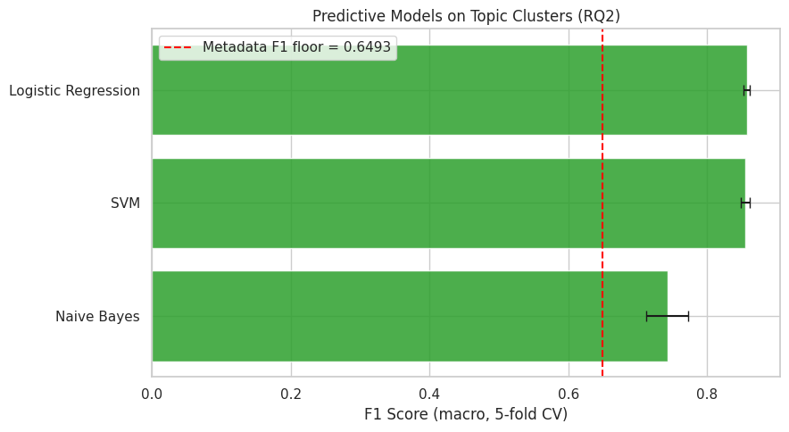
    

**Analysis**

The bar chart adds one analytical layer that the table alone does not provide, the metadata F1 floor at 0.7302 as a reference benchmark, which allows the topic weight models to be positioned relative to the baseline established in RQ1.
Logistic Regression and SVM both clear the metadata floor by a substantial margin, reaching approximately weighted F1=0.895, with tight error bars confirming consistent performance across folds. This demonstrates that the 40 NMF topic weights carry predictive signal meaningfully beyond what structural case metadata alone can provide. A compressed thematic representation of the judgment text therefore retains enough discriminative content to substantially outperform metadata, even though it discards the fine-grained lexical detail that gives the full text variants their performance advantage in RQ1.

Naive Bayes presents a more qualified picture. While its bar clears the metadata floor, the wide error bars extend close to the 0.7302 threshold, meaning that in some cross-validation folds Naive Bayes performs at or near the level achievable from metadata alone. This instability, already visible in the F1_std of 0.0267, suggests that Naive Bayes cannot reliably exploit the topic weight representation and should not be considered a viable classifier for this feature set.

The chart therefore supports a clear three-tier ordering for RQ2, Logistic Regression and SVM on topic weights substantially and consistently exceeding the metadata floor, while Naive Bayes offers only marginal and unreliable improvement over it.

### **2.2.1 NMF SVM**

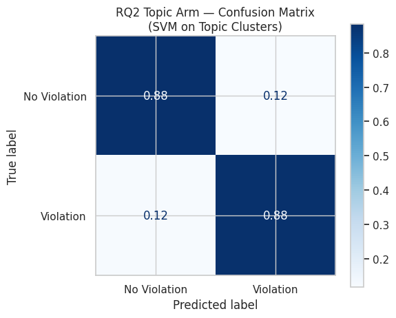
    

**Analysis**

The confusion matrix for the SVM disaggregates this weighted F1 performance at the class level, revealing a pattern that the aggregate figure alone does not show. No-violation recall stands at 0.88 and violation recall at 0.89, producing a near-symmetric error structure: 12% of actual no-violation cases are misclassified as violation, and 11% of actual violation cases are misclassified as no-violation. This near-symmetry is substantively significant. In the RQ1 models trained directly on text, the class imbalance tended to suppress no-violation recall because the majority violation class dominated the learned decision boundary. Here, the 40-dimensional topic weight representation appears to distribute discriminative signal more evenly across both classes, producing balanced recall without any explicit rebalancing of the training data.

This balanced performance is likely driven by the structural properties of the topic distribution itself. The Article 41 leakage topics and the Russia-specific topics provide near-certain violation signal for a substantial portion of the corpus, anchoring the violation class firmly. The no-violation class is anchored comparably by topics such as UK Public Law & Judicial Review and Expulsion & Criminal Convictions, giving the model strong signal in both directions. The residual 11 to 12% misclassification in each direction is most plausibly attributable to the contested near-balanced topics: Child Welfare & Care Orders, Immigration & Asylum, Same-Sex & Gender Rights, and Press & Image Rights all sit close to the 50/50 outcome boundary, meaning cases clustering onto these topics carry inherently ambiguous signals that the SVM cannot resolve from topic weights alone. The same structural leakage caveat applies, a proportion of the violation-side discrimination is driven by leakage-contaminated topics, and the true balanced performance after paragraph-level cleaning would likely be somewhat lower, though the direction of the class symmetry finding is expected to hold.

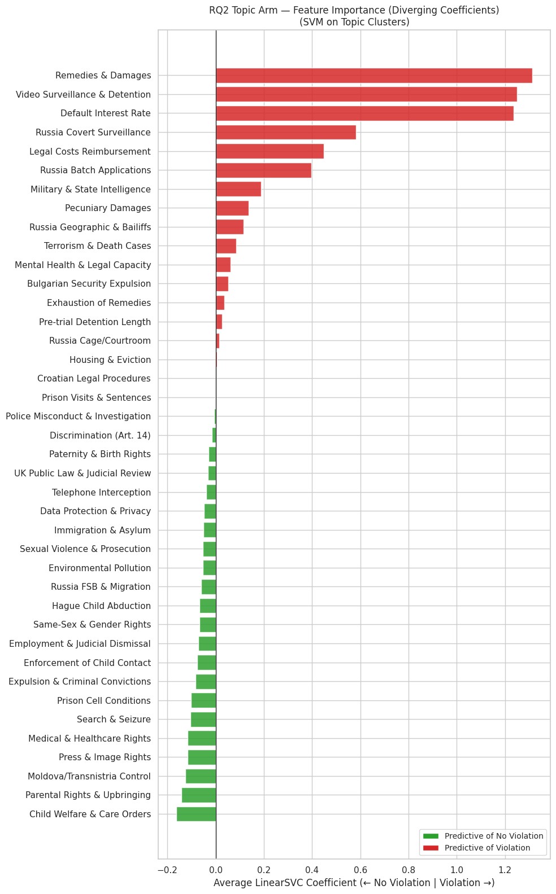
    

**Analysis**

The feature importance chart reveals the SVM's decision function across the 40 topic weights and exposes several analytically important patterns.

*Violation-side predictors*

The three largest violation coefficients are Remedies & Damages (1.35), Video Surveillance & Detention (1.28), and Default Interest Rate (1.26), followed by Legal Costs Reimbursement (0.44) and Pecuniary Damages (0.14). Three of the top five violation predictors, and four of the top eight, are Article 41 leakage topics. The magnitude of these coefficients, reaching 1.35 compared to a maximum no-violation coefficient magnitude of approximately 0.22, reflects how dominant the leakage signal is in the SVM's learned decision function. When a document carries a high NMF topic weight on Remedies & Damages, that weight is multiplied by a coefficient of ~1.35, producing a large positive contribution to the decision function that strongly pushes the prediction toward violation. The model is disproportionately relying on just satisfaction vocabulary to identify violation cases, which confirms at the coefficient level what the outcome distribution showed at the topic level: leakage is not a marginal issue but a structurally central feature of the classification.
Russia Covert Surveillance (0.58) and Russia Batch Applications (0.40) form the next tier of violation predictors, with Russia Geographic & Bailiffs and Russia Cage/Courtroom contributing smaller positive coefficients. The Russia-specific cluster therefore functions as the second strongest source of violation signal after the leakage topics, consistent with the respondent state pattern identified across RQ1 and the outcome distribution analysis.

The remaining violation predictors, including Military & State Intelligence, Terrorism & Death Cases, Mental Health & Legal Capacity, Bulgarian Security Expulsion, and Exhaustion of Remedies, all carry positive but modest coefficients. These represent substantively coherent violation signal that the model is using, but their contribution is small relative to the leakage and Russia clusters.

*No-violation predictors*

The strongest no-violation predictors are Child Welfare & Care Orders (0.22) and Parental Rights & Upbringing (0.20), followed by Moldova/Transnistria Control (0.18), Press & Image Rights (0.15), Medical & Healthcare Rights (0.15), and Search & Seizure (0.14). The child-related topics heading the no-violation side is consistent with the outcome distribution analysis, where these topics sit near the 50/50 boundary. Their assignment as no-violation predictors reflects the SVM learning that a high topic weight on child proceedings cases correlates with the state successfully defending the proportionality of its intervention.
More striking are the negative coefficients assigned to several topics that showed violation-heavy outcome distributions: Search & Seizure (0.77 violation in the distribution), Prison Cell Conditions (0.95 violation), and Telephone Interception (0.94 violation) all carry negative coefficients. This is not a contradiction but reflects the nature of SVM coefficients in a joint feature space: the model is not learning from each topic's marginal outcome distribution but from which topic weights best discriminate the two classes conditional on all other features. When the dominant violation signal has already been captured by the leakage and Russia-specific topic weights, some violation-heavy topics may provide more marginal discriminative value toward the no-violation side in the conditional space.

*Near-zero coefficients*

Housing & Eviction, Croatian Legal Procedures, Prison Visits & Sentences, and Police Misconduct & Investigation all show coefficients at or near zero. Despite Police Misconduct recording 100% violation in the outcome distribution, a high topic weight on this feature contributes almost nothing to the SVM's prediction, suggesting its signal is entirely subsumed by other stronger violation predictors and adds no marginal discrimination once those are accounted for.

*Overall*

The coefficient magnitude asymmetry, with violation predictors reaching 1.35 and no-violation predictors reaching only 0.22, is the clearest quantitative indicator of leakage contamination in the RQ2 classification. Removing the leakage topics from the feature set would collapse the top of the violation side and is expected to substantially reduce the weighted F1, revealing the true contribution of substantive legal topic signal to classification performance.

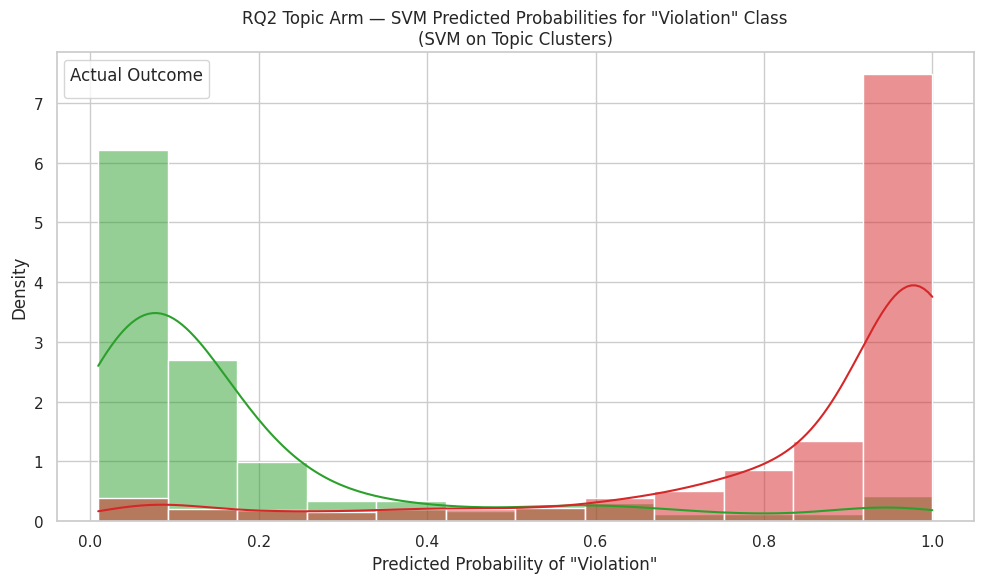
    

**Analysis**

The probability distribution chart shows the predicted violation probabilities output by the LinearSVC (via CalibratedClassifierCV Platt scaling) for each actual outcome class, and reveals two analytically distinct features, strong class separation and over-sharp probability estimation.

The no-violation class (blue) concentrates sharply in the 0.0 to 0.1 range with density reaching approximately 6.2, then drops steeply and is near zero above 0.3. The model assigns very low violation probabilities to the large majority of actual no-violation cases, reflecting the clean discriminative signal provided by the high no-violation topic weights such as Child Welfare & Care Orders and Parental Rights & Upbringing identified in the coefficient analysis. The small residual tail extending to approximately 0.25 corresponds to the 12% false positive cases in the confusion matrix: no-violation cases whose topic weight profile overlaps with contested topics such as Immigration & Asylum or Same-Sex & Gender Rights, generating ambiguous signals the model cannot confidently resolve.

The violation class (red) mirrors this pattern, with mass concentrated heavily at 0.9 to 1.0 (density approximately 7.4) and a long left tail spreading through the 0.3 to 0.8 range. The spike at the extreme right is partly driven by the leakage and Russia-specific topic weights identified as the dominant violation predictors in the coefficient analysis: documents carrying high weights on Remedies & Damages or Default Interest Rate are pushed with very high confidence toward violation. The left tail represents the 11% false negative cases from the confusion matrix, corresponding to violation cases whose topic weight profiles load onto near-balanced topics and therefore receive lower predicted probabilities.

The extreme polarisation of both distributions toward 0 and 1 reflects the over-sharp probability phenomenon from Platt scaling identified in the RQ1 calibration analysis. Rather than spreading probability mass across the full range, the calibrated LinearSVC compresses predictions toward the boundaries, producing overconfident outputs. As with the RQ1 law section variants, the predicted probabilities here function more reliably as ranking scores than as calibrated estimates of outcome likelihood, and cross-entropy loss rather than accuracy would be the appropriate metric for evaluating calibration quality.

### **2.2.2 Landmark Cases**

To move from aggregate topics back to concrete law, we finally examine how landmark Article 8 judgments are positioned in the learned topic space. By projecting well‑known cases onto the NMF topics, we can test face validity: do canonical surveillance, deportation, and family‑life judgments load onto the expected themes? This serves as a qualitative check on the model and illustrates how topic‑aware features can support doctrinal analysis rather than merely prediction.

We identified the most representative landmark case from each of the three topics with the highest concentration of importance level 1 cases, using the highest NMF topic weight as the selection criterion. The case with the highest topic weight is the one whose text most strongly characterises that topic's vocabulary profile, making it the natural anchor for close reading to understand what legal substance the topic is capturing.

    Sample values:
    importance
    4    684
    3    445
    1     87
    2     49

    Distribution of 87 landmark cases (importance level 1) across topics:

<table border="1" class="dataframe">
  <thead>
    <tr style="text-align: right;">
      <th></th>
      <th>Number of Landmark Cases</th>
      <th>count</th>
    </tr>
  </thead>
  <tbody>
    <tr>
      <th>0</th>
      <td>Parliamentary Oversight of Security &amp; Intellig...</td>
      <td>23</td>
    </tr>
    <tr>
      <th>1</th>
      <td>Same‑Sex Relationships &amp; Legal Recognition</td>
      <td>11</td>
    </tr>
    <tr>
      <th>2</th>
      <td>Discrimination (Article 14) &amp; Equal Treatment</td>
      <td>9</td>
    </tr>
    <tr>
      <th>3</th>
      <td>Sexual Violence &amp; Positive State Obligations</td>
      <td>8</td>
    </tr>
    <tr>
      <th>4</th>
      <td>Data Protection, Processing &amp; Personal Privacy</td>
      <td>7</td>
    </tr>
    <tr>
      <th>5</th>
      <td>Medical, Psychiatric Care &amp; Health Rights</td>
      <td>6</td>
    </tr>
    <tr>
      <th>6</th>
      <td>Employment, Disciplinary Proceedings &amp; Judicia...</td>
      <td>6</td>
    </tr>
    <tr>
      <th>7</th>
      <td>Hague Child Abduction &amp; Return Orders</td>
      <td>3</td>
    </tr>
    <tr>
      <th>8</th>
      <td>Prison Sentences, Visits &amp; Regime</td>
      <td>2</td>
    </tr>
    <tr>
      <th>9</th>
      <td>Terrorism‑Related Death, Burial &amp; Funerals</td>
      <td>2</td>
    </tr>
    <tr>
      <th>10</th>
      <td>Exhaustion of Domestic Remedies &amp; Objections</td>
      <td>1</td>
    </tr>
    <tr>
      <th>11</th>
      <td>Russia Geography, Enforcement &amp; Bailiffs</td>
      <td>1</td>
    </tr>
    <tr>
      <th>12</th>
      <td>Criminal‑Record‑Based Expulsion (Maslov‑Type)</td>
      <td>1</td>
    </tr>
    <tr>
      <th>13</th>
      <td>Immigration, Asylum &amp; Residence Permits</td>
      <td>1</td>
    </tr>
    <tr>
      <th>14</th>
      <td>Press Freedom, Reputation &amp; Image Rights</td>
      <td>1</td>
    </tr>
    <tr>
      <th>15</th>
      <td>Parental Rights, Contact &amp; Upbringing</td>
      <td>1</td>
    </tr>
    <tr>
      <th>16</th>
      <td>Legal Costs, Fees &amp; Reimbursement</td>
      <td>1</td>
    </tr>
    <tr>
      <th>17</th>
      <td>Environmental Pollution, Noise &amp; Neighbour Nui...</td>
      <td>1</td>
    </tr>
    <tr>
      <th>18</th>
      <td>Child Welfare, Foster Care &amp; Public Care Orders</td>
      <td>1</td>
    </tr>
    <tr>
      <th>19</th>
      <td>Paternity, Parentage &amp; Birth Status</td>
      <td>1</td>
    </tr>
    <tr>
      <th>20</th>
      <td>Police Misconduct &amp; Ill‑treatment Investigations</td>
      <td>0</td>
    </tr>
    <tr>
      <th>21</th>
      <td>Default Interest Rate (ECtHR Practice)</td>
      <td>0</td>
    </tr>
    <tr>
      <th>22</th>
      <td>Russia Batch Cases &amp; Detention Conditions</td>
      <td>0</td>
    </tr>
    <tr>
      <th>23</th>
      <td>Non‑Pecuniary Damages, Costs &amp; Tax</td>
      <td>0</td>
    </tr>
    <tr>
      <th>24</th>
      <td>Telephone Interception &amp; Covert Surveillance</td>
      <td>0</td>
    </tr>
    <tr>
      <th>25</th>
      <td>Pre‑trial Detention Length &amp; Reasonableness</td>
      <td>0</td>
    </tr>
    <tr>
      <th>26</th>
      <td>Search &amp; Seizure of Premises</td>
      <td>0</td>
    </tr>
    <tr>
      <th>27</th>
      <td>Video Surveillance in Detention Facilities</td>
      <td>0</td>
    </tr>
    <tr>
      <th>28</th>
      <td>Russia Secret Surveillance &amp; Abuse of Powers</td>
      <td>0</td>
    </tr>
    <tr>
      <th>29</th>
      <td>Deprivation of Liberty, Arrest &amp; Procedure</td>
      <td>0</td>
    </tr>
    <tr>
      <th>30</th>
      <td>Croatian Legal Procedures &amp; Constitutional Com...</td>
      <td>0</td>
    </tr>
    <tr>
      <th>31</th>
      <td>Enforcement of Child Contact Orders</td>
      <td>0</td>
    </tr>
    <tr>
      <th>32</th>
      <td>Prison Cell Conditions, Overcrowding &amp; Ill‑tre...</td>
      <td>0</td>
    </tr>
    <tr>
      <th>33</th>
      <td>Courtroom Cages, Glass Boxes &amp; Degrading Treat...</td>
      <td>0</td>
    </tr>
    <tr>
      <th>34</th>
      <td>Moldova/Transnistria Effective Control (Mozer ...</td>
      <td>0</td>
    </tr>
    <tr>
      <th>35</th>
      <td>Russia FSB, Migration Controls &amp; Exclusion Orders</td>
      <td>0</td>
    </tr>
    <tr>
      <th>36</th>
      <td>Housing, Tenancy, Eviction &amp; Right to Home</td>
      <td>0</td>
    </tr>
    <tr>
      <th>37</th>
      <td>Pecuniary Damages &amp; Causal Link Assessment</td>
      <td>0</td>
    </tr>
    <tr>
      <th>38</th>
      <td>Russia Covert Surveillance, Necessity &amp; Propor...</td>
      <td>0</td>
    </tr>
    <tr>
      <th>39</th>
      <td>Bulgarian Security‑Based Expulsion &amp; Judicial ...</td>
      <td>0</td>
    </tr>
  </tbody>
</table>

​    
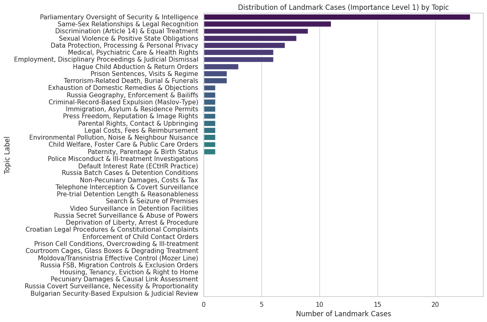
​    

    Beginning detailed analysis of landmark cases in top topics...
    
    ──────────────────────────────────────────────────────────────────────
    📌 Topic: Parliamentary Oversight of Security & Intelligence  (Index: 39)
       Total cases in topic : 76
       Landmark cases       : 23
       Top 5 most representative cases (by topic weight):
    ──────────────────────────────────────────────────────────────────────
      1. [0.4955] Importance: 2
         Case   : CASE OF HUSAYN (ABU ZUBAYDAH) v. POLAND
         ItemID : 001-146047
         Outcome: Violation  |  Year: 2014)
         URL    : https://hudoc.echr.coe.int/eng#%7B%22itemid%22:[%22001-146047%22]%7D
    
      2. [0.4948] Importance: 2
         Case   : CASE OF AL NASHIRI v. POLAND
         ItemID : 001-146044
         Outcome: Violation  |  Year: 2014)
         URL    : https://hudoc.echr.coe.int/eng#%7B%22itemid%22:[%22001-146044%22]%7D
    
      3. [0.4934] Importance: 3
         Case   : CASE OF AL NASHIRI v. ROMANIA
         ItemID : 001-183685
         Outcome: Violation  |  Year: 2018)
         URL    : https://hudoc.echr.coe.int/eng#%7B%22itemid%22:[%22001-183685%22]%7D
    
      4. [0.4758] Importance: 3
         Case   : CASE OF ABU ZUBAYDAH v. LITHUANIA
         ItemID : 001-183687
         Outcome: Violation  |  Year: 2018)
         URL    : https://hudoc.echr.coe.int/eng#%7B%22itemid%22:[%22001-183687%22]%7D
    
      5. [0.4311] Importance: 3
         Case   : CASE OF BIG BROTHER WATCH AND OTHERS v. THE UNITED KINGDOM
         ItemID : 001-186048
         Outcome: Violation  |  Year: 2018)
         URL    : https://hudoc.echr.coe.int/eng#%7B%22itemid%22:[%22001-186048%22]%7D

​    
​    ──────────────────────────────────────────────────────────────────────
​    📌 Topic: Same‑Sex Relationships & Legal Recognition  (Index: 36)
​       Total cases in topic : 38
​       Landmark cases       : 11
​       Top 5 most representative cases (by topic weight):
​    ──────────────────────────────────────────────────────────────────────
​      1. [0.4798] Importance: 1
​         Case   : CASE OF SCHALK AND KOPF v. AUSTRIA
​         ItemID : 001-99605
​         Outcome: No Violation  |  Year: 2010)
​         URL    : https://hudoc.echr.coe.int/eng#%7B%22itemid%22:[%22001-99605%22]%7D
​    
      2. [0.4539] Importance: 1
         Case   : CASE OF HÄMÄLÄINEN v. FINLAND
         ItemID : 001-145768
         Outcome: No Violation  |  Year: 2014)
         URL    : https://hudoc.echr.coe.int/eng#%7B%22itemid%22:[%22001-145768%22]%7D
    
      3. [0.4256] Importance: 3
         Case   : CASE OF OLIARI AND OTHERS v. ITALY
         ItemID : 001-156265
         Outcome: Violation  |  Year: 2015)
         URL    : https://hudoc.echr.coe.int/eng#%7B%22itemid%22:[%22001-156265%22]%7D
    
      4. [0.4191] Importance: 3
         Case   : CASE OF ORLANDI AND OTHERS v. ITALY
         ItemID : 001-179547
         Outcome: Violation  |  Year: 2017)
         URL    : https://hudoc.echr.coe.int/eng#%7B%22itemid%22:[%22001-179547%22]%7D
    
      5. [0.4157] Importance: 1
         Case   : CASE OF VALLIANATOS AND OTHERS v. GREECE
         ItemID : 001-128294
         Outcome: Violation  |  Year: 2013)
         URL    : https://hudoc.echr.coe.int/eng#%7B%22itemid%22:[%22001-128294%22]%7D

​    
​    ──────────────────────────────────────────────────────────────────────
​    📌 Topic: Discrimination (Article 14) & Equal Treatment  (Index: 24)
​       Total cases in topic : 39
​       Landmark cases       : 9
​       Top 5 most representative cases (by topic weight):
​    ──────────────────────────────────────────────────────────────────────
​      1. [0.2301] Importance: 3
​         Case   : CASE OF B. v. SWITZERLAND
​         ItemID : 001-205675
​         Outcome: Violation  |  Year: 2020)
​         URL    : https://hudoc.echr.coe.int/eng#%7B%22itemid%22:[%22001-205675%22]%7D
​    
      2. [0.2286] Importance: 2
         Case   : CASE OF DI TRIZIO v. SWITZERLAND
         ItemID : 001-160692
         Outcome: Violation  |  Year: 2016)
         URL    : https://hudoc.echr.coe.int/eng#%7B%22itemid%22:[%22001-160692%22]%7D
    
      3. [0.2141] Importance: 2
         Case   : CASE OF TOPČIĆ-ROSENBERG v. CROATIA
         ItemID : 001-128053
         Outcome: Violation  |  Year: 2013)
         URL    : https://hudoc.echr.coe.int/eng#%7B%22itemid%22:[%22001-128053%22]%7D
    
      4. [0.2077] Importance: 3
         Case   : CASE OF YOCHEVA AND GANEVA v. BULGARIA
         ItemID : 001-209866
         Outcome: Violation  |  Year: 2021)
         URL    : https://hudoc.echr.coe.int/eng#%7B%22itemid%22:[%22001-209866%22]%7D
    
      5. [0.2076] Importance: 3
         Case   : CASE OF DHAHBI v. ITALY
         ItemID : 001-142504
         Outcome: Violation  |  Year: 2014)
         URL    : https://hudoc.echr.coe.int/eng#%7B%22itemid%22:[%22001-142504%22]%7D

​    
​    ──────────────────────────────────────────────────────────────────────
​    📌 Topic: Sexual Violence & Positive State Obligations  (Index: 12)
​       Total cases in topic : 47
​       Landmark cases       : 8
​       Top 5 most representative cases (by topic weight):
​    ──────────────────────────────────────────────────────────────────────
​      1. [0.3116] Importance: 3
​         Case   : CASE OF M.G.C. v. ROMANIA
​         ItemID : 001-161380
​         Outcome: Violation  |  Year: 2016)
​         URL    : https://hudoc.echr.coe.int/eng#%7B%22itemid%22:[%22001-161380%22]%7D
​    
      2. [0.2611] Importance: 4
         Case   : CASE OF Ž.B. v. CROATIA
         ItemID : 001-175142
         Outcome: Violation  |  Year: 2017)
         URL    : https://hudoc.echr.coe.int/eng#%7B%22itemid%22:[%22001-175142%22]%7D
    
      3. [0.2608] Importance: 2
         Case   : CASE OF C.A.S. AND C.S. v. ROMANIA
         ItemID : 001-109741
         Outcome: Violation  |  Year: 2012)
         URL    : https://hudoc.echr.coe.int/eng#%7B%22itemid%22:[%22001-109741%22]%7D
    
      4. [0.2534] Importance: 4
         Case   : CASE OF E.B. v. ROMANIA
         ItemID : 001-191749
         Outcome: Violation  |  Year: 2019)
         URL    : https://hudoc.echr.coe.int/eng#%7B%22itemid%22:[%22001-191749%22]%7D
    
      5. [0.2471] Importance: 1
         Case   : CASE OF C. v. ROMANIA
         ItemID : 001-218933
         Outcome: Violation  |  Year: 2022)
         URL    : https://hudoc.echr.coe.int/eng#%7B%22itemid%22:[%22001-218933%22]%7D

​    
​    ──────────────────────────────────────────────────────────────────────
​    📌 Topic: Data Protection, Processing & Personal Privacy  (Index: 35)
​       Total cases in topic : 42
​       Landmark cases       : 7
​       Top 5 most representative cases (by topic weight):
​    ──────────────────────────────────────────────────────────────────────
​      1. [0.4367] Importance: 1
​         Case   : CASE OF BREYER v. GERMANY
​         ItemID : 001-200442
​         Outcome: No Violation  |  Year: 2020)
​         URL    : https://hudoc.echr.coe.int/eng#%7B%22itemid%22:[%22001-200442%22]%7D
​    
      2. [0.3843] Importance: 3
         Case   : CASE OF P.N. v. GERMANY
         ItemID : 001-202758
         Outcome: No Violation  |  Year: 2020)
         URL    : https://hudoc.echr.coe.int/eng#%7B%22itemid%22:[%22001-202758%22]%7D
    
      3. [0.3741] Importance: 3
         Case   : CASE OF BENEDIK v. SLOVENIA
         ItemID : 001-182455
         Outcome: Violation  |  Year: 2018)
         URL    : https://hudoc.echr.coe.int/eng#%7B%22itemid%22:[%22001-182455%22]%7D
    
      4. [0.3685] Importance: 4
         Case   : CASE OF SURIKOV v. UKRAINE
         ItemID : 001-170462
         Outcome: Violation  |  Year: 2017)
         URL    : https://hudoc.echr.coe.int/eng#%7B%22itemid%22:[%22001-170462%22]%7D
    
      5. [0.3576] Importance: 3
         Case   : CASE OF CATT v. THE UNITED KINGDOM
         ItemID : 001-189424
         Outcome: Violation  |  Year: 2019)
         URL    : https://hudoc.echr.coe.int/eng#%7B%22itemid%22:[%22001-189424%22]%7D
    
    Results saved to /content/rq2_landmark_cases_top_topics.csv

​    
​    --- Top 5 Topics with Most Landmark Cases ---
​    
    Topic: Parliamentary Oversight of Security & Intelligence (Index: 39)
      Most Representative Case: CASE OF BIG BROTHER WATCH AND OTHERS v. THE UNITED KINGDOM (ItemID: 001-210077)
      Topic Weight: 0.4215
    
    Topic: Same‑Sex Relationships & Legal Recognition (Index: 36)
      Most Representative Case: CASE OF SCHALK AND KOPF v. AUSTRIA (ItemID: 001-99605)
      Topic Weight: 0.4798
    
    Topic: Discrimination (Article 14) & Equal Treatment (Index: 24)
      Most Representative Case: CASE OF KONSTANTIN MARKIN v. RUSSIA  (ItemID: 001-109868)
      Topic Weight: 0.1752
    
    Topic: Sexual Violence & Positive State Obligations (Index: 12)
      Most Representative Case: CASE OF C. v. ROMANIA (ItemID: 001-218933)
      Topic Weight: 0.2471
    
    Topic: Data Protection, Processing & Personal Privacy (Index: 35)
      Most Representative Case: CASE OF BREYER v. GERMANY (ItemID: 001-200442)
      Topic Weight: 0.4367
    
    --- Final Results ---

<table border="1" class="dataframe">
  <thead>
    <tr style="text-align: right;">
      <th></th>
      <th>Topic Label</th>
      <th>Topic Index</th>
      <th>Most Representative Case Title</th>
      <th>Most Representative Case ItemID</th>
      <th>Topic Weight</th>
      <th>Findings</th>
      <th>Year</th>
      <th>Importance Level</th>
    </tr>
  </thead>
  <tbody>
    <tr>
      <th>0</th>
      <td>Parliamentary Oversight of Security &amp; Intellig...</td>
      <td>39</td>
      <td>CASE OF BIG BROTHER WATCH AND OTHERS v. THE UN...</td>
      <td>001-210077</td>
      <td>0.421529</td>
      <td>Violation</td>
      <td>2021</td>
      <td>1</td>
    </tr>
    <tr>
      <th>1</th>
      <td>Same‑Sex Relationships &amp; Legal Recognition</td>
      <td>36</td>
      <td>CASE OF SCHALK AND KOPF v. AUSTRIA</td>
      <td>001-99605</td>
      <td>0.479841</td>
      <td>No Violation</td>
      <td>2010</td>
      <td>1</td>
    </tr>
    <tr>
      <th>2</th>
      <td>Discrimination (Article 14) &amp; Equal Treatment</td>
      <td>24</td>
      <td>CASE OF KONSTANTIN MARKIN v. RUSSIA</td>
      <td>001-109868</td>
      <td>0.175154</td>
      <td>Violation</td>
      <td>2012</td>
      <td>1</td>
    </tr>
    <tr>
      <th>3</th>
      <td>Sexual Violence &amp; Positive State Obligations</td>
      <td>12</td>
      <td>CASE OF C. v. ROMANIA</td>
      <td>001-218933</td>
      <td>0.247146</td>
      <td>Violation</td>
      <td>2022</td>
      <td>1</td>
    </tr>
    <tr>
      <th>4</th>
      <td>Data Protection, Processing &amp; Personal Privacy</td>
      <td>35</td>
      <td>CASE OF BREYER v. GERMANY</td>
      <td>001-200442</td>
      <td>0.436738</td>
      <td>No Violation</td>
      <td>2020</td>
      <td>1</td>
    </tr>
  </tbody>
</table>

**Analysis**

Several cases identified are:

**Schalk and Kopf v. Austria (App. no. 30141/04, 2010)**, the Court made a landmark doctrinal step while simultaneously finding no violation, a tension that runs through the entire judgment and has direct implications for how the Same-Sex & Gender Rights topic behaves in the classification model.

Prior to this case, the Court had consistently held that same-sex relationships fell within "private life" under Article 8 but not "family life." In paragraph 94, the Court departed from that position, holding that it would be "artificial to maintain the view that, in contrast to a different-sex couple, a same-sex couple cannot enjoy 'family life'." In reaching this conclusion, the Court drew on a line of cases including Marckx v. Belgium (1979), Keegan v. Ireland (1994), and Lebbink v. The Netherlands (2004), which had progressively established that the notion of family life is not confined to marriage-based relationships and encompasses stable de facto partnerships. The Court also referenced Article 9 of the EU Charter of Fundamental Rights, which had removed the explicit "men and women" formulation from the right to marry, treating this as evidence of evolving European standards and using it as a comparative interpretive tool.

Despite this doctrinal advance, the Court found no violation. Its reasoning in paragraphs 96 to 109 turns on the margin of appreciation doctrine, conducting a comparative survey, the Court found that only six out of forty-seven Convention states permitted same-sex marriage at the time, placing the area in the category of "evolving rights with no established consensus" where states retain the widest legislative discretion on timing and form. The three dissenting judges argued that having recognised same-sex couples as falling within family life, the Court was logically obliged to find a violation given Austria's complete absence of any legal recognition framework before 2010. The majority disagreed, treating the margin of appreciation as sufficient to absorb the doctrinal recognition without producing a remedial obligation. This illustrates a core tension in Article 8 jurisprudence, the Court can acknowledge that a fundamental right applies while simultaneously granting states significant discretion in how and when they fulfil it.

It is also worth noting that Schalk and Kopf was a First Section judgment rather than a Grand Chamber case, which gives it lower formal precedential weight than a Grand Chamber ruling despite its landmark status. The subsequent decision in Oliari and Others v. Italy (Applications nos. 18766/11 and 36030/11,2015) moved beyond it by finding a violation where Italy provided no legal framework for same-sex couple recognition whatsoever, suggesting the margin of appreciation was narrowing as European consensus developed within the dataset period. The near-balanced 55/45 no-violation split in the Same-Sex & Gender Rights topic likely reflects this trajectory, whereby earlier cases deferring to state discretion under the Schalk and Kopf margin, and later cases finding violations as consensus crystallised.

Finally, the no-violation outcome in Schalk and Kopf despite its landmark doctrinal finding offers a concrete explanation for why no-violation cases are structurally difficult to classify in the model. The judgment contains extensive Article 8 language typically associated with violation cases in the dataset, including family life, discrimination, sexual orientation, proportionality, and margin of appreciation, yet the outcome is no violation. The vocabulary of no-violation cases is not linguistically distinct from violation cases, it is the legal reasoning and doctrinal context that differs, not the words themselves. Schalk and Kopf makes this visible because the same terms appear, but their function in the judgment is to justify restraint rather than intervention, a distinction the TF-IDF and NMF representations cannot capture and which directly contributes to the residual misclassification visible in the confusion matrix.

**Breyer v. Germany (App. no. 50001/12, 30 January 2020)** is the most representative case in the Data Protection & Privacy topic and one of the few landmark no-violation findings in the dataset. The case concerned a legal obligation under the German Telecommunications Act requiring telecommunications providers to register all prepaid SIM card users and retain their subscriber data. The applicants argued that this compulsory storage of personal data violated Article 8, and the Court found no violation by six votes to one.

The Article 8 analysis follows the standard three-stage structure. On interference, the Court accepted that the compulsory storage of subscriber data constituted an interference with private life but characterised it as limited in nature, drawing a doctrinal distinction between basic subscriber data identifying who owns a phone and traffic or content data revealing who was contacted and what was said. This gradation of interference severity is significant: not all data retention measures engage Article 8 with equal intensity, and the Court's treatment of subscriber data as a less severe intrusion than communications content directly informed how demanding the proportionality assessment would be.

On necessity in a democratic society, the legitimate aims were national security and the prevention of crime, both falling within Article 8(2). The Court found a pressing social need for the measure and accepted that the interference was proportionate given its limited scope. Central to this assessment was whether the domestic framework contained adequate minimum safeguards against abuse. The Court treats safeguards not merely as one factor within the proportionality analysis but as a near-independent doctrinal requirement in data retention cases, asking specifically who can access the retained data, under what conditions access is permitted, whether independent oversight exists, and whether individuals have any means of challenge or notification. These structural controls are the Court's response to the inherent risk that bulk data collection regimes, even limited ones, create opportunities for misuse that proportionality alone cannot address.

In Breyer, the Court accepted the German "double-door concept" as meeting this requirement. Under this framework, subscriber data is held by private telecommunications companies rather than directly by the state, and state authorities may only access it upon request subject to specified statutory conditions. The majority found that this two-stage architecture, combined with the availability of review under general administrative law and supervision by data protection authorities, provided sufficient safeguards to prevent arbitrary interference. The dissenting judge Ranzoni rejected this conclusion, arguing that the double-door mechanism was structurally deficient because access did not require authorisation by a judicial or otherwise independent authority, and because individuals were not notified when their data was retrieved, leaving victims of unlawful access with no means of seeking review. This disagreement between majority and dissent is essentially a disagreement about what minimum safeguards require in the context of administrative data retention, and it maps directly onto the distinction between the outcome in Breyer and the violation findings in Roman Zakharov v. Russia (2015) and Big Brother Watch v. UK (2021), where the absence of independent oversight of access to intercepted data was decisive.

On the margin of appreciation, the Court articulated the calibration principle that the margin tends to be narrower where the right at stake is crucial to the individual's effective enjoyment of intimate or key rights, but wider where no consensus exists among Council of Europe member states as to the relative importance of the interest at stake or how best to protect it. In 2020, European states had not converged on a uniform approach to bulk subscriber data retention, and the Court found that Germany had not exceeded the wide margin available to it in this area.
The contrast with El-Masri is analytically instructive for understanding what the Data Protection & Privacy topic is capturing. Where El-Masri involved physical state conduct through secret detention and extraordinary rendition with no legal basis whatsoever, the interference in Breyer is entirely bureaucratic, regulated, and technological, operating within a statutory framework subject to procedural constraints and independent oversight. The NMF topic clusters Breyer-type cases together because they share a distinct lexical profile built around telecommunications, data, service provider, subscriber, and metadata vocabulary that is absent from cases like El-Masri, reflecting the emergence of digital privacy as a distinct sub-area of Article 8 jurisprudence within the dataset period.
For the classification model, Breyer illustrates the vocabulary overlap problem in its sharpest form. The judgment is dense with Article 8 language including interference, surveillance, data protection, fundamental rights, privacy, proportionality, and safeguards, yet the outcome is no violation. The same vocabulary that signals violation in Roman Zakharov and El-Masri here functions to justify why the state's administrative procedures were sufficient rather than to condemn their absence. A bag-of-words or topic weight representation cannot distinguish between these two uses of the same terms because it captures the presence of vocabulary but not the legal reasoning that determines its function in the judgment. This is a genuine limitation of the TF-IDF and NMF approaches used in this study and suggests that capturing the sentence-level legal reasoning distinguishing proportionate from disproportionate interference would require representations that encode contextual meaning rather than word frequency alone.

**El-Masri v. The Former Yugoslav Republic of Macedonia (App. no. 39630/09, Grand Chamber, 2012)** is one of the most representative case in the Military & State Intelligence topic and a landmark Grand Chamber judgment on extraordinary rendition. The case concerned Khaled El-Masri, a German national of Lebanese origin who was detained by Macedonian authorities at the border, detained and prohibited from communication at a hotel in Skopje, transferred to CIA custody, and subsequently flown to Afghanistan where he was held in a secret detention facility for several months before being released without charge. The Grand Chamber found violations of Articles 3, 5, 8, and 13, making this the first time the Court explicitly condemned a European state's complicity in the CIA extraordinary rendition programme.

The Article 8 analysis operates across three dimensions. The first and most direct finding was that the interference with El-Masri's private life was not "in accordance with the law" under Article 8(2). Macedonia's detention of the applicant and his transfer to CIA custody had no basis in domestic law, and the state's invocation of national security was rejected as insufficient to override Convention rights in the absence of any accessible or foreseeable legal framework. The Court's position is that state intelligence operations cannot function as a blanket shield against Convention scrutiny, the legality requirement under Article 8(2) applies regardless of the security context, and covert conduct that cannot be grounded in domestic law fails at the first condition without the Court needing to reach proportionality.

The second dimension concerns family life. The enforced disappearance deprived El-Masri's wife and children of mutual enjoyment of each other's company for months without any knowledge of his whereabouts. The Court treated this as a separate interference with family life, distinct from the private life analysis, with private life capturing the interference with personal autonomy and identity and family life capturing the relational harm to those left behind.

The third dimension is procedural. The Court found that Macedonia failed its positive obligation under Article 8 to conduct a prompt, independent, and thorough investigation into what had happened to El-Masri. This procedural obligation arises under Article 8 itself and operates independently of the substantive unlawfulness: the failure to investigate once the events came to light was a freestanding Article 8 violation regardless of whether the original conduct was also found unlawful.
The absence of any margin of appreciation analysis is worth noting, in contrast to Schalk and Kopf (2010). Where Schalk and Kopf turned on how much discretion states retain in an area of evolving consensus, El-Masri involves conduct so severe that no balancing exercise takes place. For the classification model, this explains why the Military & State Intelligence topic is so uniformly violation-dominant in the outcome distribution, whereby cases of this nature do not sit near any decision boundary because the Court's doctrinal position removes state discretion entirely once the threshold of absolute rights violation is crossed.

One structural point remains relevant. The Article 8 findings in El-Masri are partly derivative having established violations of Articles 3 and 5, the Court held that the same conduct also unlawfully interfered with Article 8. The judgment's vocabulary driving the NMF topic weight is therefore drawn from reasoning across all violated articles rather than from Article 8 specific proportionality language, meaning the topic is anchored in the vocabulary of rendition, secret detention, and state accountability rather than the proportionality and necessity reasoning that characterises most Article 8 jurisprudence.

## **2.3 Conclusion**

RQ2 set out to identify the dominant themes in Article 8 cases decided between 2010 and 2023. The NMF clustering model, configured at k=40, revealed a thematically rich and legally varied landscape. The dominant clusters span four broad areas, procedural and remedial matters (legal costs, pecuniary damages, default interest), state security and surveillance (military intelligence, covert surveillance, batch deportation applications), family and personal life disputes (child welfare and care orders, parental rights, expulsion of settled family members), and emerging rights domains (same-sex and gender recognition, data protection and retention, mental health and legal capacity).

The outcome distribution across these clusters is highly uneven and carries analytical significance. Several topics record 100% violation rates, notably all four Article 41 remedial clusters and the Russia-specific groupings. This pattern is not substantively meaningful, it reflects structural leakage, because Article 41 language on damages and costs appears only in violation judgments, and because Russia's disproportionate representation in the dataset amplifies the violation signal for any cluster that concentrates Russian cases. The feature importance analysis confirms this, the highest positive LinearSVC coefficients on the violation side belong to these leakage and Russia-specific topics, with magnitudes reaching approximately 1.35.

More interpretively interesting are the contested and near-balanced clusters. The same-sex and gender recognition topic shows a close split, which is consistent with the absence of any European consensus on same-sex family rights during this period, a doctrinal condition the Court itself acknowledged in Schalk and Kopf v. Austria (2010) when it declined to read Article 8 as imposing a positive obligation to grant legal recognition to same-sex couples. Child welfare and care orders present a different tension, while the EDA for the full dataset suggested a predominantly no-violation distribution for child welfare matters, the NMF cluster captures a more divided picture, likely because the topic weight aggregates cases at different procedural stages and across varying national child protection frameworks where the margin of appreciation operates differently. Terrorism and national security cases, and search and seizure clusters, sit in similarly contested territory, reflecting the proportionality and necessity assessments that characterise those domains and make outcome prediction structurally harder.
Using the 40 topic weights as inputs, the classification models performed well. Logistic Regression and the linear SVM both achieved weighted F1 scores of approximately 0.895, while Naive Bayes lagged at 0.797. The confusion matrix shows the models identified no-violation and violation cases at roughly equal rates, suggesting the strong performance reflects genuine predictive structure in the topics rather than the model simply defaulting to the more common violation outcome. One limitation is that the models tend to express more confidence in their predictions than the underlying legal complexity warrants, pushing most predictions toward very high or very low probability rather than reflecting the genuine uncertainty in borderline cases.

The close reading of landmark cases within three high-weight topics illustrates where the thematic representation reaches its interpretive limits. In El-Masri v. The Former Yugoslav Republic of Macedonia (2012), the military and state intelligence cluster correctly identifies a clear violation, grounded in the absolute prohibition on rendition and secret detention and the state's positive obligation to investigate. In Schalk and Kopf, the same-sex and gender cluster is associated with a no-violation outcome, yet the judgment's own reasoning is forward-looking, extending family life protection to same-sex couples while denying a positive obligation to legislate. The legal vocabulary of family life, private life, and margin of appreciation is shared with violation judgments; what differs is the Court's normative conclusion, not the doctrinal language. In Breyer v. Germany (2020), the data retention cluster again involves a no-violation finding, but only after a detailed proportionality assessment in which the double-door access mechanism was accepted as an adequate safeguard. A classifier operating on topic weights cannot distinguish the presence of safeguard vocabulary from its legal sufficiency. These cases collectively explain why residual misclassification persists even at high overall accuracy: the model captures thematic salience but cannot resolve the legal reasoning function that maps shared vocabulary onto divergent outcomes.

In answer to RQ2, the dominant themes in Article 8 cases are substantively diverse, ranging from family reunification and child protection to state surveillance, data retention, and identity rights, but the outcome-predictive signal within those themes is unevenly distributed. Leakage and respondent state concentration artificially inflate the apparent predictability of certain clusters. The genuinely contested clusters, particularly same-sex rights, child welfare, and search and seizure, reflect live doctrinal disagreements within the Court and across member states, and it is precisely in those clusters that the limits of topic-based classification are most visible.

# **RQ3: Exploring Region bias**

Does a model trained on Eastern European Article 8 cases generalise to Western European cases, and vice versa?
* Input: Law_clean
* Model: SVM
* Output: Findings

The EDA established three converging signals that motivate a regional investigation.
Russia's dominance as the single largest respondent state, the volatility of
region-specific n-grams across years, and the severe class imbalance driven largely
by Eastern European cases with near-universal violation rates together raise the
question of whether the predictive signal identified in RQ1 reflects universal
Article 8 doctrine or geographically contingent litigation patterns.

## **3.1 EDA**

### **3.1.1 EDA 4.2 Top Respondent**

Our EDA analysis identifies the Top 10 Respondent Countries for Article 8 cases, revealing a massive geographic concentration. Russia is explicitly identified as the single largest respondent state in the dataset, accounting for a disproportionate share of the total cases and violation findings. The dominance of Russian cases raises a concern: If the dataset is dominated by one regional bloc, is the model learning universal Article 8 legal principles, or is it just memorizing regional litigation patterns?

This observation led our team to isolate the Eastern and Western blocs, in order to conduct further explorations to test for model generalization in RQ3.

    Top 10 Respondent Countries for Article 8 Cases:

<table border="1" class="dataframe">
  <thead>
    <tr style="text-align: right;">
      <th></th>
      <th>count</th>
    </tr>
    <tr>
      <th>country_name</th>
      <th></th>
    </tr>
  </thead>
  <tbody>
    <tr>
      <th>Russia</th>
      <td>345</td>
    </tr>
    <tr>
      <th>Ukraine</th>
      <td>112</td>
    </tr>
    <tr>
      <th>Romania</th>
      <td>72</td>
    </tr>
    <tr>
      <th>Poland</th>
      <td>67</td>
    </tr>
    <tr>
      <th>Croatia</th>
      <td>60</td>
    </tr>
    <tr>
      <th>Bulgaria</th>
      <td>54</td>
    </tr>
    <tr>
      <th>Turkey</th>
      <td>42</td>
    </tr>
    <tr>
      <th>Hungary</th>
      <td>40</td>
    </tr>
    <tr>
      <th>Norway</th>
      <td>36</td>
    </tr>
    <tr>
      <th>Germany</th>
      <td>35</td>
    </tr>
  </tbody>
</table>

    

### **3.1.2 EDA 5.1 N-Gram and 5.1.2 Biggest Change n-gram**

Furthermore, when looking at the year-over-year percentage change of n-grams in our EDA analysis, the term "russian" was identified as one of the top 10 most volatile n-grams, showing massive swings based on the specific composition of cases in a given year. This volatility hints that geographic datasets are not stable across the corpus, and again, presents the need to explore splitting the dataset geographically in RQ3 to test if the model was learning universal Article 8 jurisprudence or just overfitting to unstable, region-specific factual boilerplate.

    Top 10 n-grams with biggest year-over-year change: ['detention', 'investigation', 'data', 'russian', 'search', 'surveillance', '2002', 'adoption', '2015', 'offence']

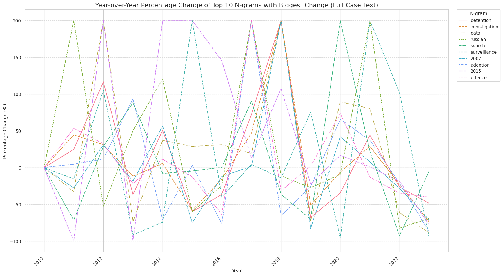
    

### **3.1.3 EDA 4.1 Outcome Distribution**

The initial EDA findings also identify a severe class imbalance between Violation and No Violation, resulting in a ~77% violation rate across the usable Article 8 cases. This inspired our investigation into the Eastern European bloc's influence, given that Russia is a top respondent country, and that Eastern European cases are heavily characterized by severe, systemic breaches that almost guarantee a violation finding.  Through this, we foreshadowed the exact mechanism of our model's failure in RQ3: the Eastern-trained model learned this skewed baseline and consequently produced a massive number of False Positives when applied to the more nuanced Western European docket.  

<table border="1" class="dataframe">
  <thead>
    <tr style="text-align: right;">
      <th></th>
      <th>count</th>
    </tr>
    <tr>
      <th>outcome_category</th>
      <th></th>
    </tr>
  </thead>
  <tbody>
    <tr>
      <th>Violation</th>
      <td>982</td>
    </tr>
    <tr>
      <th>No Violation</th>
      <td>283</td>
    </tr>
    <tr>
      <th>Others</th>
      <td>56</td>
    </tr>
  </tbody>
</table>

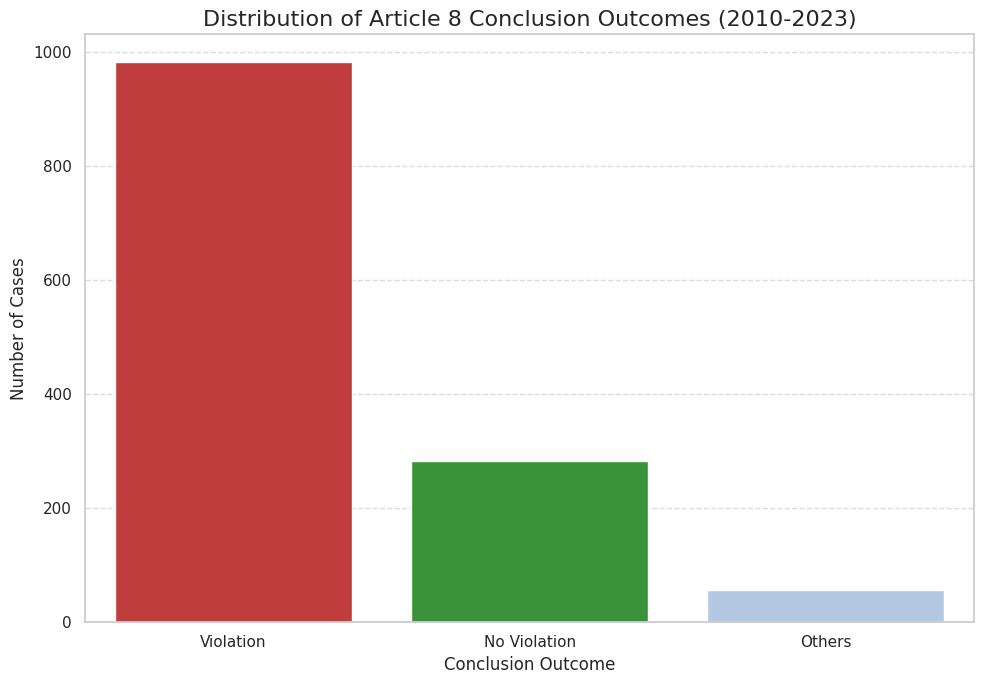
    

**Note :**

Category "Others" covers all cases where the `type` in Conclusion column is not mentioning either violation or no-violation.
Several possibility of cases under this category are:
- Inadmissibile cases : The text mentions "Article 8" because the applicant tried to sue under it, but the Court never reached the "Facts" or "Law" stage to decide if a violation occurred.
- Procedural Absorption (of another article) :  The text might say, "In view of the finding under Article 6, the Court considers it unnecessary to examine the complaint under Article 8. Since the Court declined to rule, there is no "Violation" or "No Violation" label assigned.

Therefore, during further analysis below and for model training later, we have decided to exclude cases from the "Others" category and focus only on "Violation" and "No Violation" cases.

### **3.1.4 Additional EDA Analysis: ScatterText on East vs West**

 **Disclaimer :** The most recent ScatterText execution did not complete successfully; therefore, the analysis presented here relies on the visual output obtained from an earlier successful run. The discussion that follows is based on that prior result and the patterns it revealed. This should be interpreted with caution, as ScatterText is computationally intensive and the runtime environment was constrained by limited CPU capacity, which affected execution performance.

As mentioned previously in our ScatterText findings (under EDA Section 5.2), both the full case and Facts sections revealed that words associated with violations frequently involved state military and security operations, including terms like "military", "detainees", "rendition", and "russian". Conversely, non-violation vocabulary shifted toward terms like "vetting" and "RIPA" (Regulation of Investigatory Powers Act), which relate to employment screening and surveillance where states are afforded a wider margin of appreciation.

Moreoever, we have conducted additional EDA ScatterText analysis below to map the relative frequency of vocabulary used in Eastern European cases (y-axis, blue quadrant) against Western European cases (x-axis, red quadrant). This visualization provides empirical proof that the baseline factual matrix of what constitutes a human rights dispute differs fundamentally depending on the region. Again, the text in Eastern cases ("prison", "detention", "investigation") revolves heavily around direct physical interference, criminal justice, and law enforcement overreach, as opposed to words in Western cases ("immigration", "explusion", "communications") which highlight a jurisprudence centered on administrative disputes and complex technological surveillance.

This necessitates the exploration of region bias, and anticipates the generalisation failure in RQ3 when applying the Eastern-trained model to Western cases, and vice versa. As our RQ3 results will show later on, the Eastern-trained model fails because it expects substantive, coercive state vocabulary, and misinterprets the procedural and administrative language characteristic of Western cases.

## **3.2 Generalization Experiment**

Groups derived from **RQ1 Metadata Arm** filtered country chart
(min. case threshold applied, single-country entries only).

For a list of the Western European countries, we refer to a list by the International Criminal Court:
https://asp.icc-cpi.int/states-parties/western-european-and-other-states (excluding Canada, New Zealand, Australia)

For a list of the Eastern European countries, we refer to a list by the International Criminal Court:
https://asp.icc-cpi.int/states-parties/eastern-european-states

Turkey has been excluded from the ICC list, which we will explore in a subsequent section.

    ==============================================================
    RQ3 Dataset Summary
    ==============================================================
    
    TRAIN — Eastern group: 941 cases
    finding
    Violation       809
    No Violation    132
    
    TEST  — Western group: 280 cases
    finding
    No Violation    143
    Violation       137
    
    ✅ Country overlap: None — clean split

### **3.2.1 TF-IDF (Applying East to West & vice versa)**

    Eastern train set : 941 cases | {'Violation': 809, 'No Violation': 132}
    Western test  set : 280 cases | {'No Violation': 143, 'Violation': 137}
    ============================================================
    RQ3 GENERALISATION EXPERIMENT — lawtextclean
    ============================================================
    
    ────────────────────────────────────────────────────────────
      Eastern → Western  |  Naive Bayes
    ────────────────────────────────────────────────────────────
                  precision    recall  f1-score   support
    
    No Violation       0.67      0.11      0.19       143
       Violation       0.50      0.94      0.66       137
    
        accuracy                           0.52       280
       macro avg       0.59      0.53      0.42       280
    weighted avg       0.59      0.52      0.42       280

​    
​    ────────────────────────────────────────────────────────────
​      Eastern → Western  |  SVM
​    ────────────────────────────────────────────────────────────
​                  precision    recall  f1-score   support
​    
    No Violation       0.85      0.68      0.75       143
       Violation       0.72      0.88      0.79       137
    
        accuracy                           0.78       280
       macro avg       0.79      0.78      0.77       280
    weighted avg       0.79      0.78      0.77       280

​    
​    ────────────────────────────────────────────────────────────
​      Western → Eastern  |  Naive Bayes
​    ────────────────────────────────────────────────────────────
​                  precision    recall  f1-score   support
​    
    No Violation       0.65      0.56      0.60       132
       Violation       0.93      0.95      0.94       809
    
        accuracy                           0.90       941
       macro avg       0.79      0.76      0.77       941
    weighted avg       0.89      0.90      0.89       941

​    
​    ────────────────────────────────────────────────────────────
​      Western → Eastern  |  SVM
​    ────────────────────────────────────────────────────────────
​                  precision    recall  f1-score   support
​    
    No Violation       0.75      0.75      0.75       132
       Violation       0.96      0.96      0.96       809
    
        accuracy                           0.93       941
       macro avg       0.85      0.85      0.85       941
    weighted avg       0.93      0.93      0.93       941

​    
​    ============================================================
​    RQ3 RESULTS — Generalisation F1 (macro)
​    ============================================================

<table border="1" class="dataframe">
  <thead>
    <tr style="text-align: right;">
      <th></th>
      <th>Direction</th>
      <th>Classifier</th>
      <th>F1_macro</th>
      <th>Accuracy</th>
      <th>Precision_macro</th>
      <th>Recall_macro</th>
    </tr>
  </thead>
  <tbody>
    <tr>
      <th>0</th>
      <td>Western → Eastern</td>
      <td>SVM</td>
      <td>0.8546</td>
      <td>0.9299</td>
      <td>0.8546</td>
      <td>0.8546</td>
    </tr>
    <tr>
      <th>1</th>
      <td>Eastern → Western</td>
      <td>SVM</td>
      <td>0.7735</td>
      <td>0.7750</td>
      <td>0.7869</td>
      <td>0.7771</td>
    </tr>
    <tr>
      <th>2</th>
      <td>Western → Eastern</td>
      <td>Naive Bayes</td>
      <td>0.7724</td>
      <td>0.8969</td>
      <td>0.7924</td>
      <td>0.7562</td>
    </tr>
    <tr>
      <th>3</th>
      <td>Eastern → Western</td>
      <td>Naive Bayes</td>
      <td>0.4241</td>
      <td>0.5179</td>
      <td>0.5853</td>
      <td>0.5267</td>
    </tr>
  </tbody>
</table>

**Analysis**

Evaluating our models requires a deliberate approach to our dataset's inherent class imbalance (982 Violations versus 283 No Violations), where raw accuracy can be a highly misleading metric of a model's goodness. As Akdemir notes in his study of US Supreme Court certiorari petitions, accuracy is an inadequate measure when dealing with severe class imbalance because a baseline "dummy classifier" that always predicts the majority class would achieve artificially high accuracy without actually learning anything. To address this, Akdemir (2023) prioritizes recall, the "completeness of retrieval", to minimize the cost of misclassifying rare, true positive observations, which in his context means avoiding false negatives.

For our Article 8 dataset, we similarly focus on non-accuracy metrics: precision (the "purity of retrieval," measuring the percentage of cases the model flagged as violations that actually were) and recall (measuring how many actual violations the model successfully caught). Since pushing recall up inherently drags precision down, we rely on the Macro F1 is our primary evaluation metric, similar to previous RQs. As mentioned, weighted F1 would allow the majority "Violation" class to dominate the score, effectively masking any poor performance on the "No Violations" class. Macro F1 avoids this by calculating the F1 score for each class independently and averaging them equally. This holds the model strictly accountable for both outcomes regardless of class imbalance, directly penalizing the majority-class bias that standard accuracy metrics often hide.

Furthermore, we selected the Linear Support Vector Machine (SVM) for this task because, while other models might offer marginally higher raw accuracy, the SVM allows us to rank features and extract interpretable weights to identify exactly which legal issues drive the Court's decisions. This approach builds upon the foundational work of Aletras et al. (2016), who demonstrated that SVMs trained on textual features (n-grams and topics) could successfully predict ECtHR decisions. However, while Aletras et al. treated the Court as a monolith, our cross-regional approach tests the robustness of these text-based predictors across jurisdictional boundaries.

Applying this metric framework, the cross-regional generalisation experiment reveals a stark asymmetry in predictive performance when models are applied across the Eastern and Western European jurisdictional divide:

**Eastern to Western Prediction:** Training the SVM on the Eastern European docket (941 cases) and testing on the Western European docket (280 cases) yields a Macro F1 score of 0.77.

**Western to Eastern Prediction:** Conversely, deploying the Western-trained SVM to predict Eastern European cases results in a substantially stronger Macro F1 score of 0.85.

This performance gap indicates that while the Western dataset contains sufficient doctrinal signal to predict Eastern outcomes effectively, the Eastern dataset fails to provide the model with the necessary features to accurately map Western jurisprudence.

This directional failure is even more pronounced when examining the Naive Bayes baseline classifier. The Eastern-trained Naive Bayes model completely collapses when applied to Western cases, plummeting to a Macro F1 score of 0.42. A closer look at the classification report exposes the root of this collapse: the model achieves a dismal 0.11 recall for "No Violation" cases, meaning it incorrectly assumes almost every Western case is a violation. Even the more robust Eastern-trained SVM struggles with this bias, correctly identifying only 68% of actual Western "No Violation" cases while achieving an 88% recall for actual "Violations."

This asymmetric generalisation failure highlights fundamentally divergent jurisprudential landscapes between the two blocs. As established in our earlier topic clustering, Eastern European Article 8 violations are heavily characterized by severe, systemic, and physical breaches of rights, such as inadequate detention conditions or covert surveillance. The algorithm learns that state interference in these contexts almost guarantees a violation. However, Western European cases focus more heavily on nuanced administrative disputes, technological privacy, and evolving social rights, where the respondent state is frequently granted a wider "margin of appreciation." Consequently, an Eastern-trained model is structurally blind to these nuanced balancing tests and blindly over-predicts violations when encountering routine procedural language in Western cases.

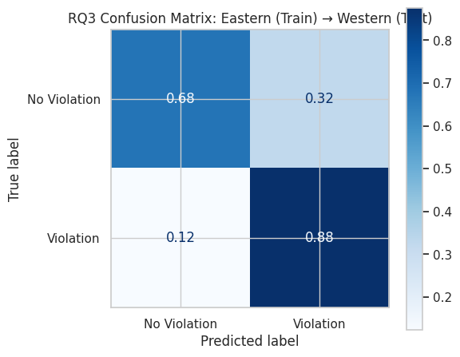
    

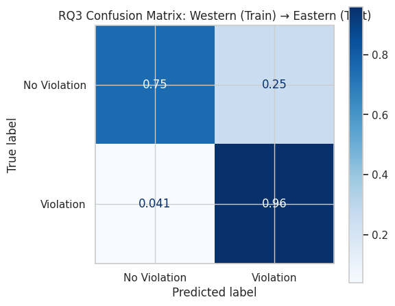
    

**Analysis**

These confusion matrices visually crystallize the performance asymmetry between the two regions. When the Eastern-trained model evaluates the Western docket, its precision collapses: it misclassifies 32% of actual "No Violation" cases as "Violations." The model is structurally predisposed to assume state fault, leading to a highly inflated False Positive rate.

In sharp contrast, the Western-trained model tested on the Eastern docket exhibits remarkable stability. It correctly identifies 96% of actual Violations and 75% of No Violations, maintaining a minimal False Negative rate of just 4.1%. The Western model possesses a sufficiently robust understanding of procedural balancing to handle Eastern cases, whereas the Eastern model lacks the vocabulary to appropriately identify justified state interference in the West.

**Feature Importance**

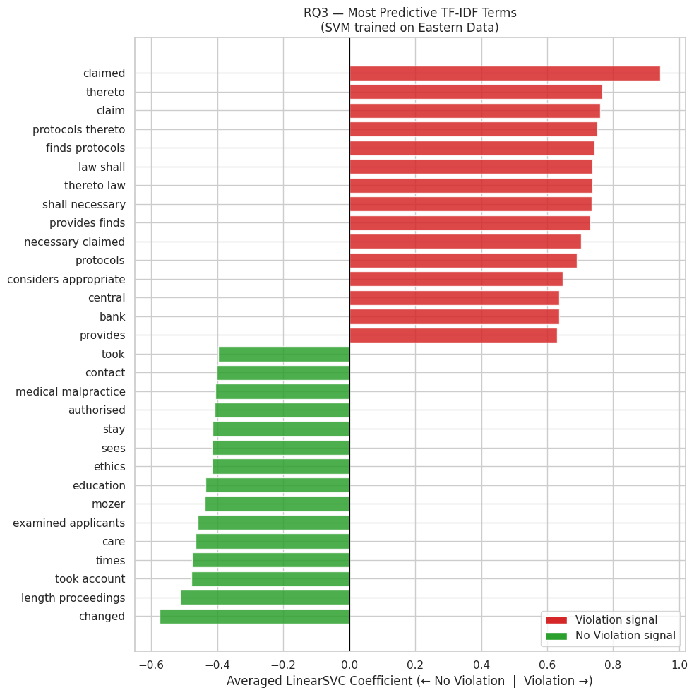
    

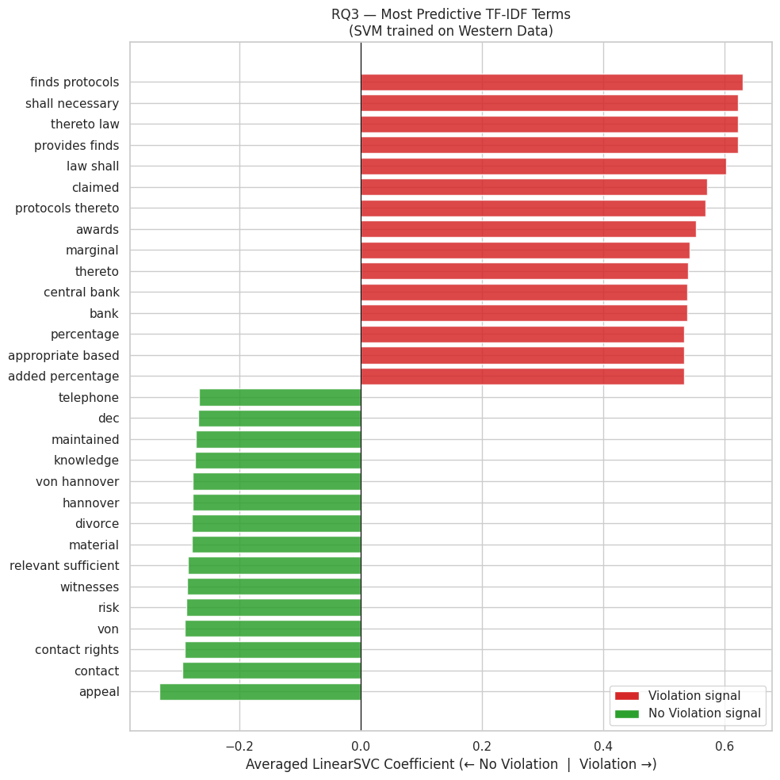
    

**Analysis**

Examining the top predictive TF-IDF terms extracted from both regional SVM models exposes a critical structural limitation in the models' learning process: pervasive Article 41 "Just Satisfaction" leakage. This was also previously hinted at in our EDA Section 4.3.2 which explores Top Article Pairing, showing the result that Article 41 dominated the article combinations. This is expected since Article 41 (just satisfaction) is always cited alongside any substantive violation finding to award compensation, and is consistent with the outcome-consequent language identified in the pecuniary damage concordance analysis.

**The Violation Signal (Structural Contamination):** In both the Eastern and Western models, the strongest signals for a "Violation" prediction are not substantive doctrinal concepts, but rather procedural boilerplate associated with remedial awards. Terms such as "claimed," "finds protocols," "thereto law," "awards," "marginal," and "central bank" overwhelmingly dominate the positive coefficients. This indicates that, despite utilizing the "Law Clean" text variant, the models artificially inflate their predictive success by detecting the structural presence of financial damage clauses rather than genuine Article 8 legal reasoning.

**The No Violation Signal (Jurisprudential Divergence):** As "No Violation" cases lack remedial awards, their predictive features offer a much more honest reflection of regional legal reasoning. The Eastern model's "No Violation" signal relies heavily on procedural delays and specific factual scenarios, utilizing terms like "length proceedings," "medical malpractice," "education," and specific citations ("mozer").

**Western Balancing Tests:** The Western model's "No Violation" signal, however, captures highly specific social and privacy balancing concepts. Its top predictive terms include "contact rights," "divorce," "appeal," and "von hannover", which may be referencing the Court's landmark doctrine balancing individual privacy against press freedom.

This sharp contrast in "No Violation" vocabulary mathematically confirms that the factual baselines and legal thresholds for justifying state interference differ fundamentally between Eastern and Western European courts, directly setting the stage for our misclassification analysis which we will explore in the following section.

### **3.2.2 Misclassification Analysis**
SVM Model trained on Eastern, tested on Western resulted in:

* False Positive (predicted V | true NV) : 46 cases
* False Negative (predicted NV | true V) : 17 cases

The performance gap between the two regional models is best understood through a misclassification analysis, which directly illustrates how regional biases impact our precision and recall. When the Eastern-trained SVM was applied to the Western test set, it produced a high number of False Positives (46 cases) alongside False Negatives (17 cases).

We utilized Generative AI, specifically the Gemini 2.5 Flash Lite Large Language Model (LLM), to read all the text in misclassified cases and diagnose the semantic and jurisprudential blind spots of our Eastern-trained SVM. Gemini is chosen rather Ollama because it can works in Collab environment, meanwhile Ollama can only work in local environment. The version 2.5 Flash Lite is accessible in Free Tier Google AI Account. We try this technique so that rather than manually reviewing dozens of misclassified Western cases, we use AI to programmatically extracted text snippets from the model's False Positives (15 sample case ) and False Negatives (15 sample case) and fed them into the LLM via an API. By prompting the AI to act as a legal expert in ECHR Article 8 jurisprudence, we instructed it to analyze these specific case clusters and output its findings using a strict, predefined JSON schema. This structured approach forced the LLM to identify common linguistic patterns, explain the root causes of the SVM's predictive failure, and isolate the complex Western legal features, such as nuanced proportionality tests and specific procedural vocabulary, that the algorithm systematically failed to recognize.

**Note :** To run this section, you need to input your Gemini Token. Without token, skip running this section and see the backup result here instead https://drive.google.com/file/d/1JON88sYZ0-S8QAYYcYPTVvZ6IZV8BwdW/view?usp=drive_link

<table border="1" class="dataframe">
  <thead>
    <tr style="text-align: right;">
      <th></th>
      <th>error_type</th>
      <th>cases_ids</th>
      <th>summary_of_common_factors</th>
      <th>why_model_failed_group</th>
      <th>western_legal_features_group</th>
      <th>regional_bias_insight_group</th>
      <th>key_legal_phrases_group</th>
    </tr>
  </thead>
  <tbody>
    <tr>
      <th>0</th>
      <td>False Positive</td>
      <td>[001-189641, 001-100293, 001-102940, 001-20044...</td>
      <td>These cases frequently involve state surveilla...</td>
      <td>The Eastern-trained SVM likely failed due to a...</td>
      <td>Western European jurisprudence under Article 8...</td>
      <td>The misclassification suggests that Eastern Eu...</td>
      <td>[necessity in a democratic society, respect fo...</td>
    </tr>
  </tbody>
</table>

<table border="1" class="dataframe">
  <thead>
    <tr style="text-align: right;">
      <th></th>
      <th>error_type</th>
      <th>cases_ids</th>
      <th>summary_of_common_factors</th>
      <th>why_model_failed_group</th>
      <th>western_legal_features_group</th>
      <th>regional_bias_insight_group</th>
      <th>key_legal_phrases_group</th>
    </tr>
  </thead>
  <tbody>
    <tr>
      <th>0</th>
      <td>False Negative</td>
      <td>[001-106282, 001-99817, 001-199382, 001-113460...</td>
      <td>These cases predominantly concern family life ...</td>
      <td>The model, trained exclusively on Eastern Euro...</td>
      <td>Western European Article 8 jurisprudence often...</td>
      <td>The bias suggests that Eastern European Articl...</td>
      <td>[respect for private and family life, necessar...</td>
    </tr>
  </tbody>
</table>

**Analysis**

**False Positives: The Procedural Blindspot:**

The high False Positive rate severely degraded the model's precision, as it incorrectly flagged numerous actual "No Violation" cases as "Violations". This misclassification stems from a fundamental vocabulary and phrasing bias rooted in the structural differences of how these regions reason under Article 8. Eastern European cases frequently focus on direct, substantive violations of rights, leading the Eastern-trained algorithm to over-rely on specific linguistic markers tied to those direct breaches.

However, Western European jurisprudence frequently employs a much more elaborate, procedural legal lexicon. Western cases involve robust engagement with the domestic legal system as a prerequisite to Strasbourg review, requiring careful navigation of procedural pathways. These cases feature intricate discussions on the "exhaustion of domestic remedies," time limits, and specific civil claims for redress. As the Eastern model was trained on a less procedurally complex dataset, it is structurally blind to sophisticated Western legal terms like "locus standi," "judicial review," "declaration of incompatibility," and "manifestly ill-founded". When faced with this dense procedural and comparative legal language, the model incorrectly interprets the complex navigation of domestic remedies as evidence of a state violation.

**False Negatives: The Proportionality and Family Life Blindspot:**

Conversely, the 17 False Negative cases, where the model failed to identify actual violations, highlight a secondary blindspot regarding substantive balancing tests. These misclassified cases predominantly revolve around complex "family life" issues, such as immigration, deportation, adoption, and child welfare.

In these contexts, Western courts apply a highly explicit and granular balancing exercise between an individual's rights and the state's legitimate aims. The Eastern model fails to recognize the nuanced legal terminology used in Western proportionality and necessity tests, missing the subtle variations in how Western courts elaborate on concepts like "necessary in a democratic society" or the "protection of health or morals". Furthermore, Western cases frequently explore the evolving nature of "family life" (e.g., step-families, single parents) and recognize the positive obligations of the state, heavily invoking the "margin of appreciation" to assess the state's room for maneuver. Since these violations are framed within intricate proportionality assessments rather than explicit descriptions of state overreach, the Eastern model fails to detect them as core Article 8 infringements.

Ultimately, this asymmetric generalisation failure highlights fundamentally divergent jurisprudential landscapes. The Eastern-trained model over-relied on specific linguistic markers and reasoning patterns prevalent in its own region. The Gemini analysis further confirmed this by identifying additional evidence of procedural vocabulary gaps. Consequently, the model failed to generalize beyond its specific regional "dialect" when faced with the elaborate jurisprudential frameworks, complex proportionality assessments, and unique procedural emphases characteristic of Western European courts.

### **3.2.3 Exploration on Turkey**
SVM and Prediction Scores on Turkey

    Turkey cases for testing: 42 (Violations: 34, No Violations: 7)
    
    Evaluating Eastern-trained Naive Bayes on Turkey data...
      Eastern-trained Naive Bayes on Turkey: F1_macro=0.3466, Accuracy=0.7619
                  precision    recall  f1-score   support
    
    No Violation       0.84      0.91      0.87        34
       Violation       0.20      0.14      0.17         7
    
        accuracy                           0.76        42
       macro avg       0.35      0.35      0.35        42
    weighted avg       0.71      0.76      0.73        42

​    
​    Evaluating Eastern-trained SVM on Turkey data...
​      Eastern-trained SVM on Turkey: F1_macro=0.3182, Accuracy=0.6905
​                  precision    recall  f1-score   support
​    
    No Violation       0.80      0.82      0.81        34
       Violation       0.14      0.14      0.14         7
    
        accuracy                           0.69        42
       macro avg       0.31      0.32      0.32        42
    weighted avg       0.67      0.69      0.68        42

​    
​    Evaluating Western-trained Naive Bayes on Turkey data...
​      Western-trained Naive Bayes on Turkey: F1_macro=0.3754, Accuracy=0.7381
​                  precision    recall  f1-score   support
​    
    No Violation       0.83      0.85      0.84        34
       Violation       0.29      0.29      0.29         7
    
        accuracy                           0.74        42
       macro avg       0.37      0.38      0.38        42
    weighted avg       0.72      0.74      0.73        42

​    
​    Evaluating Western-trained SVM on Turkey data...
​      Western-trained SVM on Turkey: F1_macro=0.4552, Accuracy=0.7857
​                  precision    recall  f1-score   support
​    
    No Violation       0.88      0.85      0.87        34
       Violation       0.44      0.57      0.50         7
    
        accuracy                           0.79        42
       macro avg       0.44      0.47      0.46        42
    weighted avg       0.79      0.79      0.78        42

​    
​    ==================================================
​    RQ3 Generalisation: Eastern vs Western Model on Turkey
​    ==================================================
​    F1_macro Scores on Turkey Data (Naive Bayes first, then SVM):
​                          Model  F1_macro
​    Eastern-trained Naive Bayes  0.346635
​    Western-trained Naive Bayes  0.375431
​            Eastern-trained SVM  0.318150
​            Western-trained SVM  0.455224

Cosine Similarity and TF-IDF Centroids Exploration on Turkey

    ------------------------------------------------------------
    RQ3: Mapping Turkey's Jurisprudential Alignment via Cosine Similarity
    ------------------------------------------------------------
    Cosine Similarity: Turkey vs. Eastern Europe : 0.8222
    Cosine Similarity: Turkey vs. Western Europe : 0.7845
    ------------------------------------------------------------
    VERDICT: Turkey aligns mathematically closer to Eastern Europe.

To further explore cross-regional generalisation, we isolated cases from Turkey (42 cases) as a boundary state and evaluated them against both regional models.

**Mathematical Alignment vs. Predictive Success**

We first sought to mathematically verify Turkey's alignment using Cosine Similarity. By calculating the TF-IDF centroid, the "average" mathematical representation of a judgment's vocabulary, we mapped the relative distances between regional clusters within our high-dimensional vector space. Turkey's semantic centroid generates a notably higher cosine similarity score when measured against Eastern Europe (0.8222) compared to Western Europe (0.7845). This indicates that the baseline factual scenarios, procedural posture, and general context of Turkish cases strongly mirror the Eastern European docket. This factual alignment with the Eastern docket reflects historical observations by scholars like Çalı (2010), who note that Turkey's human rights litigation profile at the ECtHR has traditionally mirrored the structural and systemic violation patterns seen in post-Soviet states.
However, the predictive metrics reveal a compelling paradox. Despite Turkey's factual alignment with the East, the Western-trained SVM achieved a higher Macro F1 score (0.455) on Turkish cases compared to the Eastern-trained SVM (0.318).

**Interpreting the Metrics: Precision, Recall, and the "Why"**

In understanding why the Western model outperformed the Eastern model on an "Eastern-leaning" docket, we must look beyond raw accuracy and examine how the models handled the dataset's severe class imbalance (34 "Violation" cases versus 7 "No Violation" cases). As established, the true "goodness" of a model in an imbalanced setting relies on its precision and recall for the minority class.
The Eastern-trained SVM struggled severely with the minority "Violation" class, achieving a dismal recall of 0.14 and a precision of 0.14. It essentially failed to catch the actual violations (poor recall) and made highly inaccurate predictions when it did flag them (poor precision). In contrast, the Western-trained SVM demonstrated vastly superior discriminative power, improving minority class recall to 0.57 and precision to 0.44. The Western model was far better at "retrieving" the true violations without aggressively misclassifying the rest of the docket. The weighted F1 score balances these metrics, proving the Western model is structurally superior at handling this specific dataset.

**The Root Cause: Generalisation vs. Overfitting**

This discrepancy perfectly illustrates our hypothesis regarding training balance and model generalisation. The Eastern European dataset is overwhelmingly dominated by cases from a single country (Russia) with a near-universal violation rate. Consequently, the Eastern-trained model becomes over-fitted to Russian factual boilerplate and systemic structural failures. It learns to memorize country-specific facts and assumes state interference automatically equals a violation.

Conversely, the Western dataset, while smaller, is geographically diverse and exhibits more balanced distribution of outcomes. This balanced training environment forces the Western-trained model to learn more applicable, generalized legal reasoning. To succeed on its own training data, the Western model had to learn the actual doctrinal boundaries of proportionality and the "margin of appreciation" rather than relying on factual shortcuts.

Turkey acts as a jurisprudential bridge. While its factual vocabulary is distinctly Eastern, the specific doctrinal language that separates a justified state action from a human rights violation requires the generalized legal learning that only the Western-trained model possesses.

The Turkey analysis represents more than a robustness check on the regional
generalisation experiment. It introduces a methodological framework for identifying
jurisprudential boundary states, defined as countries whose factual vocabulary aligns
with one regional bloc but whose doctrinal reasoning aligns with another. Cosine
similarity alone would classify Turkey as Eastern, but predictive performance reveals it
is better served by a Western-trained model. This divergence between mathematical
alignment and predictive success suggests that TF-IDF centroid distance is an
insufficient proxy for legal similarity, and that outcome-predictive capacity is a more
meaningful measure of jurisprudential affinity than vocabulary overlap. Future work could
apply this boundary-state framework systematically across the full respondent state list,
using the gap between centroid alignment and model performance as a diagnostic tool for
identifying states undergoing doctrinal convergence or divergence from the mainstream of
Convention jurisprudence.

### **3.2.4 Topic-based SVMs and Feature Importance for Eastern Europe and Western Europe (with k=20)**

Under Shifterator (Section 5.4) of our EDA findings, as mentioned above, the word shift graphs visually quantified the vocabulary that most heavily tilted a judgment toward a specific outcome. The analysis highlighted that terms like "russian" and "russia" disproportionately contributed to violation cases. This was the base for our regional bias hypothesis. The Shifterator results proved early on that the model was associating specific geographic indicators with violations. In RQ3, our feature importance analysis below will explore and validate this hypothesis by showing that the Eastern-trained SVM was structurally predisposed to assume state fault, relying heavily on specific linguistic markers tied to direct breaches.

Data Processing

    Creating 'analysis_text' column in df_art8...
    Preparing text data for Eastern and Western regions...
    Extracting 20 topics via NMF...

NMF and Top 15 words for each topic:

    === Eastern NMF Topics (k=20) — Top 15 Words ===
    
    Topic 1: constitutional | official gazette | gazette | zakon | municipal | sud | croatian | constitutional complaint | act zakon | act | croatia | republike | zagreb | remedies | county
    Topic 2: appended table | appended | table | wellestablished caselaw | wellestablished | examined material | applications | russia | indicated appended | inadequate conditions | russia nos | having examined | detention | raised complaints | complaints
    Topic 3: eur | plus tax | tax chargeable | chargeable | plus | tax | costs | damage | nonpecuniary damage | expenses | nonpecuniary | eur nonpecuniary | costs expenses | eur costs | damage plus
    Topic 4: child | childs | contact | parent | father | parents | parental | mother | enforcement | contact rights | best interests | children | best | enforcement proceedings | interests child
    Topic 5: zubkov | surveillance | secret surveillance | russia november | surveillance measures | secret | covert surveillance | covert | interception | context criminal | appended table | appended | communications | table | russia
    Topic 6: council | parliament | political | parliamentary | committee | ministers | europe | minister | member | assembly | member states | countries | international | constitution | discrimination
    Topic 7: permanent video | video surveillance | postconviction detention | postconviction | gorlov | video | surveillance | detainees | detainees right | permanent | detention facilities | placement | facilities | detention | ibid
    Topic 8: eviction | flat | housing | right home | tenancy | applicants eviction | evicted | eviction order | property | accommodation | owner | home | flats | ownership | housing code
    Topic 9: search | warrant | seizure | police | investigation | seized | criminal procedure | criminal | code criminal | officers | investigator | prosecutor | procedure | search warrant | authorisation
    Topic 10: residence permit | expulsion | russian | permit | residence | migration | deportation | immigration | exclusion | exclusion order | nationals | aliens | fms | migration service | foreign
    Topic 11: hague | removal retention | return child | retention | return | habitual | habitual residence | abduction | child abduction | wrongful | international child | child | judicial administrative | rights custody | order return
    Topic 12: freedom expression | reputation | publication | newspaper | expression | journalist | freedom | journalists | debate | media | press | right freedom | published | von hannover | hannover
    Topic 13: cell | conditions detention | cells | prison | inmates | prisoners | space | detention | sq | conditions | toilet | degrading | prison authorities | detainees | overcrowding
    Topic 14: burial | deceased | armed | terrorist | russian | death | mr | federal | interment | servicemen | killed | relatives | terrorism | investigator | attack
    Topic 15: hospital | medical | patients | patient | consent | care | doctors | psychiatric | doctor | treatment | hospitals | mental | legal capacity | medical treatment | illness
    Topic 16: violence | sexual | police | investigation | victims | injuries | rape | illtreatment | perpetrator | perpetrators | incident | mc | physical | criminallaw | prosecution
    Topic 17: visits | prison | prisoners | sentences | restrictions | code execution | visit | sentence | criminal sentences | execution criminal | imprisonment | convicted | visitors | prisoner | life
    Topic 18: pretrial detention | release | detention | trial | pretrial | pending trial | applicants detention | applicants pretrial | remand | trial reasonable | arrested | reasonable time | length | preventive | pending
    Topic 19: rate | default rate | rate based | default | lending | marginal lending | rate european | percentage points | lending rate | european central | central bank | marginal | percentage | bank added | added percentage
    Topic 20: mrt | mozer | mozer cited | moldovan | ilacu | republic moldova | ilacu cited | moldova | ivanoc | effective control | russian federation | russian | federation | republic | region

​    
​    === Western NMF Topics (k=20) — Top 15 Words ===
​    
    Topic 1: hague | custody | removal retention | return child | child | abduction | childs | child abduction | enforcement | wrongful | childs return | mother | youth | italian | district
    Topic 2: expulsion | expelled | country expelled | deportation | prison | ner | convicted | offence committed | offences | ties | boultif | sentenced | offence | encounter country | social cultural
    Topic 3: child welfare | care order | foster home | foster | county social | welfare board | welfare services | xs | county | contact sessions | board | welfare act | welfare | contact rights | placement
    Topic 4: samesex | partnership | samesex couples | registered partnership | partnerships | differentsex | marry | legal recognition | couples | schalk | schalk kopf | sexual orientation | kopf | partners | orientation
    Topic 5: freedom expression | media | publication | reputation | expression | freedom | press | hannover | von hannover | debate | right freedom | von | axel springer | springer | axel
    Topic 6: expenses | costs expenses | costs | eur | incurred | plus tax | chargeable | tax chargeable | nonpecuniary damage | damage | nonpecuniary | eur nonpecuniary | plus | tax | award
    Topic 7: difference treatment | discrimination | difference | discriminatory | enjoyment rights | treatment | reasonable justification | objective reasonable | similar situations | justification | sex | proportionality means | citizenship | ambit | different treatment
    Topic 8: seizure | search | search seizure | seized | criminal procedure | code criminal | search warrant | searches | warrant | investigation | prosecution | criminal | premises | data | items
    Topic 9: paternity act | paternity | paternity proceedings | putative | paternity established | recognition paternity | fiveyear | timelimit | born wedlock | supervisor | wedlock | mikuli | biological father | legal certainty | biological
    Topic 10: immigration | residence permit | immigration authorities | immigration appeals | nunez | rodrigues | rodrigues da | silva hoogkamer | hoogkamer | immigration act | norwegian | residence | permit | directorate | city
    Topic 11: danish | reentry | reentry ban | aliens act | expulsion order | expulsion | denmark | ties denmark | denmarks international | aliens | denmarks | penal code | danish courts | ban | penal
    Topic 12: interception | intelligence | surveillance | intercepted | communications | interception communications | ipt | secret surveillance | weber | saravia | weber saravia | ripa | intercept | communications intercepted | surveillance measures
    Topic 13: medical | suicide | prescription | patients | doctors | doctor | suffering | patient | end life | lethal | pretty | products | illness | selfdetermination | die
    Topic 14: surrogacy | parentchild relationship | parentchild | adoption | legal parentchild | surrogate | intended parents | surrogate mother | birth certificate | fertilisation | biological | parentage | assisted reproduction | childs | child
    Topic 15: civil code | legal father | biological father | paternity | social relationship | biological | legal parents | childs | father | father child | anayo | child | german | expert | wedlock
    Topic 16: asylum | aliens | alien | residence permit | stay execution | detention | removal order | removal | degrading treatment | residence | inhuman degrading | inhuman | degrading | refugees | torture
    Topic 17: social council | childrens | social services | care | public care | parents | health development | care order | children | best interests | contact | interests children | administrative appeal | parental | councils
    Topic 18: lord | lords | house lords | gbp | secretary | judicial review | local | test | house | rights act | judge | england | properly | review | scheme
    Topic 19: personal data | data | processing | data subject | data protection | processing personal | database | stored | deletion | data subjects | processed | data processing | retention | marper | marper cited
    Topic 20: church | catholic | religious | catholic church | beliefs | religion belief | churchs | dismissal | religion | diocese | employees | spanish | employment tribunal | employer | freedom religion

**Analysis**

In order for us to better understand the semantic divergence between the regions, we applied Non-Negative Matrix Factorization (NMF) to extract latent legal topics from the text. A recognized limitation of NMF is hyperparameter rigidity, specifically, the requirement to pre-define the number of topics (k). We deliberately constrained the model to exactly 20 topics (k=20) for both the Eastern and Western corpora. While the "true" optimal number of legal themes might organically differ between the two regions, forcing k=20 is a necessary stabilizing mechanism given the smaller, partitioned regional datasets. This threshold provides enough granularity to capture substantive legal doctrines while preventing "topic splintering", where coherent concepts break into noisy, meaningless fragments, and avoiding the high dimensionality that would cause the subsequent SVM to overfit the training data.

An analysis of the top 15 words per topic confirms that k=20 successfully extracts highly distinct, interpretable legal themes that highlight the fundamental differences between the dockets. The Eastern topics are heavily dominated by vocabulary reflecting physical state overreach and systemic infrastructural failures (e.g., "appended table/inadequate conditions," "secret surveillance/zubkov," "cell/overcrowding," and "armed/terrorist/killed"). In contrast, the Western topics reveal a jurisprudence centered on administrative, technological, and evolving social rights (e.g., "samesex/partnership," "freedom expression/von hannover," "personal data/marper," and "surrogacy"). This confirms that the baseline factual matrix of what constitutes a human rights dispute differs fundamentally depending on the region.

Training and Confusion Matrices

    Training SVMs on Topic Weights...
    
    --- Evaluation for Eastern Topics SVM ---
    Classification Report (Eastern Topics SVM):
                  precision    recall  f1-score   support
    
    No Violation       0.31      0.72      0.44       132
       Violation       0.94      0.74      0.83       809
    
        accuracy                           0.74       941
       macro avg       0.63      0.73      0.63       941
    weighted avg       0.85      0.74      0.77       941

​    
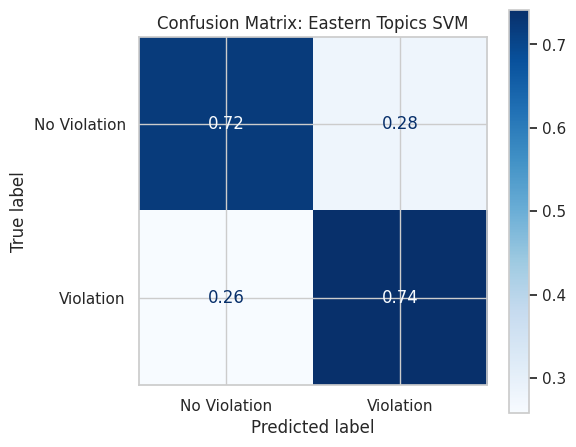
​    

​    
​    --- Evaluation for Western Topics SVM ---
​    Classification Report (Western Topics SVM):
​                  precision    recall  f1-score   support
​    
    No Violation       0.76      0.69      0.72       143
       Violation       0.70      0.77      0.73       137
    
        accuracy                           0.73       280
       macro avg       0.73      0.73      0.73       280
    weighted avg       0.73      0.73      0.73       280

​    
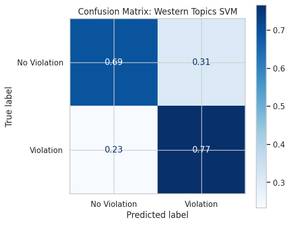
​    

In addition, we trained separate Linear SVMs on the topic weights for each region, to help us determine if these 20 thematic topics are sufficient to train a predictive model. The confusion matrices demonstrate that these 20 topics provide a remarkably robust training signal when the models are evaluated on their native jurisprudence.

Despite the severe class imbalance inherent to the dataset, the Eastern Topics SVM correctly classifies 74% of actual violations and 72% of actual "No Violations". Similarly, the Western Topics SVM successfully identifies 77% of actual violations and 69% of actual "No Violations". The fact that both models maintain strong diagonal performance and avoid collapsing into majority-class prediction proves that the 20 extracted topics effectively capture the critical decision boundaries needed to predict outcomes within their specific regional contexts.

Feature Importance and Topic Weights Analysis

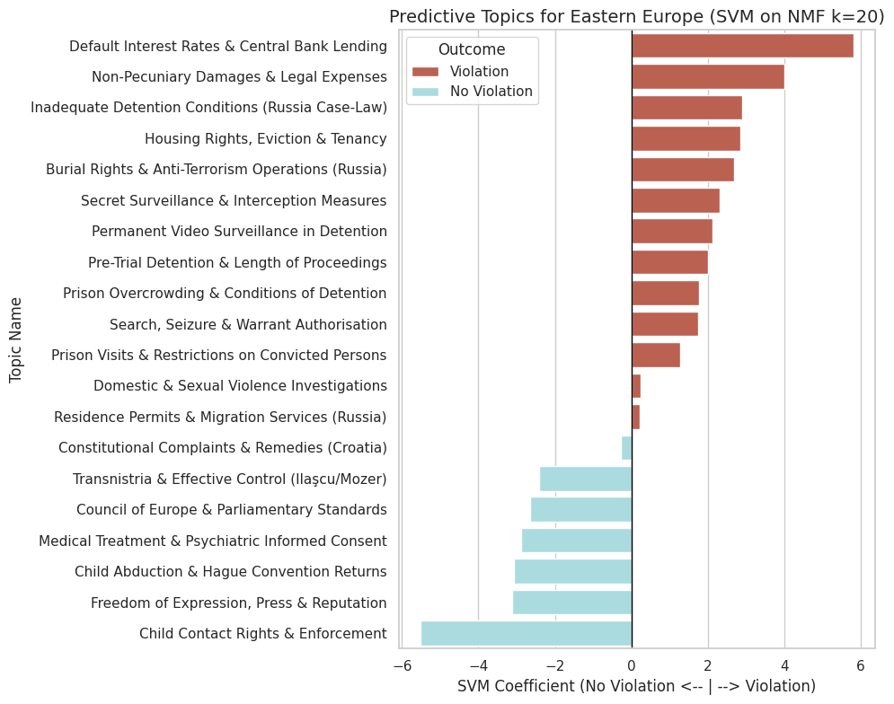
    

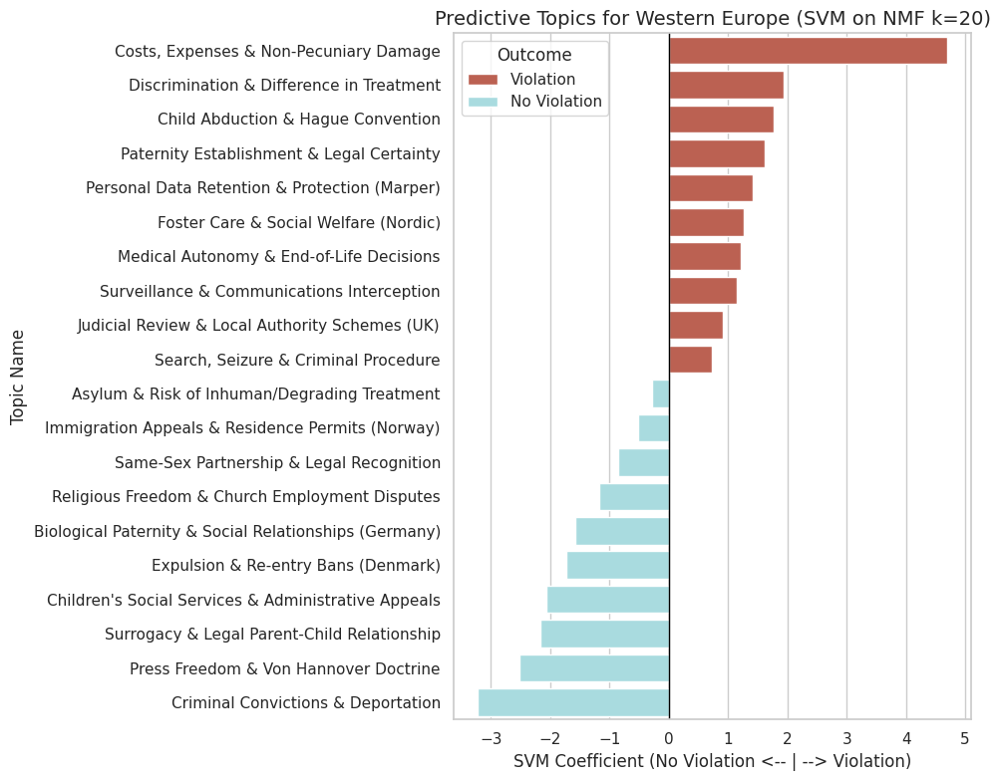
    

To understand the semantic divergence between Eastern and Western European ECHR Article 8 cases, we trained separate Linear SVM classifiers on the 20 NMF-generated topic features for each region. The resulting feature importance charts measured by the SVM coefficients reveal stark differences in the types of cases that drive "Violation" versus "No Violation" findings in each bloc.

Setting aside this structural artifact, the substantive predictive topics clearly illustrate the diverging jurisprudential landscapes:

**Eastern Europe: Systemic Failures vs. Family Disputes**

The Eastern European model reveals a jurisprudence heavily weighted by structural and physical state interference.

**Predictive of Violation:** Setting aside the dominant outcome-leakage topic ("eur, plus tax"), the Eastern violation topics are characterized by severe, systemic, and physical breaches of rights. The most predictive topics include Russian batch applications and boilerplate ("appended table"), state surveillance ("zubkov, secret surveillance"), extreme prison conditions ("cell, conditions detention", "permanent video"), police overreach ("search, warrant, police, seizure"), and lethal state action ("burial, deceased, armed, terrorist").

**Predictive of No Violation:** The strongest predictors for a "No Violation" in the East center on private family matters. Topics like "child, contact, parent" and "hague, removal retention" indicate that when Eastern states adjudicate child custody or family contact disputes, the ECtHR frequently finds that the domestic authorities operated within their margin of appreciation.

**Western Europe: Nuanced Rights vs. Migration Margin**

The Western European model maps a vastly different legal landscape, focused more on administrative, technological, and evolving social rights.

**Predictive of Violation:** Again, ignoring the outcome-leakage topic ("expenses, costs"), the Western violation topics are highly administrative and specific. They include "data protection, processing, personal data," "paternity act, putative," and "difference treatment, discrimination." Interestingly, "hague, custody, removal retention" is a strong violation predictor in the West, directly contrasting with the East where it reliably predicted No Violation.

**Predictive of No Violation:** The Western model's non-violation boundary is defined almost entirely by areas where the Court grants states a wide margin of appreciation. The strongest predictors include migration and deportation ("expulsion, expelled, deportation", "asylum, aliens, residence permit", "danish, reentry ban"), as well as evolving social issues lacking a European consensus, such as "samesex, partnership" and "surrogacy, adoption".

While the Topic-Based SVM provides a highly interpretable mechanism for mapping the jurisprudential divide between Eastern and Western Europe, it is imperative to acknowledge the methodological limitations inherent to this approach. Addressing these constraints is essential for preserving the construct validity of our findings and ensuring we do not conflate mathematical artefacts with genuine legal inference. By transparently defining where the NMF and SVM architecture falls short, we can accurately contextualize our predictive metrics, avoid overstating the model's capacity for substantive legal reasoning, and establish a rigorous theoretical foundation for the deep semantic analysis that follows. While NMF clustering provides excellent interpretability and successfully exposes these regional differences, this specific application is constrained by three distinct limitations:

**The "Just Satisfaction" Outcome Leakage:** As established in our EDA findings (Section 4.3) on Article Pairing, as well as RQ1 and RQ2 analyses, the same structural caveat regarding Article 41 heavily applies here. In the feature importance charts, the absolute strongest predictors of a Violation are topics dominated by financial remedy boilerplate rather than substantive law. This directly corroborates the findings of Medvedeva et al. (2020), who warned that ECtHR predictive models often suffer from "future leakage." As the Court drafts its judgments retroactively, algorithms easily learn to identify the structural presence of Article 41 damages rather than the substantive legal arguments that led to them. For the Eastern model, the top predictor is "Default Interest Rates & Central Bank Lending," followed closely by "Non-Pecuniary Damages & Legal Expenses." For the Western model, the strongest predictor is "Costs, Expenses & Non-Pecuniary Damage." As noted for RQ2, leakage topics like Default Interest Rate, Legal Costs Reimbursement, Pecuniary Damages, and Remedies & Damages carry a 100% violation signal and function as near-perfect violation predictors in the topic weight feature matrix. Therefore, a proportion of the models' predictive success is attributable to these leakage-contaminated features rather than genuine legal thematic discrimination. Again to reiterate, this leakage can be mitigated by explicitly excising all 'just satisfaction' paragraphs before feeding the corpus into the NMF model. Taking this preprocessing step is essential to ensure that our predictive metrics reflect genuine jurisprudential themes rather than superficial formatting artifacts.

**Hyperparameter Rigidity (k=20):** We constrained the NMF algorithm to find exactly 20 topics for both the East and the West. While the true "optimal" number of legal themes likely differs between regions, this hyperparameter adjustment is necessary due to the reduced size of the partitioned regional corpora. Maintaining a higher $k$ on these smaller subsets would risk "topic splintering" and introduce high dimensionality, causing the subsequent Linear SVM to overfit the training data. Forcing $k=20$ provides an optimal balance, ensuring the extracted features represent dense, substantive legal doctrines rather than mathematical noise, even if it risks minor "topic collapsing" (mashing distinct concepts into one).

**Static Word Representation:** NMF is essentially a sophisticated "bag-of-words" approach. It groups words that frequently co-occur, but it does not understand context or syntax. For example, the word "child" appears in both violation and non-violation topics, but NMF cannot tell us how the word is being used. To truly understand how the Court's reasoning changes, for instance, how the exact phrase "margin of appreciation" is applied differently in the East versus the West, we must move beyond static topic distributions and examine the semantic neighborhoods of the words themselves.

This final limitation directly necessitates the use of neural word embeddings, which we will explore in RQ4 using Word2Vec.

## **3.3 Conclusion**

The cross-regional generalisation experiment reveals a pronounced and asymmetric answer to RQ3. A model trained on Western European cases generalises strongly to the Eastern corpus, achieving a macro F1 of 0.85, while a model trained on Eastern European cases generalises substantially less well to the Western corpus, achieving a macro F1 of 0.77.

The confusion matrices clarify what drives this asymmetry. The Eastern-trained model applied to Western cases achieves a recall of 0.88 for actual violations but only 0.68 for actual no-violation cases, meaning it misclassifies 32% of genuine no-violation outcomes as violations. The model is structurally predisposed to predict state fault regardless of whether Western legal reasoning supports that conclusion. The Western-trained model applied to Eastern cases suffers no comparable collapse, correctly identifying 96% of violations and 75% of no-violation cases. The failure is therefore directional, the Eastern model lacks the vocabulary to recognise justified state interference in Western cases, while the Western model possesses sufficient generalised legal reasoning to handle Eastern cases adequately.

The feature importance analysis identifies two explanations for this pattern. The first is structural, both models are partially contaminated by Article 41 leakage, with the strongest violation-side predictors in both the Eastern and Western classifiers being remedial boilerplate terms such as "claimed", "finds protocols", "thereto law" and "awards" rather than substantive legal reasoning vocabulary. This inflates both models' apparent performance and means that a portion of the predictive signal in each direction reflects the presence or absence of just satisfaction language rather than genuine doctrinal discrimination. The second explanation is respondent state concentration. The Eastern corpus is dominated by Russian cases carrying near-universal violation rates, causing the Eastern-trained model to learn country-specific factual patterns rather than transferable legal principles. When faced with Western cases that involve complex proportionality assessments and elaborate domestic remedy procedures, the Eastern model misreads procedural complexity as evidence of violation.

The no-violation feature vocabulary makes this divergence concrete. The Eastern model's strongest no-violation predictors are procedural delay terms and specific factual scenarios, including "length proceedings", "medical malpractice" and "education" as well as a named-case citation ("mozer"). The Western model's no-violation signal is anchored in substantive social rights and privacy balancing concepts, including "contact rights", "divorce", "appeal”. These are not interchangeable legal vocabularies. A classifier trained on the Eastern signal has no basis for recognising Western proportionality reasoning as a no-violation marker.

The Turkey analysis strengthens this interpretation. Turkey's TF-IDF centroid is factually closer to the Eastern corpus, with a cosine similarity of 0.8222 against 0.7845 for the Western corpus, yet the Western-trained model outperforms the Eastern-trained model on Turkish cases, achieving Macro F1 of 0.45 against 0.31. Turkey acts as a jurisprudential boundary state: its cases share the factual vocabulary of Eastern European litigation but require the doctrinal balancing analysis that the Western model has learned to apply. The Eastern model's failure on Turkish cases despite their factual alignment with Eastern docket patterns confirms that the generalisation gap is not primarily a factual vocabulary problem but a legal reasoning problem rooted in Russia-specific overfitting.

In answer to RQ3, the generalisation capacity of Article 8 classifiers is asymmetric and corpus-dependent. Western-trained models generalise effectively to Eastern cases because they have learned a more broadly applicable doctrinal framework. Eastern-trained models fail to generalise to Western cases because they have learned a regionally specific pattern of state interference that does not transfer to the proportionality-centred reasoning characteristic of Western jurisprudence. A genuinely portable Article 8 classifier would require a balanced, geographically diverse training corpus with Article 41 text removed prior to feature extraction.

# **RQ4: Semantic Analysis between Region**

---

RQ3 revealed a clear asymmetry in how well Article 8 classifiers travel across regional boundaries. RQ4 therefore examines a subtler possibility: even when Eastern and Western courts use the same legal words, those words may not carry the same meaning in practice.

Terms such as margin of appreciation, proportionate, and family life appear in virtually every Article 8 judgment regardless of region. A bag-of-words model like TF-IDF treats identical words as identical features, so it cannot detect that proportionate in a Russian surveillance case and proportionate in a French child-custody dispute may be doing very different doctrinal work.

RQ4 tests this directly. By training separate Word2Vec models on each regional corpus and comparing the semantic neighbourhoods of key doctrinal terms, we ask whether the classifier’s failure to generalise is partly a consequence of genuine semantic drift in the legal vocabulary itself.

## 4.1 EDA - Focal Term

RQ3 established that the generalisation gap is real and asymmetric, but it does not
explain why — RQ4 addresses this by asking whether the same legal terms carry
different semantic content across the two regional corpora.

To investigate semantic drift, we focus on important legal terms drawn from Article 8 and core ECHR doctrine. These focal terms are expected to appear across judgments in both regions, making them useful anchors for comparing whether the same word functions similarly in different legal contexts.

> **Article 8**
>
> 1 Everyone has the right to respect for his **private and family life**, his **home** and his **correspondence**.
>
> 2 There shall be no interference by a public authority with the exercise of this right except such as is in accordance with the law and is **necessary** in a **democratic** society in the interests of national **security**, public **safety** or the economic well-being of the country, for the prevention of disorder or crime, for the protection of health or morals, or for the protection of the rights and freedoms of others.

**Focal Term**

The focal terms were drawn directly from the text of Article 8 and core ECHR doctrine. These are words the Court is expected to use in every judgment regardless of region. These words are chosen by our team member with legal background as representative terms for detecting potential semantic drift within the technical limits of the method, although this is not intended to be an exhaustive list.

The thirteen focal terms examined are: **margin | margin appreciation | proportionate | necessary | democratic | integrity | private_life | family_life | correspondence | safety | security | home | positive obligations.**

### **4.1.1 Focal Term Occurences**

Before measuring whether a term means something different across regions, we first check whether it is used at the same rate. A term that appears rarely in one region produces unreliable embeddings, so frequency is a necessary sanity check before interpreting any drift or semantic difference.

    Eastern cases : 937
    Western cases : 277
    Focal Term Occurrences in Eastern vs. Western Data:

<table border="1" class="dataframe">
  <thead>
    <tr style="text-align: right;">
      <th></th>
      <th>Focal Term</th>
      <th>Eastern Data Occurrences</th>
      <th>Western Data Occurrences</th>
    </tr>
  </thead>
  <tbody>
    <tr>
      <th>0</th>
      <td>necessary</td>
      <td>866</td>
      <td>271</td>
    </tr>
    <tr>
      <th>2</th>
      <td>democratic</td>
      <td>780</td>
      <td>267</td>
    </tr>
    <tr>
      <th>5</th>
      <td>safety</td>
      <td>761</td>
      <td>253</td>
    </tr>
    <tr>
      <th>4</th>
      <td>security</td>
      <td>759</td>
      <td>252</td>
    </tr>
    <tr>
      <th>12</th>
      <td>family_life</td>
      <td>659</td>
      <td>258</td>
    </tr>
    <tr>
      <th>8</th>
      <td>home</td>
      <td>560</td>
      <td>221</td>
    </tr>
    <tr>
      <th>3</th>
      <td>correspondence</td>
      <td>530</td>
      <td>197</td>
    </tr>
    <tr>
      <th>9</th>
      <td>correspondence</td>
      <td>530</td>
      <td>197</td>
    </tr>
    <tr>
      <th>11</th>
      <td>private_life</td>
      <td>415</td>
      <td>168</td>
    </tr>
    <tr>
      <th>7</th>
      <td>margin</td>
      <td>365</td>
      <td>227</td>
    </tr>
    <tr>
      <th>1</th>
      <td>proportionate</td>
      <td>298</td>
      <td>153</td>
    </tr>
    <tr>
      <th>13</th>
      <td>positive_obligation</td>
      <td>207</td>
      <td>77</td>
    </tr>
    <tr>
      <th>6</th>
      <td>integrity</td>
      <td>167</td>
      <td>80</td>
    </tr>
    <tr>
      <th>10</th>
      <td>margin_appreciation</td>
      <td>1</td>
      <td>0</td>
    </tr>
  </tbody>
</table>

All thirteen focal terms appear in both regional corpora, which confirms they are active doctrinal vocabulary in both East and West rather than region-specific language. However, the raw counts vary considerably across regions. Terms like `necessary` (East: 866, West: 271), `democratic` (East: 780, West: 267), `safety` (East: 761), and `security` (East: 759) appear far more frequently in Eastern cases. Meanwhile, `margin` (East: 365, West: 227) and `proportionate` (East: 298, West: 153) show a more balanced but still unequal distribution.

We realize that raw count is not really representative because Eastern corpora consist of more cases compare to Western corpora, therefore in the next step we try to visualize it in normalized bar chart to show more balanced view.

### **4.1.2 Normalized Bar Chart**

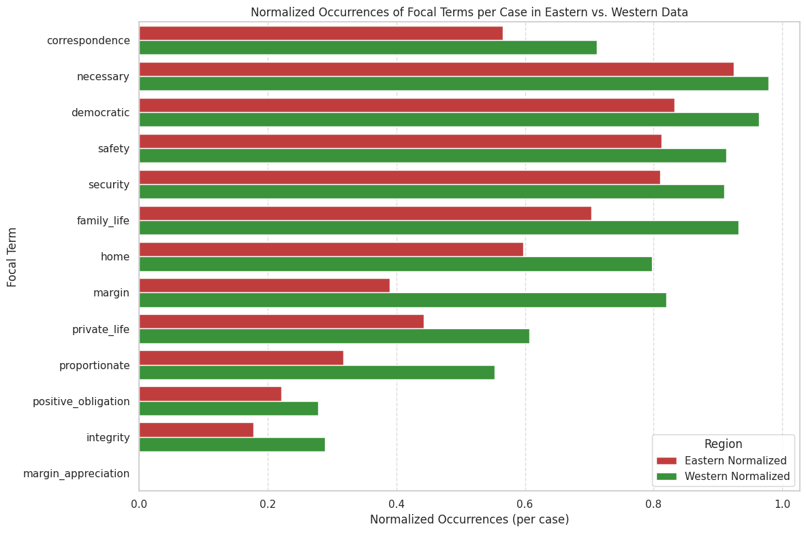
    

**Analysis:** Overall, all thirteen focal terms appear consistently across both corpora, confirming they are genuine Article 8 doctrinal staples rather than region-specific vocabulary. After apply normalization by case count, most terms appear slightly more often in Western cases, suggesting Western judgments invoke a broader range of Article 8 concepts per case.

Two findings stand in opposite directions.
* `Margin` appears at nearly double the rate in the West (0.82) compared to the East (0.39), reflecting the Western tradition of applying the margin of appreciation doctrine more explicitly and frequently.
* In contrast, `security` and `safety` are more prominent in the East, consistent with Eastern cases centering on state surveillance and physical integrity rather than proportionality balancing.

These frequency differences already hint at a structural divergence in how the two regions approach Article 8 reasoning. However, frequency tells us how often a term appears, but not whether it means the same thing. The next step assisted with Word2Vec embedding will examines neighbourhood change rather than raw count

## **4.2 Word2Vec Embedding Model**
We train two separate Word2Vec models: one on Eastern European judgments and one on Western European judgments, so that each model learns word meanings purely from its own regional legal vocabulary. This is the key design choice: by keeping the models separate, any difference in how a word is positioned in the embedding space reflects a genuine regional difference in how that word is used, not a difference in the volume of text.

The text used for training is the raw law section of each judgment, with legal stop words removed but focal terms explicitly kept. Before training, the text is tokenised into sentences, lemmatized, and passed through a bigram detector that joins recurring word pairs like `positive_obligations` and `private_life` into single tokens.

Preprocessing

    Single terms  : ['correspondence', 'democratic', 'home', 'integrity', 'margin', 'necessary', 'proportionate', 'safety', 'security']
    Phrase tokens : ['margin_appreciation', 'private_life', 'family_life', 'positive_obligation']
    Total focal   : 13
    
    Eastern cases : 937
    Western cases : 277
    
    Collecting sentences...
      Eastern : 123,151 sentences from 937 cases
      Western : 46,094 sentences from 277 cases
    
    Detecting bigrams...
    
    Phrase occurrence counts:
      Phrase                                  East     West  Status
      ────────────────────────────────────────────────────────────
      margin_appreciation                      576      604  ✅
      private_life                            1325      799  ✅
      family_life                             2643     1555  ✅
      positive_obligation                     1007      357  ✅
    
    ✅ Preprocessing complete.
       east_sents_phrased → /content/east_sents_phrased.pkl
       west_sents_phrased → /content/west_sents_phrased.pkl

Training

    Training Word2Vec for Eastern cases...
    Eastern Word2Vec model training complete.
    
    Training Word2Vec for Western cases...
    Western Word2Vec model training complete.
    Models saved to /content/

### **4.2.1 Semantic Drift Analysis**
With two separate Word2Vec models trained, the next step is to measure how much each focal term has drifted between regions. We do this using two scores: **dG (global drift)** measures how different a term's overall position is in the two embedding spaces — a high dG means the word sits in a completely different neighbourhood in the East versus the West. **dL (local drift)** measures whether the term's closest neighbours are the same across regions — a high dL means the words most associated with it differ between the two corpora. Together, dG and dL give complementary views of drift: dG captures broad semantic displacement, while dL captures whether the immediate doctrinal context of a term has shifted. A term can score high on one but low on the other, and that distinction matters for interpretation.

* **dG measures global semantic displacement**. It captures how far a word moves in the overall embedding space between the East and West corpora after alignment.

* **dL measures local neighbourhood change**. It captures how much the word’s nearest neighbours change between the two corpora.(calculated based on k nearest neighbour = 25, refer to Hamilton paper)

    Calculating semantic drift and nearest neighbors for focal terms...
    df_drift created with 13 terms.

<table border="1" class="dataframe">
  <thead>
    <tr style="text-align: right;">
      <th></th>
      <th>term</th>
      <th>dG</th>
      <th>dL</th>
      <th>nn_east_top25</th>
      <th>nn_west_top25</th>
    </tr>
  </thead>
  <tbody>
    <tr>
      <th>0</th>
      <td>correspondence</td>
      <td>0.943136</td>
      <td>1.000000</td>
      <td>censorship,monitoring_correspondence,censored,...</td>
      <td>protects_confidentiality,business_premise,regi...</td>
    </tr>
    <tr>
      <th>1</th>
      <td>home</td>
      <td>0.831484</td>
      <td>1.000000</td>
      <td>policeman_entered,obligation_vacate,risking,ad...</td>
      <td>extreme_form,demolition,eviction_demolition,dw...</td>
    </tr>
    <tr>
      <th>2</th>
      <td>democratic</td>
      <td>0.938061</td>
      <td>0.979592</td>
      <td>governance,restore_trust,democracy,corruption,...</td>
      <td>legitimation,ideal,wide_variety,science,dynami...</td>
    </tr>
    <tr>
      <th>3</th>
      <td>safety</td>
      <td>0.825207</td>
      <td>0.979592</td>
      <td>urban_development,endanger,elevated,experiment...</td>
      <td>occupational,professional_athlete,competition,...</td>
    </tr>
    <tr>
      <th>4</th>
      <td>security</td>
      <td>0.982732</td>
      <td>0.958333</td>
      <td>non-interference,interest_national,tighter,pro...</td>
      <td>interest_national,detecting_crime,purpose_prev...</td>
    </tr>
    <tr>
      <th>5</th>
      <td>necessary</td>
      <td>0.877701</td>
      <td>0.958333</td>
      <td>pastukhov_yelagin,ready,afford_just,facilities...</td>
      <td>specifying,overall,authorised_purpose,dignifie...</td>
    </tr>
    <tr>
      <th>6</th>
      <td>family_life</td>
      <td>0.769943</td>
      <td>0.958333</td>
      <td>right_private,life,essential_detainee,romania_...</td>
      <td>created_time,aware_immigration,status_persiste...</td>
    </tr>
    <tr>
      <th>7</th>
      <td>positive_obligation</td>
      <td>0.903139</td>
      <td>0.936170</td>
      <td>punish_rape,inherent_effective,effectively_pun...</td>
      <td>inherent_effective,imposes,negative_obligation...</td>
    </tr>
    <tr>
      <th>8</th>
      <td>integrity</td>
      <td>0.923693</td>
      <td>0.913043</td>
      <td>physical_moral,attack_physical,includes_person...</td>
      <td>physical_moral,self-determination,extends_aspe...</td>
    </tr>
    <tr>
      <th>9</th>
      <td>private_life</td>
      <td>0.809263</td>
      <td>0.888889</td>
      <td>broad_concept,intimate_aspect,intrusion,extend...</td>
      <td>community_living,moral_integrity,broad_concept...</td>
    </tr>
    <tr>
      <th>10</th>
      <td>proportionate</td>
      <td>0.684342</td>
      <td>0.888889</td>
      <td>lawful_proportionate,corresponded_pressing,jus...</td>
      <td>proportionate_aim,remains_examined,satisfies,p...</td>
    </tr>
    <tr>
      <th>11</th>
      <td>margin</td>
      <td>0.698107</td>
      <td>0.863636</td>
      <td>existence_identity,involve_intimate,facet_indi...</td>
      <td>usually_wide,broad_margin,enjoyed_wide,require...</td>
    </tr>
    <tr>
      <th>12</th>
      <td>margin_appreciation</td>
      <td>0.893449</td>
      <td>0.809524</td>
      <td>enjoy_wide,wide_margin,determining_step,enjoy_...</td>
      <td>afforded_state,enjoyed_deciding,appreciation_a...</td>
    </tr>
  </tbody>
</table>

**Analysis :** The raw dG and dL scores reveal how far each focal term has drifted between the Eastern and Western corpora. `Home` and `Correspondence` stands out immediately with the high dG and a perfect dL of 1.00 — meaning its vector position shifted dramatically across regions and it shares zero common neighbours between East and West.

In contrast, `proportionate` records the low dG, confirming that despite being applied more frequently in the West, its core meaning and surrounding vocabulary remain largely consistent across both corpora — it behaves as a shared legal standard rather than a region-specific concept.

The key insight from the raw scores is that high dG does not always align with high frequency differences. `Correspondence`, for example, appears at comparable rates in both corpora, yet shows the most severe semantic displacement — a signal that it is being used in structurally different legal contexts depending on the region.

### **4.2.2 Normalization for dG & dL**

The raw dG and dL scores sit on different scales — dG is a cosine distance (0 to 2) while dL is a neighbour-overlap proportion (0 to 1) — so comparing them directly would be misleading. Normalising both to a 0–1 scale allows us to plot them together and spot terms that drift on both dimensions simultaneously. We will use this chart to rank and compare terms relative to each other. But we can not use this chart to interpret the normalised values as absolute drift magnitudes — a normalised dG of 0.8 does not mean 80% drift; it simply means that term drifted more than most others in this dataset.

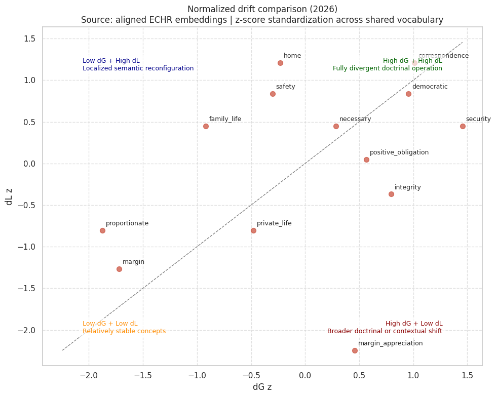
    

**Analysis** :

The chart reveals a clear diagonal pattern where most terms drift on both dimensions together, but two focal terms stand out as notable exceptions that tell different stories.

**Overall pattern:** Most terms cluster near the diagonal dashed line, meaning their global displacement (dG) and local neighbourhood change (dL) move in tandem. This is the expected behaviour — if a word shifts broadly in semantic space, its immediate neighbours tend to shift too. Terms like correspondence and home sit in the top-right quadrant (High dG + High dL), confirming fully divergent doctrinal operation across regions: not only do these words occupy different positions in the embedding space, but the concepts they are associated with are entirely different between East and West.

**First exception —** `proportionate` (High dG, Low dL): This term sits distinctly below the diagonal in the bottom-right region. Its global position has shifted considerably across corpora, yet its closest neighbours remain largely the same. This suggests proportionate anchors itself to a stable doctrinal cluster — likely terms like `necessary`, `democratic`, interference — even as the broader semantic context around it diverges. The word functions as a shared legal standard but is embedded within different surrounding reasoning in each region.

**Second exception —** `margin_appreciation` (Low dG, Low dL): Positioned in the bottom-left quadrant, this term shows the least drift of any focal term on both dimensions, making it the most semantically stable concept across regions. Despite the regional jurisprudential differences documented throughout this study, the doctrine of margin of appreciation appears to occupy a consistent and universally understood position in Article 8 reasoning in both East and West alike.

What this means is that the focal terms show several degrees of drift, and some of those differences may help explain the generalisation failure from Eastern to Western cases. Because these terms are central to Article 8 reasoning, even moderate semantic shifts can affect how the classifier learns and applies legal meaning across regions.

### **4.2.3 Local Semantic Drift Analysis**

The next stage of the analysis groups the focal terms into four clusters based on their dL scores to structure the interpretation more clearly. For each cluster, we use two complementary lenses: t-SNE visualizations to show how a term's semantic neighbourhood physically repositions itself between the Eastern and Western embedding spaces, and concordance lines to ground those visual shifts in actual judgment text, revealing how judges in each region deploy the same word in different doctrinal contexts. Together, these tools move the analysis from abstract scores to concrete legal meaning.

</style>
<table border="1" class="dataframe">
  <thead>
    <tr style="text-align: right;">
      <th></th>
      <th>term</th>
      <th>dL</th>
      <th>dL_cluster</th>
    </tr>
  </thead>
  <tbody>
    <tr>
      <th>0</th>
      <td>correspondence</td>
      <td>1.000000</td>
      <td>Q4 (dL &gt; 0.980) - High Drift</td>
    </tr>
    <tr>
      <th>1</th>
      <td>home</td>
      <td>1.000000</td>
      <td>Q4 (dL &gt; 0.980) - High Drift</td>
    </tr>
    <tr>
      <th>2</th>
      <td>democratic</td>
      <td>0.979592</td>
      <td>Q3 (0.958 &lt; dL &lt;= 0.980) - Moderate Drift</td>
    </tr>
    <tr>
      <th>3</th>
      <td>safety</td>
      <td>0.979592</td>
      <td>Q3 (0.958 &lt; dL &lt;= 0.980) - Moderate Drift</td>
    </tr>
    <tr>
      <th>4</th>
      <td>security</td>
      <td>0.958333</td>
      <td>Q2 (0.889 &lt; dL &lt;= 0.958) - Moderate Drift</td>
    </tr>
    <tr>
      <th>5</th>
      <td>necessary</td>
      <td>0.958333</td>
      <td>Q2 (0.889 &lt; dL &lt;= 0.958) - Moderate Drift</td>
    </tr>
    <tr>
      <th>6</th>
      <td>family_life</td>
      <td>0.958333</td>
      <td>Q2 (0.889 &lt; dL &lt;= 0.958) - Moderate Drift</td>
    </tr>
    <tr>
      <th>7</th>
      <td>positive_obligation</td>
      <td>0.936170</td>
      <td>Q2 (0.889 &lt; dL &lt;= 0.958) - Moderate Drift</td>
    </tr>
    <tr>
      <th>8</th>
      <td>integrity</td>
      <td>0.913043</td>
      <td>Q2 (0.889 &lt; dL &lt;= 0.958) - Moderate Drift</td>
    </tr>
    <tr>
      <th>9</th>
      <td>private_life</td>
      <td>0.888889</td>
      <td>Q1 (dL &lt;= 0.889) - Low Drift</td>
    </tr>
    <tr>
      <th>10</th>
      <td>proportionate</td>
      <td>0.888889</td>
      <td>Q1 (dL &lt;= 0.889) - Low Drift</td>
    </tr>
    <tr>
      <th>11</th>
      <td>margin</td>
      <td>0.863636</td>
      <td>Q1 (dL &lt;= 0.889) - Low Drift</td>
    </tr>
    <tr>
      <th>12</th>
      <td>margin_appreciation</td>
      <td>0.809524</td>
      <td>Q1 (dL &lt;= 0.889) - Low Drift</td>
    </tr>
  </tbody>
</table>

#### **a. High Drift Cluster**

<h2 style='color:#D6604D;'>High Drift Cluster (dL)</h2>

<h4 style='margin:16px 0 6px'>Nearest Neighbours — <code style='background:#f0f0f0;padding:2px 5px;border-radius:3px'>correspondence</code>&nbsp;dG=0.943 &nbsp; dL=1.000</h4><style type="text/css">
<table id="T_891e5">
  <caption>Top-10 nearest neighbours for 'correspondence' | East corpus n=937 cases | West corpus n=277 cases</caption>
  <thead>
    <tr>
      <th class="blank level0" >&nbsp;</th>
      <th id="T_891e5_level0_col0" class="col_heading level0 col0" >East — correspondence</th>
      <th id="T_891e5_level0_col1" class="col_heading level0 col1" >Sim (E)</th>
      <th id="T_891e5_level0_col2" class="col_heading level0 col2" >West — correspondence</th>
      <th id="T_891e5_level0_col3" class="col_heading level0 col3" >Sim (W)</th>
    </tr>
  </thead>
  <tbody>
    <tr>
      <th id="T_891e5_level0_row0" class="row_heading level0 row0" >0</th>
      <td id="T_891e5_row0_col0" class="data row0 col0" >censorship</td>
      <td id="T_891e5_row0_col1" class="data row0 col1" >0.7431</td>
      <td id="T_891e5_row0_col2" class="data row0 col2" >protects_confidentiality</td>
      <td id="T_891e5_row0_col3" class="data row0 col3" >0.7125</td>
    </tr>
    <tr>
      <th id="T_891e5_level0_row1" class="row_heading level0 row1" >1</th>
      <td id="T_891e5_row1_col0" class="data row1 col0" >monitoring_correspondence</td>
      <td id="T_891e5_row1_col1" class="data row1 col1" >0.6872</td>
      <td id="T_891e5_row1_col2" class="data row1 col2" >business_premise</td>
      <td id="T_891e5_row1_col3" class="data row1 col3" >0.6958</td>
    </tr>
    <tr>
      <th id="T_891e5_level0_row2" class="row_heading level0 row2" >2</th>
      <td id="T_891e5_row2_col0" class="data row2 col0" >censored</td>
      <td id="T_891e5_row2_col1" class="data row2 col1" >0.6650</td>
      <td id="T_891e5_row2_col2" class="data row2 col2" >registered_office</td>
      <td id="T_891e5_row2_col3" class="data row2 col3" >0.6957</td>
    </tr>
    <tr>
      <th id="T_891e5_level0_row3" class="row_heading level0 row3" >3</th>
      <td id="T_891e5_row3_col0" class="data row3 col0" >m_misakyan</td>
      <td id="T_891e5_row3_col1" class="data row3 col1" >0.6623</td>
      <td id="T_891e5_row3_col2" class="data row3 col2" >electronic_data</td>
      <td id="T_891e5_row3_col3" class="data row3 col3" >0.6915</td>
    </tr>
    <tr>
      <th id="T_891e5_level0_row4" class="row_heading level0 row4" >4</th>
      <td id="T_891e5_row4_col0" class="data row4 col0" >monitoring</td>
      <td id="T_891e5_row4_col1" class="data row4 col1" >0.6607</td>
      <td id="T_891e5_row4_col2" class="data row4 col2" >e-mail</td>
      <td id="T_891e5_row4_col3" class="data row4 col3" >0.6882</td>
    </tr>
    <tr>
      <th id="T_891e5_level0_row5" class="row_heading level0 row5" >5</th>
      <td id="T_891e5_row5_col0" class="data row5 col0" >routine_monitoring</td>
      <td id="T_891e5_row5_col1" class="data row5 col1" >0.6520</td>
      <td id="T_891e5_row5_col2" class="data row5 col2" >working_company</td>
      <td id="T_891e5_row5_col3" class="data row5 col3" >0.6754</td>
    </tr>
    <tr>
      <th id="T_891e5_level0_row6" class="row_heading level0 row6" >6</th>
      <td id="T_891e5_row6_col0" class="data row6 col0" >correspondence_monitored</td>
      <td id="T_891e5_row6_col1" class="data row6 col1" >0.6466</td>
      <td id="T_891e5_row6_col2" class="data row6 col2" >law_firm</td>
      <td id="T_891e5_row6_col3" class="data row6 col3" >0.6706</td>
    </tr>
    <tr>
      <th id="T_891e5_level0_row7" class="row_heading level0 row7" >7</th>
      <td id="T_891e5_row7_col0" class="data row7 col0" >letter_inspected</td>
      <td id="T_891e5_row7_col1" class="data row7 col1" >0.6412</td>
      <td id="T_891e5_row7_col2" class="data row7 col2" >martin</td>
      <td id="T_891e5_row7_col3" class="data row7 col3" >0.6597</td>
    </tr>
    <tr>
      <th id="T_891e5_level0_row8" class="row_heading level0 row8" >8</th>
      <td id="T_891e5_row8_col0" class="data row8 col0" >lublin_district</td>
      <td id="T_891e5_row8_col1" class="data row8 col1" >0.6408</td>
      <td id="T_891e5_row8_col2" class="data row8 col2" >mirror_image</td>
      <td id="T_891e5_row8_col3" class="data row8 col3" >0.6579</td>
    </tr>
    <tr>
      <th id="T_891e5_level0_row9" class="row_heading level0 row9" >9</th>
      <td id="T_891e5_row9_col0" class="data row9 col0" >censorship_correspondence</td>
      <td id="T_891e5_row9_col1" class="data row9 col1" >0.6380</td>
      <td id="T_891e5_row9_col2" class="data row9 col2" >labelled</td>
      <td id="T_891e5_row9_col3" class="data row9 col3" >0.6570</td>
    </tr>
  </tbody>
</table>

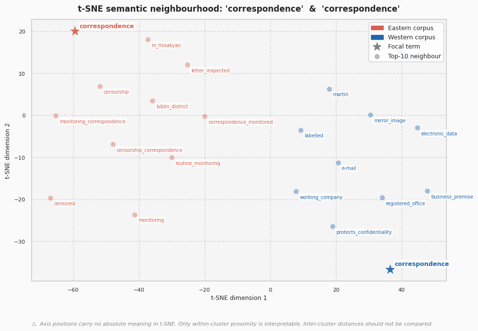
    

Concordances for <code style='background:#f0f0f0;padding:2px 5px;border-radius:3px'>correspondence</code> &nbsp;|&nbsp; 3 lines per region &nbsp;|&nbsp; ±80 chars window

<b style='color:#D6604D'>Eastern</b> (3 lines shown)<ol style='margin:6px 0 0 18px'><li style='margin-bottom:8px;line-height:1.5;font-size:13px'>…s in a rented flat, had violated their right to respect for their private life, <b style='color:#c0392b'>correspondence</b> and home. They relied on Article 8 of the Convention, which reads as follows: “…</li><li style='margin-bottom:8px;line-height:1.5;font-size:13px'>…yone has the right to respect for his private and family life, his home and his <b style='color:#c0392b'>correspondence</b>. 2.  There shall be no interference by a public authority with the exercise of…</li><li style='margin-bottom:8px;line-height:1.5;font-size:13px'>…the alleged violations of his or her right to respect for private life, home or <b style='color:#c0392b'>correspondence</b>. The remedy used by Mr Gorbunov (application no. 5402/07) had also been ineffec…</li></ol>

<b style='color:#2166AC'>Western</b> (3 lines shown)<ol style='margin:6px 0 0 18px'><li style='margin-bottom:8px;line-height:1.5;font-size:13px'>…yone has the right to respect for his private and family life, his home and his <b style='color:#c0392b'>correspondence</b>. 2.  There shall be no interference by a public authority with the exercise of…</li><li style='margin-bottom:8px;line-height:1.5;font-size:13px'>…yone has the right to respect for his private and family life, his home and his <b style='color:#c0392b'>correspondence</b>. 2.  There shall be no interference by a public authority with the exercise of…</li><li style='margin-bottom:8px;line-height:1.5;font-size:13px'>…yone has the right to respect for his private and family life, his home and his <b style='color:#c0392b'>correspondence</b>. 2.  There shall be no interference by a public authority with the exercise of…</li></ol>

<h4 style='margin:16px 0 6px'>Nearest Neighbours — <code style='background:#f0f0f0;padding:2px 5px;border-radius:3px'>home</code>&nbsp;dG=0.831 &nbsp; dL=1.000</h4><style type="text/css">
<table id="T_d610e">
  <caption>Top-10 nearest neighbours for 'home' | East corpus n=937 cases | West corpus n=277 cases</caption>
  <thead>
    <tr>
      <th class="blank level0" >&nbsp;</th>
      <th id="T_d610e_level0_col0" class="col_heading level0 col0" >East — home</th>
      <th id="T_d610e_level0_col1" class="col_heading level0 col1" >Sim (E)</th>
      <th id="T_d610e_level0_col2" class="col_heading level0 col2" >West — home</th>
      <th id="T_d610e_level0_col3" class="col_heading level0 col3" >Sim (W)</th>
    </tr>
  </thead>
  <tbody>
    <tr>
      <th id="T_d610e_level0_row0" class="row_heading level0 row0" >0</th>
      <td id="T_d610e_row0_col0" class="data row0 col0" >policeman_entered</td>
      <td id="T_d610e_row0_col1" class="data row0 col1" >0.6414</td>
      <td id="T_d610e_row0_col2" class="data row0 col2" >extreme_form</td>
      <td id="T_d610e_row0_col3" class="data row0 col3" >0.6333</td>
    </tr>
    <tr>
      <th id="T_d610e_level0_row1" class="row_heading level0 row1" >1</th>
      <td id="T_d610e_row1_col0" class="data row1 col0" >obligation_vacate</td>
      <td id="T_d610e_row1_col1" class="data row1 col1" >0.6360</td>
      <td id="T_d610e_row1_col2" class="data row1 col2" >demolition</td>
      <td id="T_d610e_row1_col3" class="data row1 col3" >0.5696</td>
    </tr>
    <tr>
      <th id="T_d610e_level0_row2" class="row_heading level0 row2" >2</th>
      <td id="T_d610e_row2_col0" class="data row2 col0" >risking</td>
      <td id="T_d610e_row2_col1" class="data row2 col1" >0.6342</td>
      <td id="T_d610e_row2_col2" class="data row2 col2" >eviction_demolition</td>
      <td id="T_d610e_row2_col3" class="data row2 col3" >0.5589</td>
    </tr>
    <tr>
      <th id="T_d610e_level0_row3" class="row_heading level0 row3" >3</th>
      <td id="T_d610e_row3_col0" class="data row3 col0" >adult_female</td>
      <td id="T_d610e_row3_col1" class="data row3 col1" >0.6223</td>
      <td id="T_d610e_row3_col2" class="data row3 col2" >dwelling</td>
      <td id="T_d610e_row3_col3" class="data row3 col3" >0.5578</td>
    </tr>
    <tr>
      <th id="T_d610e_level0_row4" class="row_heading level0 row4" >4</th>
      <td id="T_d610e_row4_col0" class="data row4 col0" >dormitory_building</td>
      <td id="T_d610e_row4_col1" class="data row4 col1" >0.6175</td>
      <td id="T_d610e_row4_col2" class="data row4 col2" >travel_funeral</td>
      <td id="T_d610e_row4_col3" class="data row4 col3" >0.5489</td>
    </tr>
    <tr>
      <th id="T_d610e_level0_row5" class="row_heading level0 row5" >5</th>
      <td id="T_d610e_row5_col0" class="data row5 col0" >gajeva_street</td>
      <td id="T_d610e_row5_col1" class="data row5 col1" >0.6062</td>
      <td id="T_d610e_row5_col2" class="data row5 col2" >moreno_gómez</td>
      <td id="T_d610e_row5_col3" class="data row5 col3" >0.5457</td>
    </tr>
    <tr>
      <th id="T_d610e_level0_row6" class="row_heading level0 row6" >6</th>
      <td id="T_d610e_row6_col0" class="data row6 col0" >flat_amounted</td>
      <td id="T_d610e_row6_col1" class="data row6 col1" >0.6042</td>
      <td id="T_d610e_row6_col2" class="data row6 col2" >galiana</td>
      <td id="T_d610e_row6_col3" class="data row6 col3" >0.5403</td>
    </tr>
    <tr>
      <th id="T_d610e_level0_row7" class="row_heading level0 row7" >7</th>
      <td id="T_d610e_row7_col0" class="data row7 col0" >reallocated</td>
      <td id="T_d610e_row7_col1" class="data row7 col1" >0.6035</td>
      <td id="T_d610e_row7_col2" class="data row7 col2" >municipal_authority</td>
      <td id="T_d610e_row7_col3" class="data row7 col3" >0.5364</td>
    </tr>
    <tr>
      <th id="T_d610e_level0_row8" class="row_heading level0 row8" >8</th>
      <td id="T_d610e_row8_col0" class="data row8 col0" >apartment</td>
      <td id="T_d610e_row8_col1" class="data row8 col1" >0.5971</td>
      <td id="T_d610e_row8_col2" class="data row8 col2" >beaten</td>
      <td id="T_d610e_row8_col3" class="data row8 col3" >0.5358</td>
    </tr>
    <tr>
      <th id="T_d610e_level0_row9" class="row_heading level0 row9" >9</th>
      <td id="T_d610e_row9_col0" class="data row9 col0" >flat</td>
      <td id="T_d610e_row9_col1" class="data row9 col1" >0.5971</td>
      <td id="T_d610e_row9_col2" class="data row9 col2" >caravan</td>
      <td id="T_d610e_row9_col3" class="data row9 col3" >0.5353</td>
    </tr>
  </tbody>
</table>

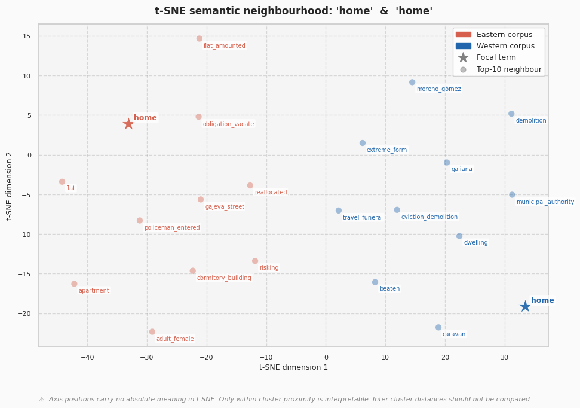
    

Concordances for <code style='background:#f0f0f0;padding:2px 5px;border-radius:3px'>home</code> &nbsp;|&nbsp; 3 lines per region &nbsp;|&nbsp; ±80 chars window

<b style='color:#D6604D'>Eastern</b> (3 lines shown)<ol style='margin:6px 0 0 18px'><li style='margin-bottom:8px;line-height:1.5;font-size:13px'>…had violated their right to respect for their private life, correspondence and <b style='color:#c0392b'>home</b>. They relied on Article 8 of the Convention, which reads as follows: “1.  Every…</li><li style='margin-bottom:8px;line-height:1.5;font-size:13px'>…ws: “1.  Everyone has the right to respect for his private and family life, his <b style='color:#c0392b'>home</b> and his correspondence. 2.  There shall be no interference by a public authorit…</li><li style='margin-bottom:8px;line-height:1.5;font-size:13px'>…ity for the alleged violations of his or her right to respect for private life, <b style='color:#c0392b'>home</b> or correspondence. The remedy used by Mr Gorbunov (application no. 5402/07) had…</li></ol>

<b style='color:#2166AC'>Western</b> (3 lines shown)<ol style='margin:6px 0 0 18px'><li style='margin-bottom:8px;line-height:1.5;font-size:13px'>…1.  Everyone has the right to respect for his private and family life [and] his <b style='color:#c0392b'>home</b> ... 2.  There shall be no interference by a public authority with the exercise…</li><li style='margin-bottom:8px;line-height:1.5;font-size:13px'>…iving partner to the deceased's tenancy rights, which fell under the notion of “<b style='color:#c0392b'>home</b>”, the Court explicitly left open the question whether the case also concerned t…</li><li style='margin-bottom:8px;line-height:1.5;font-size:13px'>…ws: “1.  Everyone has the right to respect for his private and family life, his <b style='color:#c0392b'>home</b> and his correspondence. 2.  There shall be no interference by a public authorit…</li></ol>

 <b>Note:</b> Detailed Nearest Neighbour tables and concordances were displayed directly in the notebook output as HTML. t-SNE plots for the focal terms are saved by the underlying functions to <code>/content/rq4_normalized_drift_comparison_scatter.jpg</code> (a single file). This text file only contains the standard print output.

**Analysis:**

 `home` and `correspondence` have completely different legal surroundings in the East versus the West. This suggests that while these words are used in both regions, their actual interpretation and context are not the same. This semantic drift highlights how legal concepts, even common ones, can evolve differently across judicial systems, leading to potential misunderstandings or varied applications of similar laws.

 This finding provides a linguistic explanation for the generalisation asymmetry
identified in RQ3. The Eastern-trained model's failure on the Western docket is not
simply a product of training data imbalance or Russia-specific factual boilerplate.
It is also a consequence of the fact that home and correspondence, two of the four
interests explicitly protected under Article 8, operate in semantically distinct
neighbourhoods in the two regional corpora. A model trained on Eastern cases learns one version of what these terms mean. When
applied to Western cases where the same terms function differently, it encounters
vocabulary it has effectively never seen in the relevant doctrinal context.

#### **b. Low Drift Cluster**

<h2 style='color:#2166AC;'>Low Drift Cluster (dL)</h2>

    --- Visualizing with Nearest Neighbours, t-SNE, and Concordances for Low Drift Cluster ---
    
    Processing focal term: 'private_life'
    Generating Nearest Neighbour Comparison for 'private_life'

<h4 style='margin:16px 0 6px'>Nearest Neighbours — <code style='background:#f0f0f0;padding:2px 5px;border-radius:3px'>private_life</code>&nbsp;dG=0.809 &nbsp; dL=0.889</h4><style type="text/css">
<table id="T_327be">
  <caption>Top-10 nearest neighbours for 'private_life' | East corpus n=937 cases | West corpus n=277 cases</caption>
  <thead>
    <tr>
      <th class="blank level0" >&nbsp;</th>
      <th id="T_327be_level0_col0" class="col_heading level0 col0" >East — private_life</th>
      <th id="T_327be_level0_col1" class="col_heading level0 col1" >Sim (E)</th>
      <th id="T_327be_level0_col2" class="col_heading level0 col2" >West — private_life</th>
      <th id="T_327be_level0_col3" class="col_heading level0 col3" >Sim (W)</th>
    </tr>
  </thead>
  <tbody>
    <tr>
      <th id="T_327be_level0_row0" class="row_heading level0 row0" >0</th>
      <td id="T_327be_row0_col0" class="data row0 col0" >broad_concept</td>
      <td id="T_327be_row0_col1" class="data row0 col1" >0.6645</td>
      <td id="T_327be_row0_col2" class="data row0 col2" >community_living</td>
      <td id="T_327be_row0_col3" class="data row0 col3" >0.6527</td>
    </tr>
    <tr>
      <th id="T_327be_level0_row1" class="row_heading level0 row1" >1</th>
      <td id="T_327be_row1_col0" class="data row1 col0" >intimate_aspect</td>
      <td id="T_327be_row1_col1" class="data row1 col1" >0.6567</td>
      <td id="T_327be_row1_col2" class="data row1 col2" >moral_integrity</td>
      <td id="T_327be_row1_col3" class="data row1 col3" >0.6435</td>
    </tr>
    <tr>
      <th id="T_327be_level0_row2" class="row_heading level0 row2" >2</th>
      <td id="T_327be_row2_col0" class="data row2 col0" >intrusion</td>
      <td id="T_327be_row2_col1" class="data row2 col1" >0.6483</td>
      <td id="T_327be_row2_col2" class="data row2 col2" >broad_concept</td>
      <td id="T_327be_row2_col3" class="data row2 col3" >0.6406</td>
    </tr>
    <tr>
      <th id="T_327be_level0_row3" class="row_heading level0 row3" >3</th>
      <td id="T_327be_row3_col0" class="data row3 col0" >extends_aspect</td>
      <td id="T_327be_row3_col1" class="data row3 col1" >0.6423</td>
      <td id="T_327be_row3_col2" class="data row3 col2" >rare_settled</td>
      <td id="T_327be_row3_col3" class="data row3 col3" >0.6405</td>
    </tr>
    <tr>
      <th id="T_327be_level0_row4" class="row_heading level0 row4" >4</th>
      <td id="T_327be_row4_col0" class="data row4 col0" >private_family</td>
      <td id="T_327be_row4_col1" class="data row4 col1" >0.6391</td>
      <td id="T_327be_row4_col2" class="data row4 col2" >extends_aspect</td>
      <td id="T_327be_row4_col3" class="data row4 col3" >0.6393</td>
    </tr>
    <tr>
      <th id="T_327be_level0_row5" class="row_heading level0 row5" >5</th>
      <td id="T_327be_row5_col0" class="data row5 col0" >particular_readership</td>
      <td id="T_327be_row5_col1" class="data row5 col1" >0.6386</td>
      <td id="T_327be_row5_col2" class="data row5 col2" >demonstrate_deportation</td>
      <td id="T_327be_row5_col3" class="data row5 col3" >0.6388</td>
    </tr>
    <tr>
      <th id="T_327be_level0_row6" class="row_heading level0 row6" >6</th>
      <td id="T_327be_row6_col0" class="data row6 col0" >cover_physical</td>
      <td id="T_327be_row6_col1" class="data row6 col1" >0.6374</td>
      <td id="T_327be_row6_col2" class="data row6 col2" >migrant_unable</td>
      <td id="T_327be_row6_col3" class="data row6 col3" >0.6342</td>
    </tr>
    <tr>
      <th id="T_327be_level0_row7" class="row_heading level0 row7" >7</th>
      <td id="T_327be_row7_col0" class="data row7 col0" >peck</td>
      <td id="T_327be_row7_col1" class="data row7 col1" >0.6341</td>
      <td id="T_327be_row7_col2" class="data row7 col2" >encompasses</td>
      <td id="T_327be_row7_col3" class="data row7 col3" >0.6331</td>
    </tr>
    <tr>
      <th id="T_327be_level0_row8" class="row_heading level0 row8" >8</th>
      <td id="T_327be_row8_col0" class="data row8 col0" >pfeifer_v.</td>
      <td id="T_327be_row8_col1" class="data row8 col1" >0.6300</td>
      <td id="T_327be_row8_col2" class="data row8 col2" >constitutes_concept</td>
      <td id="T_327be_row8_col3" class="data row8 col3" >0.6328</td>
    </tr>
    <tr>
      <th id="T_327be_level0_row9" class="row_heading level0 row9" >9</th>
      <td id="T_327be_row9_col0" class="data row9 col0" >term_susceptible</td>
      <td id="T_327be_row9_col1" class="data row9 col1" >0.6270</td>
      <td id="T_327be_row9_col2" class="data row9 col2" >world_embrace</td>
      <td id="T_327be_row9_col3" class="data row9 col3" >0.6220</td>
    </tr>
  </tbody>
</table>

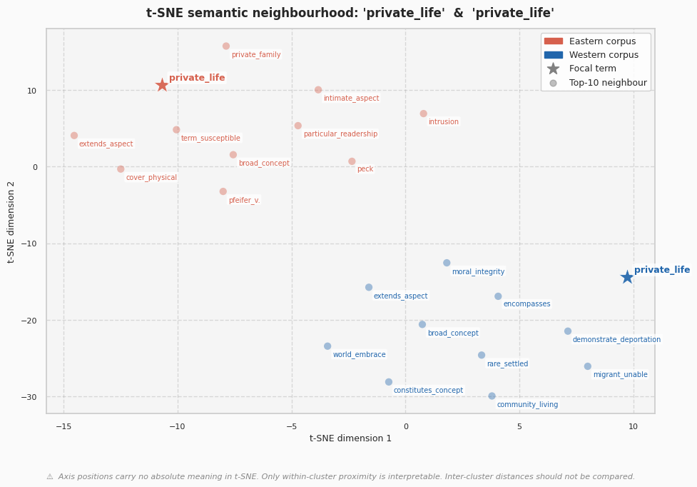
    

Concordances for <code style='background:#f0f0f0;padding:2px 5px;border-radius:3px'>private_life</code> &nbsp;|&nbsp; 3 lines per region &nbsp;|&nbsp; ±80 chars window

<b style='color:#D6604D'>Eastern</b> (3 lines shown)<ol style='margin:6px 0 0 18px'><li style='margin-bottom:8px;line-height:1.5;font-size:13px'>…h acquaintances in a rented flat, had violated their right to respect for their <b style='color:#c0392b'>private life</b>, correspondence and home. They relied on Article 8 of the Convention, which rea…</li><li style='margin-bottom:8px;line-height:1.5;font-size:13px'>…te responsibility for the alleged violations of his or her right to respect for <b style='color:#c0392b'>private life</b>, home or correspondence. The remedy used by Mr Gorbunov (application no. 5402/0…</li><li style='margin-bottom:8px;line-height:1.5;font-size:13px'>…complaint that the interference with the applicants’ right to respect for their <b style='color:#c0392b'>private life</b> and correspondence was not “in accordance with the law” or not “necessary in a…</li></ol>

<b style='color:#2166AC'>Western</b> (3 lines shown)<ol style='margin:6px 0 0 18px'><li style='margin-bottom:8px;line-height:1.5;font-size:13px'>…ationship of a same-sex couple like the applicants' falls within the notion of “<b style='color:#c0392b'>private life</b>” within the meaning of Article 8. However, in the light of the parties' comment…</li><li style='margin-bottom:8px;line-height:1.5;font-size:13px'>…ed that the emotional and sexual relationship of a same-sex couple constitutes “<b style='color:#c0392b'>private life</b>” but has not found that it constitutes “family life”, even where a longterm rel…</li><li style='margin-bottom:8px;line-height:1.5;font-size:13px'>…that his deportation to  would violate his right to respect for his family and <b style='color:#c0392b'>private life</b> as provided in Article 8 of the Convention, which reads as follows: “1.  Everyo…</li></ol>

<h4 style='margin:16px 0 6px'>Nearest Neighbours — <code style='background:#f0f0f0;padding:2px 5px;border-radius:3px'>proportionate</code>&nbsp;dG=0.684 &nbsp; dL=0.889</h4><style type="text/css">

<table id="T_9dbf6">
  <caption>Top-10 nearest neighbours for 'proportionate' | East corpus n=937 cases | West corpus n=277 cases</caption>
  <thead>
    <tr>
      <th class="blank level0" >&nbsp;</th>
      <th id="T_9dbf6_level0_col0" class="col_heading level0 col0" >East — proportionate</th>
      <th id="T_9dbf6_level0_col1" class="col_heading level0 col1" >Sim (E)</th>
      <th id="T_9dbf6_level0_col2" class="col_heading level0 col2" >West — proportionate</th>
      <th id="T_9dbf6_level0_col3" class="col_heading level0 col3" >Sim (W)</th>
    </tr>
  </thead>
  <tbody>
    <tr>
      <th id="T_9dbf6_level0_row0" class="row_heading level0 row0" >0</th>
      <td id="T_9dbf6_row0_col0" class="data row0 col0" >lawful_proportionate</td>
      <td id="T_9dbf6_row0_col1" class="data row0 col1" >0.7006</td>
      <td id="T_9dbf6_row0_col2" class="data row0 col2" >proportionate_aim</td>
      <td id="T_9dbf6_row0_col3" class="data row0 col3" >0.6871</td>
    </tr>
    <tr>
      <th id="T_9dbf6_level0_row1" class="row_heading level0 row1" >1</th>
      <td id="T_9dbf6_row1_col0" class="data row1 col0" >corresponded_pressing</td>
      <td id="T_9dbf6_row1_col1" class="data row1 col1" >0.6600</td>
      <td id="T_9dbf6_row1_col2" class="data row1 col2" >remains_examined</td>
      <td id="T_9dbf6_row1_col3" class="data row1 col3" >0.6707</td>
    </tr>
    <tr>
      <th id="T_9dbf6_level0_row2" class="row_heading level0 row2" >2</th>
      <td id="T_9dbf6_row2_col0" class="data row2 col0" >justified</td>
      <td id="T_9dbf6_row2_col1" class="data row2 col1" >0.6505</td>
      <td id="T_9dbf6_row2_col2" class="data row2 col2" >satisfies</td>
      <td id="T_9dbf6_row2_col3" class="data row2 col3" >0.6574</td>
    </tr>
    <tr>
      <th id="T_9dbf6_level0_row3" class="row_heading level0 row3" >3</th>
      <td id="T_9dbf6_row3_col0" class="data row3 col0" >proportionate_aim</td>
      <td id="T_9dbf6_row3_col1" class="data row3 col1" >0.6502</td>
      <td id="T_9dbf6_row3_col2" class="data row3 col2" >pursuit</td>
      <td id="T_9dbf6_row3_col3" class="data row3 col3" >0.6472</td>
    </tr>
    <tr>
      <th id="T_9dbf6_level0_row4" class="row_heading level0 row4" >4</th>
      <td id="T_9dbf6_row4_col0" class="data row4 col0" >pursuit_legitimate</td>
      <td id="T_9dbf6_row4_col1" class="data row4 col1" >0.6454</td>
      <td id="T_9dbf6_row4_col2" class="data row4 col2" >proportional</td>
      <td id="T_9dbf6_row4_col3" class="data row4 col3" >0.6446</td>
    </tr>
    <tr>
      <th id="T_9dbf6_level0_row5" class="row_heading level0 row5" >5</th>
      <td id="T_9dbf6_row5_col0" class="data row5 col0" >proportional</td>
      <td id="T_9dbf6_row5_col1" class="data row5 col1" >0.6414</td>
      <td id="T_9dbf6_row5_col2" class="data row5 col2" >necessary_proportionate</td>
      <td id="T_9dbf6_row5_col3" class="data row5 col3" >0.6412</td>
    </tr>
    <tr>
      <th id="T_9dbf6_level0_row6" class="row_heading level0 row6" >6</th>
      <td id="T_9dbf6_row6_col0" class="data row6 col0" >legitimate_aim</td>
      <td id="T_9dbf6_row6_col1" class="data row6 col1" >0.6402</td>
      <td id="T_9dbf6_row6_col2" class="data row6 col2" >disproportionate</td>
      <td id="T_9dbf6_row6_col3" class="data row6 col3" >0.6354</td>
    </tr>
    <tr>
      <th id="T_9dbf6_level0_row7" class="row_heading level0 row7" >7</th>
      <td id="T_9dbf6_row7_col0" class="data row7 col0" >disorder_crime</td>
      <td id="T_9dbf6_row7_col1" class="data row7 col1" >0.6369</td>
      <td id="T_9dbf6_row7_col2" class="data row7 col2" >ordinarily</td>
      <td id="T_9dbf6_row7_col3" class="data row7 col3" >0.6337</td>
    </tr>
    <tr>
      <th id="T_9dbf6_level0_row8" class="row_heading level0 row8" >8</th>
      <td id="T_9dbf6_row8_col0" class="data row8 col0" >preventing_disorder</td>
      <td id="T_9dbf6_row8_col1" class="data row8 col1" >0.6344</td>
      <td id="T_9dbf6_row8_col2" class="data row8 col2" >burdensome</td>
      <td id="T_9dbf6_row8_col3" class="data row8 col3" >0.6335</td>
    </tr>
    <tr>
      <th id="T_9dbf6_level0_row9" class="row_heading level0 row9" >9</th>
      <td id="T_9dbf6_row9_col0" class="data row9 col0" >need_proportionate</td>
      <td id="T_9dbf6_row9_col1" class="data row9 col1" >0.6332</td>
      <td id="T_9dbf6_row9_col2" class="data row9 col2" >remains_ascertained</td>
      <td id="T_9dbf6_row9_col3" class="data row9 col3" >0.6304</td>
    </tr>
  </tbody>
</table>

    

Concordances for <code style='background:#f0f0f0;padding:2px 5px;border-radius:3px'>proportionate</code> &nbsp;|&nbsp; 3 lines per region &nbsp;|&nbsp; ±80 chars window

<b style='color:#D6604D'>Eastern</b> (3 lines shown)<ol style='margin:6px 0 0 18px'><li style='margin-bottom:8px;line-height:1.5;font-size:13px'>…rticular whether the contested actions answered a pressing social need and were <b style='color:#c0392b'>proportionate</b> to any legitimate aims pursued, principles which lie at the heart of the Court’…</li><li style='margin-bottom:8px;line-height:1.5;font-size:13px'>…ning whether the contested interference answered a pressing social need and was <b style='color:#c0392b'>proportionate</b> to the aims pursued could not be considered an effective remedy (see Smith and…</li><li style='margin-bottom:8px;line-height:1.5;font-size:13px'>…itimate aim if it answers a “pressing social need” and, in particular, if it is <b style='color:#c0392b'>proportionate</b> to the legitimate aim pursued and if the reasons adduced by the national author…</li></ol>

<b style='color:#2166AC'>Western</b> (3 lines shown)<ol style='margin:6px 0 0 18px'><li style='margin-bottom:8px;line-height:1.5;font-size:13px'>…that this was important in considering whether the deportation decision was dis<b style='color:#c0392b'>proportionate</b>, relying on Omojudi v. the , no. 1820/08, § 42, 24 November 2009. He noted in p…</li><li style='margin-bottom:8px;line-height:1.5;font-size:13px'>…ain was granted. 44.  In conclusion, the Government argued that deportation was <b style='color:#c0392b'>proportionate</b> to the need to protect the public, including vulnerable members of the public s…</li><li style='margin-bottom:8px;line-height:1.5;font-size:13px'>…al order had been made notwithstanding the fact that such expulsion would be dis<b style='color:#c0392b'>proportionate</b> having regard to subsequent developments. The Government have not explained whe…</li></ol>

<h4 style='margin:16px 0 6px'>Nearest Neighbours — <code style='background:#f0f0f0;padding:2px 5px;border-radius:3px'>margin</code>&nbsp;dG=0.698 &nbsp; dL=0.864</h4><style type="text/css">

<table id="T_6a3fb">
  <caption>Top-10 nearest neighbours for 'margin' | East corpus n=937 cases | West corpus n=277 cases</caption>
  <thead>
    <tr>
      <th class="blank level0" >&nbsp;</th>
      <th id="T_6a3fb_level0_col0" class="col_heading level0 col0" >East — margin</th>
      <th id="T_6a3fb_level0_col1" class="col_heading level0 col1" >Sim (E)</th>
      <th id="T_6a3fb_level0_col2" class="col_heading level0 col2" >West — margin</th>
      <th id="T_6a3fb_level0_col3" class="col_heading level0 col3" >Sim (W)</th>
    </tr>
  </thead>
  <tbody>
    <tr>
      <th id="T_6a3fb_level0_row0" class="row_heading level0 row0" >0</th>
      <td id="T_6a3fb_row0_col0" class="data row0 col0" >existence_identity</td>
      <td id="T_6a3fb_row0_col1" class="data row0 col1" >0.8048</td>
      <td id="T_6a3fb_row0_col2" class="data row0 col2" >usually_wide</td>
      <td id="T_6a3fb_row0_col3" class="data row0 col3" >0.7571</td>
    </tr>
    <tr>
      <th id="T_6a3fb_level0_row1" class="row_heading level0 row1" >1</th>
      <td id="T_6a3fb_row1_col0" class="data row1 col0" >involve_intimate</td>
      <td id="T_6a3fb_row1_col1" class="data row1 col1" >0.8039</td>
      <td id="T_6a3fb_row1_col2" class="data row1 col2" >broad_margin</td>
      <td id="T_6a3fb_row1_col3" class="data row1 col3" >0.7439</td>
    </tr>
    <tr>
      <th id="T_6a3fb_level0_row2" class="row_heading level0 row2" >2</th>
      <td id="T_6a3fb_row2_col0" class="data row2 col0" >facet_individual</td>
      <td id="T_6a3fb_row2_col1" class="data row2 col1" >0.7927</td>
      <td id="T_6a3fb_row2_col2" class="data row2 col2" >enjoyed_wide</td>
      <td id="T_6a3fb_row2_col3" class="data row2 col3" >0.7435</td>
    </tr>
    <tr>
      <th id="T_6a3fb_level0_row3" class="row_heading level0 row3" >3</th>
      <td id="T_6a3fb_row3_col0" class="data row3 col0" >allowed_restricted</td>
      <td id="T_6a3fb_row3_col1" class="data row3 col1" >0.7740</td>
      <td id="T_6a3fb_row3_col2" class="data row3 col2" >required_strike</td>
      <td id="T_6a3fb_row3_col3" class="data row3 col3" >0.7317</td>
    </tr>
    <tr>
      <th id="T_6a3fb_level0_row4" class="row_heading level0 row4" >4</th>
      <td id="T_6a3fb_row4_col0" class="data row4 col0" >embracing_legislation</td>
      <td id="T_6a3fb_row4_col1" class="data row4 col1" >0.7610</td>
      <td id="T_6a3fb_row4_col2" class="data row4 col2" >determining_breadth</td>
      <td id="T_6a3fb_row4_col3" class="data row4 col3" >0.7246</td>
    </tr>
    <tr>
      <th id="T_6a3fb_level0_row5" class="row_heading level0 row5" >5</th>
      <td id="T_6a3fb_row5_col0" class="data row5 col0" >narrowed</td>
      <td id="T_6a3fb_row5_col1" class="data row5 col1" >0.7436</td>
      <td id="T_6a3fb_row5_col2" class="data row5 col2" >acted_margin</td>
      <td id="T_6a3fb_row5_col3" class="data row5 col3" >0.7211</td>
    </tr>
    <tr>
      <th id="T_6a3fb_level0_row6" class="row_heading level0 row6" >6</th>
      <td id="T_6a3fb_row6_col0" class="data row6 col0" >usually_wide</td>
      <td id="T_6a3fb_row6_col1" class="data row6 col1" >0.7326</td>
      <td id="T_6a3fb_row6_col2" class="data row6 col2" >enjoyed_deciding</td>
      <td id="T_6a3fb_row6_col3" class="data row6 col3" >0.7184</td>
    </tr>
    <tr>
      <th id="T_6a3fb_level0_row7" class="row_heading level0 row7" >7</th>
      <td id="T_6a3fb_row7_col0" class="data row7 col0" >correspondingly</td>
      <td id="T_6a3fb_row7_col1" class="data row7 col1" >0.7279</td>
      <td id="T_6a3fb_row7_col2" class="data row7 col2" >decisively</td>
      <td id="T_6a3fb_row7_col3" class="data row7 col3" >0.7169</td>
    </tr>
    <tr>
      <th id="T_6a3fb_level0_row8" class="row_heading level0 row8" >8</th>
      <td id="T_6a3fb_row8_col0" class="data row8 col0" >evans_v.</td>
      <td id="T_6a3fb_row8_col1" class="data row8 col1" >0.6956</td>
      <td id="T_6a3fb_row8_col2" class="data row8 col2" >consensus_member</td>
      <td id="T_6a3fb_row8_col3" class="data row8 col3" >0.7098</td>
    </tr>
    <tr>
      <th id="T_6a3fb_level0_row9" class="row_heading level0 row9" >9</th>
      <td id="T_6a3fb_row9_col0" class="data row9 col0" >state_enjoy</td>
      <td id="T_6a3fb_row9_col1" class="data row9 col1" >0.6818</td>
      <td id="T_6a3fb_row9_col2" class="data row9 col2" >state_enjoy</td>
      <td id="T_6a3fb_row9_col3" class="data row9 col3" >0.7082</td>
    </tr>
  </tbody>
</table>

    

Concordances for <code style='background:#f0f0f0;padding:2px 5px;border-radius:3px'>margin</code> &nbsp;|&nbsp; 3 lines per region &nbsp;|&nbsp; ±80 chars window

<b style='color:#D6604D'>Eastern</b> (3 lines shown)<ol style='margin:6px 0 0 18px'><li style='margin-bottom:8px;line-height:1.5;font-size:13px'>…rest on it, from expiry of that period until settlement, at a rate equal to the <b style='color:#c0392b'>margin</b>al lending rate of the European Central Bank during the default period plus thre…</li><li style='margin-bottom:8px;line-height:1.5;font-size:13px'>…considers it appropriate that the default interest rate should be based on the <b style='color:#c0392b'>margin</b>al lending rate of the European Central Bank, to which should be added three per…</li><li style='margin-bottom:8px;line-height:1.5;font-size:13px'>…re of protection against acts of individuals is in principle within the State’s <b style='color:#c0392b'>margin</b> of appreciation, effective deterrence against grave acts such as rape, where fu…</li></ol>

<b style='color:#2166AC'>Western</b> (3 lines shown)<ol style='margin:6px 0 0 18px'><li style='margin-bottom:8px;line-height:1.5;font-size:13px'>…een the Contracting States, this was an area in which they still enjoyed a wide <b style='color:#c0392b'>margin</b> of appreciation (see Mata Estevez v. Spain (dec.), no. 56501/00, ECHR 2001-VI,…</li><li style='margin-bottom:8px;line-height:1.5;font-size:13px'>…s certain similarities to the present case, it found that in cases in which the <b style='color:#c0392b'>margin</b> of appreciation afforded to States is narrow, as is the position where there is…</li><li style='margin-bottom:8px;line-height:1.5;font-size:13px'>…Court considers it appropriate that the default interest should be based on the <b style='color:#c0392b'>margin</b>al lending rate of the European Central Bank, to which should be added three per…</li></ol>

<h4 style='margin:16px 0 6px'>Nearest Neighbours — <code style='background:#f0f0f0;padding:2px 5px;border-radius:3px'>margin_appreciation</code>&nbsp;dG=0.893 &nbsp; dL=0.810</h4><style type="text/css">
<table id="T_938e0">
  <caption>Top-10 nearest neighbours for 'margin_appreciation' | East corpus n=937 cases | West corpus n=277 cases</caption>
  <thead>
    <tr>
      <th class="blank level0" >&nbsp;</th>
      <th id="T_938e0_level0_col0" class="col_heading level0 col0" >East — margin_appreciation</th>
      <th id="T_938e0_level0_col1" class="col_heading level0 col1" >Sim (E)</th>
      <th id="T_938e0_level0_col2" class="col_heading level0 col2" >West — margin_appreciation</th>
      <th id="T_938e0_level0_col3" class="col_heading level0 col3" >Sim (W)</th>
    </tr>
  </thead>
  <tbody>
    <tr>
      <th id="T_938e0_level0_row0" class="row_heading level0 row0" >0</th>
      <td id="T_938e0_row0_col0" class="data row0 col0" >enjoy_wide</td>
      <td id="T_938e0_row0_col1" class="data row0 col1" >0.7488</td>
      <td id="T_938e0_row0_col2" class="data row0 col2" >afforded_state</td>
      <td id="T_938e0_row0_col3" class="data row0 col3" >0.7344</td>
    </tr>
    <tr>
      <th id="T_938e0_level0_row1" class="row_heading level0 row1" >1</th>
      <td id="T_938e0_row1_col0" class="data row1 col0" >wide_margin</td>
      <td id="T_938e0_row1_col1" class="data row1 col1" >0.7400</td>
      <td id="T_938e0_row1_col2" class="data row1 col2" >enjoyed_deciding</td>
      <td id="T_938e0_row1_col3" class="data row1 col3" >0.6990</td>
    </tr>
    <tr>
      <th id="T_938e0_level0_row2" class="row_heading level0 row2" >2</th>
      <td id="T_938e0_row2_col0" class="data row2 col0" >determining_step</td>
      <td id="T_938e0_row2_col1" class="data row2 col1" >0.7340</td>
      <td id="T_938e0_row2_col2" class="data row2 col2" >appreciation_accorded</td>
      <td id="T_938e0_row2_col3" class="data row2 col3" >0.6916</td>
    </tr>
    <tr>
      <th id="T_938e0_level0_row3" class="row_heading level0 row3" >3</th>
      <td id="T_938e0_row3_col0" class="data row3 col0" >enjoy_certain</td>
      <td id="T_938e0_row3_col1" class="data row3 col1" >0.7332</td>
      <td id="T_938e0_row3_col2" class="data row3 col2" >afforded_wide</td>
      <td id="T_938e0_row3_col3" class="data row3 col3" >0.6855</td>
    </tr>
    <tr>
      <th id="T_938e0_level0_row4" class="row_heading level0 row4" >4</th>
      <td id="T_938e0_row4_col0" class="data row4 col0" >narrow_margin</td>
      <td id="T_938e0_row4_col1" class="data row4 col1" >0.7089</td>
      <td id="T_938e0_row4_col2" class="data row4 col2" >assessing_extent</td>
      <td id="T_938e0_row4_col3" class="data row4 col3" >0.6801</td>
    </tr>
    <tr>
      <th id="T_938e0_level0_row5" class="row_heading level0 row5" >5</th>
      <td id="T_938e0_row5_col0" class="data row5 col0" >enjoys_wide</td>
      <td id="T_938e0_row5_col1" class="data row5 col1" >0.7014</td>
      <td id="T_938e0_row5_col2" class="data row5 col2" >enjoy_wide</td>
      <td id="T_938e0_row5_col3" class="data row5 col3" >0.6797</td>
    </tr>
    <tr>
      <th id="T_938e0_level0_row6" class="row_heading level0 row6" >6</th>
      <td id="T_938e0_row6_col0" class="data row6 col0" >appreciation_afforded</td>
      <td id="T_938e0_row6_col1" class="data row6 col1" >0.6980</td>
      <td id="T_938e0_row6_col2" class="data row6 col2" >enjoyed_wide</td>
      <td id="T_938e0_row6_col3" class="data row6 col3" >0.6782</td>
    </tr>
    <tr>
      <th id="T_938e0_level0_row7" class="row_heading level0 row7" >7</th>
      <td id="T_938e0_row7_col0" class="data row7 col0" >breadth</td>
      <td id="T_938e0_row7_col1" class="data row7 col1" >0.6977</td>
      <td id="T_938e0_row7_col2" class="data row7 col2" >margin</td>
      <td id="T_938e0_row7_col3" class="data row7 col3" >0.6649</td>
    </tr>
    <tr>
      <th id="T_938e0_level0_row8" class="row_heading level0 row8" >8</th>
      <td id="T_938e0_row8_col0" class="data row8 col0" >enjoys_certain</td>
      <td id="T_938e0_row8_col1" class="data row8 col1" >0.6945</td>
      <td id="T_938e0_row8_col2" class="data row8 col2" >determining_breadth</td>
      <td id="T_938e0_row8_col3" class="data row8 col3" >0.6634</td>
    </tr>
    <tr>
      <th id="T_938e0_level0_row9" class="row_heading level0 row9" >9</th>
      <td id="T_938e0_row9_col0" class="data row9 col0" >resource_community</td>
      <td id="T_938e0_row9_col1" class="data row9 col1" >0.6872</td>
      <td id="T_938e0_row9_col2" class="data row9 col2" >accorded</td>
      <td id="T_938e0_row9_col3" class="data row9 col3" >0.6549</td>
    </tr>
  </tbody>
</table>

    

Concordances for <code style='background:#f0f0f0;padding:2px 5px;border-radius:3px'>margin_appreciation</code> &nbsp;|&nbsp; 3 lines per region &nbsp;|&nbsp; ±80 chars window

<b style='color:#D6604D'>Eastern</b> (1 lines shown)<ol style='margin:6px 0 0 18px'><li style='margin-bottom:8px;line-height:1.5;font-size:13px'>…applicant’s guardianship over him, the domestic authorities acted within their <b style='color:#c0392b'>margin appreciation</b> and in compliance with their obligation under Article 8 of the Convention to ai…</li></ol>

<b style='color:#2166AC'>Western</b> (0 lines shown)<ol style='margin:6px 0 0 18px'><li style='color:#999'>No matches found.</li></ol>

**Analysis :** This cluster comprises terms like `integrity`, `private_life`, `proportionate`, and `necessary`. These terms demonstrate remarkable semantic stability across both Eastern and Western European legal corpora, indicating they represent consistently understood and applied legal concepts within Article 8 jurisprudence. This stability implies that, regardless of regional differences in case types or interpretations, these foundational terms maintain a coherent legal meaning, serving as bedrock principles that transcend geographical variations in the application of Article 8.

## **4.3 Conclusion :**
RQ4 was motivated by a precise question left unanswered by RQ3: why does an Eastern-trained model fail to generalise to Western cases, while the reverse transfer works substantially better? The semantic drift analysis provides a layered answer, though one that is more nuanced than a simple high-drift versus low-drift divide.

The high-drift cluster offers the most direct explanation. Terms like `home` and `correspondence` are not merely repositioned in the Eastern embedding space — they are surrounded by entirely different doctrinal neighbours. When the Eastern model encounters these words in Western judgments, it applies the wrong interpretive frame, reading Western procedural complexity and proportionality balancing as signals of state fault. This produces the false positive pattern observed in RQ3, where the Eastern model misclassified genuine no-violation Western cases as violations.

However, the low-drift cluster reveals a subtler and equally important failure mode. `Proportionate` and `margin_appreciation` are semantically stable — both models agree on what these words mean in isolation. Yet stability at the word level masks divergence at the reasoning level. The Eastern model, overfitted to Russia's near-universal violation rate, never learned the intricate proportionality balancing and elaborated margin of appreciation doctrine that characterises Western judgments. The word is shared; the legal logic it anchors is not.

Critically, the moderate-drift terms — those sitting between the two extremes — compound both failure modes simultaneously, introducing partial misalignment that is harder to detect but equally damaging to cross-regional performance. The generalisation failure in RQ3 is therefore not caused by any single source of drift, but by the combined pressure of semantic displacement, contextual divergence, and Eastern corpus overfitting acting together across the full doctrinal vocabulary.

Taken together, these findings suggest that building a genuinely portable Article 8 classifier would require more than simply adding more data. It would demand several things at least :
* Training corpus that is geographically balanced
* Free of Article 41 leakage
* Rich enough in Western proportionality reasoning to allow the model to learn the full spectrum of how shared legal concepts are actually applied — not just what they mean, but what work they do in judgment.

Yet this ideal sits in direct tension with reality. Aggressive preprocessing reduces usable data volume, while the ECHR docket is structurally imbalanced by history and litigation patterns — not by experimental design. **A perfectly balanced, clean, large-scale legal corpus does not exist, because the law itself is not balanced. This is not a limitation of the study; it is an inherent constraint of applying machine learning to living legal systems, and any future work in this space must reckon with it honestly.**

# III. Final Critical Reflections and Limitations

While this project successfully establishes foundational predictive models for European Court of Human Rights decisions (RQ1), extracts overarching legal themes (RQ2), and maps the semantic and jurisprudential divides between Eastern and Western European Article 8 cases (RQ3), it is critical to acknowledge the boundaries of our methodology to ensure we do not conflate mathematical artifacts with genuine legal reasoning.

First, across our initial baseline models and topic analyses in RQ1, RQ2 and RQ3, the predictive modeling suffers from data contamination and future leakage due to the presence of Article 41 just satisfaction awards. Because the Court retroactively includes financial remedy boilerplate only when a violation is found, the models learned to identify this structural text rather than the substantive legal arguments, meaning future research must explicitly excise these paragraphs prior to feature extraction.

Second, our cross-regional generalization experiment exposed a severe geographic dataset bias, as the Eastern European corpus is overwhelmingly dominated by Russian cases with a near-universal violation rate. This imbalance caused the Eastern-trained models to overfit to country-specific factual boilerplate, learning a factual shortcut that automatically equates state interference with a violation rather than learning generalizable doctrinal boundaries.

Third, in RQ3, our feature extraction methodology necessitated rigid hyperparameter tuning, specifically constraining the Non-Negative Matrix Factorization to exactly 20 topics to prevent high-dimensionality overfitting on our smaller regional datasets. While necessary, this forced topic collapsing, mashing distinct, nuanced legal concepts together into single mathematical features and sacrificing granular doctrinal precision for macro-level interpretability.

Fourth, in RQ4, our models suffer from algorithmic blindspots because both the NMF topic modeling and the Word2Vec semantic drift analysis rely on static word representations. These bag-of-words and local-window approaches successfully map broad vocabulary differences but cannot understand sentence-level context, such as how the Court dynamically applies phrases like the margin of appreciation, directly necessitating a transition to contextualized large language models like BERT in future studies.

Finally, our reliance on Generative AI in RQ3—specifically the Gemini 2.5 Flash Lite model—to conduct the misclassification analysis introduces a significant interpretative risk. While prompting the LLM to act as a legal expert efficiently identified error clusters, it risks projecting sophisticated human jurisprudential reasoning onto what are fundamentally just the SVM's statistical classification errors. The LLM may hallucinate complex legal rationales for misclassifications that are actually driven by simple mathematical noise or vocabulary gaps, meaning its diagnostic outputs must be viewed as an unverified approximation rather than authoritative legal truth.

---

### Legal Implications

The strong predictive performance of the Law section SVM (macro F1: 0.904) demonstrates that Article 8 outcomes are, to a meaningful degree, linguistically predictable from the text of the judgment itself. This finding is consistent with the rule of law principle that like cases should be decided alike — the Court's proportionality reasoning follows sufficiently consistent doctrinal patterns that a statistical classifier can detect them. However, the Facts section results (macro F1: 0.694) represent the more legally honest estimate of genuine predictability, and the gap between the two is itself a finding about the structural organisation of ECHR judgments rather than the determinacy of Article 8 law.

This distinction matters for how computational legal prediction tools are interpreted in practice. A model trained on the Law section — which achieves high F1 partly through leakage — would give a misleading impression of how mechanically predictable Convention outcomes are. Practitioners and researchers using such tools should be aware that apparent model confidence may reflect document structure rather than jurisprudential consistency, and that the Facts section provides a more reliable, if more modest, estimate of what the factual circumstances of a case can tell us about its likely outcome.

---

### Policy Implications

The regional generalisation failure identified in RQ3, and the country-specific topic clusters in RQ2, together suggest that Article 8 outcomes are not uniformly determined by the substantive legal framework but are also shaped by respondent state identity and domestic institutional capacity. States that consistently generate violation findings in structurally similar case types — as Russia did across surveillance, detention conditions, and enforcement of contact orders — may benefit from targeted structural reform rather than case-by-case remediation.

The NMF topic map developed in RQ2 offers a data-driven basis for this kind of prioritisation. By identifying which legal sub-areas within Article 8 are driving a given state's violation rate, the topic model could in principle inform the Committee of Ministers' allocation of supervision resources under the enhanced procedure, directing attention toward systemic structural failures rather than treating each judgment as an isolated compliance event. This represents a practical policy application of the unsupervised modelling work that extends beyond the immediate research questions.

---

### Ethical Implications

Three ethical concerns warrant explicit acknowledgment before this work is considered for any applied context.

First, deploying a predictive model for ECHR outcomes in a legal advice or case screening setting risks creating a feedback loop in which applicants with cases the model classifies as low-probability violations are discouraged from pursuing meritorious claims. The asymmetric confusion matrix results — where no-violation recall consistently lags violation recall across all text variants — mean that a deployed version of this model would systematically underestimate the prospects of cases that ultimately succeed as no-violation findings. This is not a marginal concern: at the Facts section SVM's no-violation recall of 0.35, the model misclassifies 65% of actual no-violation cases as violations, meaning two in three applicants who would have succeeded could in principle be screened out by an uncritical application of the model's predictions.

Second, the country-level signal embedded in the metadata features raises a fairness concern. A model that assigns high violation probability to applicants from states with historically high violation rates — regardless of the individual merits of their case — risks entrenching existing structural inequalities in access to Convention protection. This is particularly acute for applicants from states like Russia or Ukraine, where the model's country feature functions as a near-deterministic predictor rather than a substantive legal assessment.

Third, the broader use of AI in legal prediction raises transparency and accountability questions that the ECHR's own jurisprudence under Article 8 is beginning to address. The Court has increasingly scrutinised automated decision-making systems in domestic contexts, requiring that such systems meet the "in accordance with the law" standard — meaning they must be sufficiently accessible and foreseeable in their operation to protect individuals against arbitrariness. A predictive model of the kind developed here, if deployed in a legal advice or judicial support context, would itself need to satisfy the proportionality requirements it is trained to predict. This circularity is not merely ironic; it points to the need for human oversight, explainability, and contestability as preconditions for any responsible deployment of ECHR outcome prediction tools.

---

### Future Work

Several directions would meaningfully extend this analysis. Most immediately, paragraph-level removal of Article 41 just satisfaction text prior to feature extraction would provide a cleaner estimate of how much predictive signal is genuinely doctrinal rather than structural — the single highest-priority methodological improvement identified by this study.

Expanding the dataset beyond Article 8 to cover Articles 3, 5, and 6 would allow cross-article comparison of predictive difficulty and topic structure, testing whether the leakage and geographic concentration problems identified here are specific to Article 8 or characteristic of the ECHR corpus more broadly.

Replacing the bag-of-words TF-IDF representation with a fine-tuned legal language model such as Legal-BERT or the ECHR-specific model developed by Chalkidis would allow the model to capture semantic relationships between legal concepts that unigram and bigram features cannot represent — directly addressing the algorithmic blindspot identified in our fourth limitation above.

A longitudinal analysis splitting the corpus into pre- and post-2015 periods would test whether the semantic drift identified in RQ4 produces a measurable decline in cross-temporal model performance, connecting the Word2Vec findings to a concrete classification consequence and providing empirical grounding for the doctrinal shift hypothesis.

Finally, incorporating the applicant's submissions and the government's observations — where available — rather than only the Court's judgment text would allow modelling of the adversarial structure of Convention proceedings, which is closer to the prediction problem a legal practitioner actually faces and would provide a more realistic assessment of what computational tools can contribute to legal advice and case preparation.

# IV. References

**Academic Papers**

* Akdemir, I. (2023). Essays on Law and Natural Language Processing.
*   Aletras, N., Tsarapatsanis, D., Preotiuc-Pietro, D., & Lampos, V. (2016). Predicting judicial decisions of the European Court of Human Rights: A natural language processing perspective. PeerJ Computer Science, 2, e93. https://doi.org/10.7717/peerj-cs.93
* Calı, B. (2010). The Logics of Supranational Human Rights Litigation, Official Acknowledgment, and Resolving the Problem of Structural Human Rights Violations. Law & Social Inquiry, 35(2), 311-337.
* Chalkidis, I., Androutsopoulos, I., &
Aletras, N. (2019). Neural legal judgment prediction in English. In Proceedings of the 57th Annual Meeting of the Association for Computational Linguistics (pp. 4317–4323). Association for Computational Linguistics. https://doi.org/10.18653/v1/P19-1424
* Hamilton, W.L., Leskovec, J. and Jurafsky, D., 2016. Cultural shift or linguistic drift? Comparing two computational measures of semantic change. In Proceedings of EMNLP 2016, pp. 2116–2121.
* Medvedeva, M., Vols, M., & Wieling, M. (2020). Using machine learning to predict decisions of the European Court of Human Rights. Artificial Intelligence and Law, 28(2), 237–266. https://doi.org/10.1007/s10506-019-09255-y
* O'Sullivan, C., & Beel, J. (2019). Predicting the outcome of judicial decisions made by the European Court of Human Rights. ADAPT Centre, Trinity College Dublin.

**ECHR Cases**

* Big Brother Watch and Others v. the United Kingdom, App. Nos. 58170/13, 62322/14 and 24960/15 (European Court of Human Rights Grand Chamber, 25 May 2021). https://hudoc.echr.coe.int

* Bou Hassoun v. Bulgaria, App. No. 72893/14 (European Court of Human Rights, 2020). https://hudoc.echr.coe.int

* Breyer v. Germany, App. No. 50001/12 (European Court of Human Rights, 30 January 2020). https://hudoc.echr.coe.int

* El-Masri v. The Former Yugoslav Republic of Macedonia, App. No. 39630/09 (European Court of Human Rights Grand Chamber, 13 December 2012). https://hudoc.echr.coe.int

* Ivinović v. Croatia, App. No. 13006/13 (European Court of Human Rights, 18 September 2014). https://hudoc.echr.coe.int

* Keegan v. Ireland, App. No. 16969/90 (European Court of Human Rights, 26 May 1994). https://hudoc.echr.coe.int

* Lebbink v. The Netherlands, App. No. 45582/99 (European Court of Human Rights, 1 June 2004). https://hudoc.echr.coe.int

* Marckx v. Belgium, App. No. 6833/74 (European Court of Human Rights, 13 June 1979). https://hudoc.echr.coe.int

* Oliari and Others v. Italy, App. Nos. 18766/11 and 36030/11 (European Court of Human Rights, 21 July 2015). https://hudoc.echr.coe.int

* Roman Zakharov v. Russia, App. No. 47143/06 (European Court of Human Rights Grand Chamber, 4 December 2015). https://hudoc.echr.coe.int

* Schalk and Kopf v. Austria, App. No. 30141/04 (European Court of Human Rights, 24 June 2010). https://hudoc.echr.coe.int
  X v. Finland, App. No. 34806/04 (European Court of Human Rights, 3 July 2012). https://hudoc.echr.coe.int

  

# V. Disclaimer Note on AI Usage:

We used Gemini 3 Flash & Pro, Claude Sonnet 4.6, and Gemini 2.5 Flash in Google Colab to generate code, conduct debugging, data analysis, perform research, draft and review our analytical findings. We are fully responsible for the content, accuracy, and quality of the final submitted work. All AI outputs were independently verified and synthesized by the group members.
